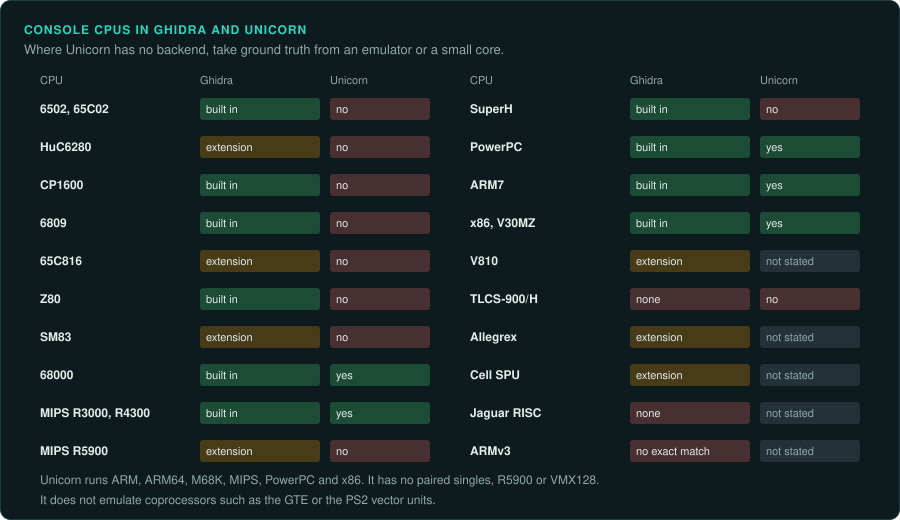
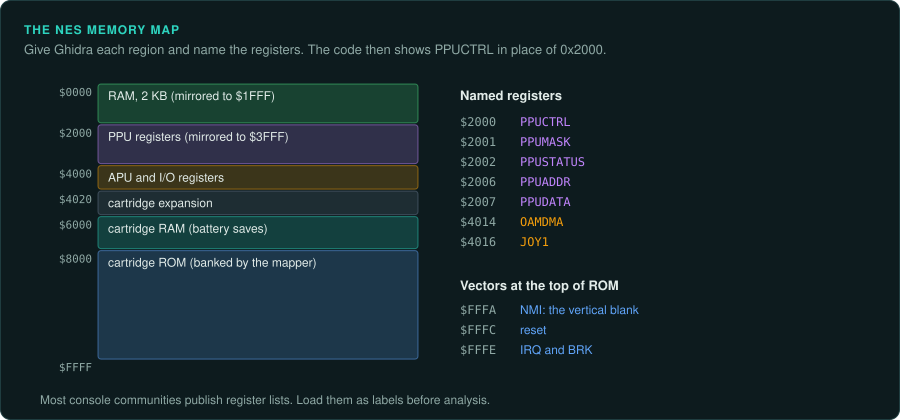
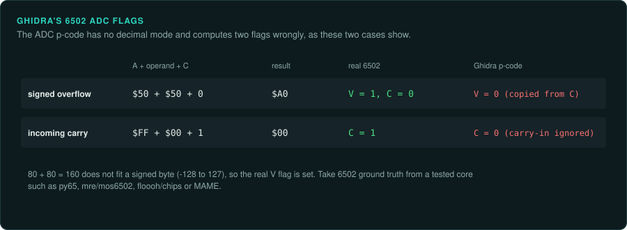
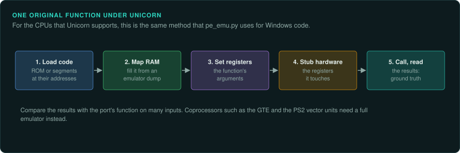

# Tools for console work

GameFrame's playbook works for consoles, but some tools change. The tables on this page
cover both home consoles and handhelds. The [Handhelds](../handhelds/README.md) pages add the
handheld CPUs and tools. Ghidra needs the right
processor module and a loader for the console's file format. Take most ground truth from
emulators with debuggers. GameFrame's Unicorn emulator runs some console CPUs.

## Disassembly and decompilation

| CPU | Consoles | In Ghidra |
|---|---|---|
| 6502 and 65C02 | Atari 2600, 5200 and 7800, NES, Lynx, PC Engine (HuC6280 is close) | Built in (6502, 65C02). Extensions add NES ROM loaders and mappers. The `ADC` p-code is not exact (see below) |
| HuC6280 | PC Engine, PC Engine CD | 65C02 is close; [Ghidra_HuC6280](https://github.com/TiCoKH/Ghidra_HuC6280) fixes the block-transfer and MMU instructions |
| CP1600 | Intellivision | Built in |
| 6809 | Vectrex | Built in under MC6800 |
| 65C816 | SNES | Through community extensions; IDA and dedicated disassemblers are alternatives |
| Z80 and SM83 | Master System, Game Boy, sound CPUs | Z80 built in; the Game Boy's SM83 through extensions |
| 68000 | Mega Drive, Neo Geo, arcade boards | Built in (68000). Extensions add Mega Drive ROM loaders |
| MIPS (R3000, R4300, R5900) | PlayStation, Nintendo 64, PlayStation 2 | MIPS built in; extensions add PS-X EXE and N64 ROM loaders, and the R5900's extra instructions |
| SuperH (SH-2, SH-4) | Saturn, Dreamcast | Built in (SuperH with SH-1, SH-2 and SH-2A; SuperH4) |
| PowerPC (Gekko, Broadway) | GameCube, Wii | PowerPC built in; extensions add paired-single instructions and DOL and REL loaders |
| ARM7 (ARM and Thumb) | Game Boy Advance, Nintendo DS | Built in |
| x86 | Xbox, PS4 onward | Built in; an extension adds the XBE loader |
| V30MZ | WonderSwan | x86 real mode, plus [ghidra-wonderswan](https://github.com/JidouGhost-TL/ghidra-wonderswan) |
| V810 | Virtual Boy | The built-in V850 differs; [Ghidra_v810_v830](https://github.com/20Enderdude20/Ghidra_v810_v830) adds it |
| TLCS-900/H | Neo Geo Pocket | None; [NGDis](https://se.aminet.net/dev/asm/NGDis.readme) disassembles |
| Allegrex | PSP | [ghidra-allegrex](https://github.com/kotcrab/ghidra-allegrex) |
| Cell SPU | PlayStation 3 | [GhidraSPU](https://github.com/aerosoul94/GhidraSPU) |
| Jaguar RISC (Tom and Jerry) | Atari Jaguar | None known |
| ARMv3 (ARM60) | 3DO | ARM languages start at v4, so no exact match |

Set the memory map before analysis: ROM, RAM and hardware registers at their addresses, and
name the hardware registers. Most console communities publish register lists; load them as
labels so the decompiled code reads `PPUCTRL` instead of `0x2000`.

For 8-bit and 16-bit games written in assembly, the decompiler's C output is of limited use.
Work from the disassembly and write your findings as tables and prose.

**Ghidra's 6502 `ADC` p-code is not exact.** It has no decimal path. It leaves the incoming
carry out of the carry-out test. It copies V from C instead of computing signed overflow
([6502.slaspec lines 127–138](https://github.com/NationalSecurityAgency/ghidra/blob/master/Ghidra/Processors/6502/data/languages/6502.slaspec#L127-L138)).
Do not use p-code emulation as ground truth for 6502 games. Take 6502 ground truth from a
tested core: [py65](https://github.com/mnaberez/py65), [mre/mos6502](https://github.com/mre/mos6502),
[floooh/chips](https://github.com/floooh/chips) or MAME.

Capstone's `next` branch has MOS65XX modes (6502, 65C02, W65C02, 65816) and M680X modes (6809,
6309 and others). It has no Z80, R5900 or Allegrex mode
([capstone.h](https://github.com/capstone-engine/capstone/blob/next/include/capstone/capstone.h)).
For 65816 code, the Capstone width mode must follow the M and X flag state in each function.

## Ghidra loaders

| Loader | Platform | Format |
|---|---|---|
| [ghidra-vectrex-loader](https://github.com/nevesnunes/ghidra-vectrex-loader) | Vectrex | Cartridge |
| [NTRGhidra](https://github.com/pedro-javierf/NTRGhidra) | Nintendo DS | ARM9 and ARM7 binaries |
| [Ghidra-GameCube-Loader](https://github.com/Cuyler36/Ghidra-GameCube-Loader) | GameCube, Wii | DOL and REL |
| [XEXLoaderWV](https://github.com/zeroKilo/XEXLoaderWV) | Xbox 360 | XEX2 |
| [ghidra-3ds](https://github.com/Stary2001/ghidra-3ds) | Nintendo 3DS | 3DS files; analysis described as "pretty broken" |
| [ghidra-3dsx-loader](https://github.com/danylokos/ghidra-3dsx-loader) | Nintendo 3DS | 3DSX homebrew |
| [GhidraVitaLoader](https://github.com/xerpi/GhidraVitaLoader), [VitaLoaderRedux](https://github.com/CreepNT/VitaLoaderRedux) | PS Vita | SELF wrapping ARM ELF |
| [GhidraRPXLoader](https://github.com/cemu-project/GhidraRPXLoader) | Wii U | RPX and RPL |
| [GhidraPS4Loader, GhidraOrbis](https://p.codekk.com/detail/64e02e470c2d5a3fbe2aa984) | PlayStation 4 | Decrypted ELF without the Sony header |
| [Ghidra-Switch-Loader](https://github.com/Adubbz/Ghidra-Switch-Loader) | Nintendo Switch | NSO |

Check each extension's recent activity before relying on it. Archived modules need a pinned
version that matches the Ghidra release, or an active fork. Test an extension with few users on
a known binary.

## Emulators with debuggers

| Console | Emulators with good debuggers |
|---|---|
| NES, SNES, Game Boy, PC Engine | Mesen (NES; Mesen 2 adds SNES, Game Boy, PC Engine), bsnes-plus (SNES), BGB and SameBoy (Game Boy) |
| Mega Drive | BlastEm, Exodus, Gens KMod |
| Game Boy Advance | mGBA, no$gba |
| PlayStation | PCSX-Redux, DuckStation, no$psx |
| Nintendo 64 | ares, Project64 with its debugger |
| Saturn | Mednafen, Kronos |
| Dreamcast | Flycast, Redream (limited debugging) |
| PlayStation 2 | PCSX2 with its debugger |
| GameCube and Wii | Dolphin |
| Xbox | xemu |
| Atari 2600 | Stella |
| Intellivision | jzIntv |
| Lynx | Handy, Mednafen |
| Jaguar | BigPEmu (closed; debugger unknown), Virtual Jaguar |
| 3DO | Opera (not confirmed) |
| Virtual Boy, WonderSwan, Neo Geo Pocket, PC Engine CD | Mednafen |
| PlayStation 3 | RPCS3 |
| Xbox 360 | Xenia Canary |
| Nintendo DS | melonDS, DeSmuME, no$gba |
| Nintendo 3DS | Azahar |
| PSP | PPSSPP |
| PS Vita | Vita3K |
| Wii U | Cemu |
| PlayStation 4 | shadPS4 |
| Nintendo Switch | Ryubing, Eden, Citron |
| Arcade | MAME |
| Several systems, scripted | BizHawk (Lua scripting, input movies, RAM watch, many cores) |

Debugger support in the newer emulators varies. Some entries above are not confirmed. The
[Seventh generation onward](modern.md#emulator-status) page gives the dated status of the home
console emulators. The [Handhelds](../handhelds/README.md) pages give the handheld emulators,
from SameBoy and PokeMini to the Switch forks. The family pages give the rest
([Early consoles](early-consoles.md), [Jaguar and 3DO](32-bit-oddities.md),
[CD add-ons](cd-add-ons.md)).

What to use them for:

- **RAM search and watch** to find variables: search for a value that changes when the
  player's lives change, then name the address.
- **Breakpoints** on reads and writes to find the code that changes a variable.
- **Trace logs** of every instruction for a frame, to compare with your port's behaviour.
- **Input movies** (BizHawk, FCEUX, Mesen) as recorded per-frame input. They are the console
  equivalent of demos. Tool-assisted speedrun movies cover whole games.
- **Scripting** (Lua in Mesen, BizHawk, FCEUX) to dump RAM every frame and to drive the game.
  This is the console equivalent of GameFrame's headless runs.

## GameFrame's Unicorn emulator

Unicorn 2 emulates ARM, ARM64, M68K, MIPS (32 and 64-bit), PowerPC, RISC-V, s390x, SPARC,
TriCore and x86. It has no 6502, 65816, Z80 or SuperH. It has no R5900, no paired singles and
no VMX128. Its MIPS likely does not model the R3000A load delay slot; this is untested. For the CPUs it supports, you can run one original function
headless, as `pe_emu.py` does for Windows code:

1. Load the ROM or the executable's code segments at their addresses.
2. Map RAM, and fill it from a RAM dump taken in an emulator at the right moment.
3. Set the registers, call the function, read the results.
4. Stub hardware registers the function touches.

This gives bit-exact ground truth in tests, as for PC games. Unicorn does not emulate
coprocessors such as the PlayStation's GTE or the PS2's vector units; take ground truth for
those from a full emulator.

For CPUs Unicorn lacks, MAME's m6809, g65816, tms9900, cp1610, jaguar and m68000 core files
carry `license:BSD-3-Clause` headers, though MAME as a whole is GPL-2.0. For the Z80,
[iz80](https://github.com/ivanizag/iz80) (BSD-3) passes ZEXALL. Otherwise use a small emulator core in Python or Rust for that CPU (6502 and Z80
cores are short), or script a full emulator to run the function and dump the result.

## Splitting and building tools

Projects that decompile console games built tools that also help a reimplementation:

| Tool | What it does |
|---|---|
| splat | Splits a ROM or executable (N64, PlayStation, PS2) into code, data and assets by a configuration file, and disassembles the code |
| asm-differ | Compares the assembly of two builds function by function |
| decomp-toolkit (dtk) and objdiff | Split and compare GameCube and Wii programs |
| decomp.me | A website for comparing the output of the original compilers with candidate C code |
| m2c | Turns MIPS and PowerPC assembly into first-draft C |

See [Matching decompilation](matching-decomp.md) for how they fit together.
