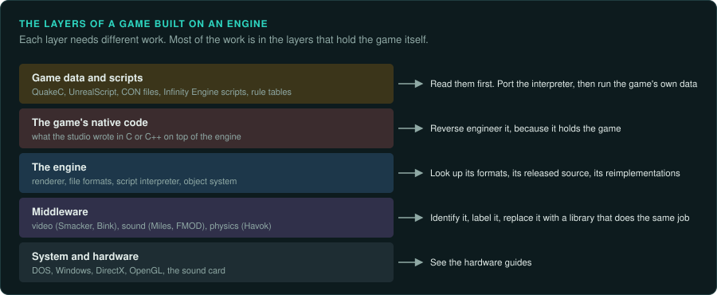
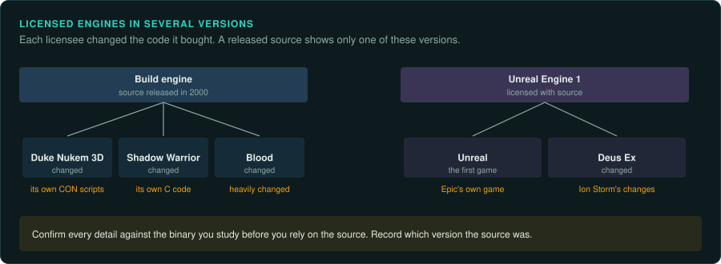

# Software engines and middleware

Most games from the 1980s and early 1990s were written from scratch. Each studio had its own
drawing code, its own file formats and its own tools. From the mid-1990s, more and more games
were built on a licensed engine (Build, the Quake engines, Unreal) or on an engine the studio
reused across several games (Westwood's, Blizzard's, BioWare's Infinity Engine). Most games also
use **middleware**: libraries for one job, such as video (Smacker, Bink), sound (Miles, FMOD)
or physics (Havok).

Knowing the engine helps in several ways.

- The file formats are often already documented by modders, sometimes for decades.
- The engine's source code may have been released. Then you study the source for the engine
  and reverse engineer only the game code on top of it.
- The game's rules may live in a script language the engine interprets (QuakeC, UnrealScript,
  Duke Nukem 3D's CON files, Infinity Engine scripts). Once the interpreter is ported, the
  port runs the rules from the game's data.
- An engine reimplementation may already run the game. Its documentation and tests tell you
  how the formats and the scripts behave. Read its documents and its behaviour. Follow your project's rules about reading its code ([Legal](../LEGAL.md)).
- Middleware is library code from another company. Identify it early and leave it out of your analysis.
  Replace it in the port with a library that does the same job.

## Finding the engine

- [Recognising an engine](recognising.md): strings, file names, magic numbers, libraries and
  debug paths that identify an engine or a library.

## Engine families

- [The id Software engines](id-tech.md): Wolfenstein 3D, Doom, Quake, Quake II, Quake III, and
  the engines built from them.
- [Build, Jedi and other 2.5D engines](build-2-5d.md): sector engines with a flat world and
  heights.
- [Unreal Engine 1 and 2](unreal.md): packages, native classes and UnrealScript.
- [Other licensed 3D engines](licensed-3d.md): GoldSrc, LithTech, NetImmerse and Gamebryo,
  RenderWare.
- [Studio engines for 2D and isometric games](studio-2d.md): Westwood, Blizzard, the Infinity
  Engine, the Fallout engine, the adventure engines.

## Inside an engine

- [Engine structures in machine code](engine-structures.md): type records, reference
  counting, factories, streaming, scene graphs, controllers and level of detail, as they
  appear in the binary.
- [Run-time systems in machine code](engine-runtime.md): allocators, names stored as hashes,
  handles, the resource registry, settings, the order of updates, events, threads, streaming
  and debugging aids left in the build.
- [Skeletons and animation](animation.md): skeletons, poses, clips, blending, compression and
  the state machines that pick clips.

## Web players

- [Flash and Shockwave games](flash-and-shockwave.md): SWF files and projectors, ActionScript,
  JPEXS, Ruffle, Flashpoint, Director and Lingo, and the routes to a port.

## Libraries

- [Middleware](middleware.md): video, sound, physics, compression, scripting and online
  libraries, and what to do with each.

## How an engine changes each step

| Step | Without a known engine | With a known engine |
|---|---|---|
| Inventory | Every file type is new | Look up the engine's formats first |
| Decompile | Every function is unknown | Name the engine's functions from its source, its exports or a reimplementation's documents, and label them in Ghidra |
| Trace | Find the rules in machine code | Look in the scripts first; the machine code holds the engine and the native parts of the game |
| Emulate | Every routine may need ground truth | The engine's maths often matches its released source; check that first, then measure the game's own code |
| Port | Write everything | Reuse a format reader, write the interpreter, port the native game code |
| Verify | Compare with the original | Also compare with the engine's own demos, test maps and tools |

## A warning about versions

Licensees changed the engines they bought. Duke Nukem 3D, Shadow Warrior and Blood all use the Build engine. Each of them changed its code. Deus Ex runs Unreal Engine 1 with Ion Storm's
changes. A released engine source shows one version. Confirm every detail against the binary
you are studying before you rely on it, and record which version the source was.
