# Skeletons and animation

Characters in 3D games move by skeletal animation: a tree of joints, a pose for each joint at
each moment, and a mesh whose vertices follow the joints. Earlier games and simpler objects use
other methods: whole rigid parts moved as a hierarchy, or a stored copy of every vertex for
each frame. This page lists the data each method stores, how it looks in a file and in the
code, and the details a port must copy so that characters move the same way. It covers what
the formats and the maths share. [Engine structures](engine-structures.md) covers the scene
graph and the controllers that drive animation, and [3D graphics](../hardware/graphics-3d.md)
the drawing.

## Methods, from oldest to newest

| Method | What is stored | How to recognise it |
|---|---|---|
| Sprite frames | One image per frame | Sheets of images and a table of frame rectangles and timings ([2D graphics](../hardware/graphics-2d.md)) |
| Vertex animation | Every vertex position for each key frame, often 8-bit or 16-bit and scaled. The game blends between two frames | Quake's MDL and MD2 formats: frames of compressed vertices with a scale and an offset per frame |
| Rigid hierarchy | A transform for each part (a limb, a turret) per key frame. Each part is a separate mesh | Many small meshes with parent indices and per-part keys |
| Skinned skeleton | A transform for each joint per sample. One mesh, each vertex weighted to up to four joints | Parent arrays, inverse bind matrices, bone indices and weights in the vertex format |
| Morph targets | Offsets for each vertex from a base mesh, blended by weights | Faces, lip sync. Named target sets |

## The skeleton

A skeleton is an array of joints. Each joint holds its parent's index, and the array is sorted
so that every parent comes before its children. The root's parent is -1. Computing world
positions is then one pass from the start of the array, multiplying each joint's local
transform by its parent's world transform, which has already been computed.

Each joint also stores the inverse of its world transform in the bind pose, the pose the
mesh was modelled in. Skinning multiplies a joint's current world transform by its inverse
bind transform. The product moves a vertex from where it was modelled to where it is now.

`tools/formats/skeleton.py FILE` finds parent arrays of 8, 16 or 32-bit indices, runs of unit
quaternions (bind poses and uncompressed samples), and names that look like joint names
(Bip01 from 3ds Max Character Studio, Bone, pelvis, spine and similar). `--at OFFSET --width N`
prints one array as a tree. Joint names are usually stored in the same order as the parents,
which gives each index its name.

## Poses and clips

A joint's local pose is a rotation, a translation and sometimes a scale: a quaternion and two
vectors, or a 4x3 matrix. A clip is a sequence of poses sampled at a fixed rate (15, 30 or 60
samples per second are common), with a duration, a loop flag, and often events at given
times (a footstep sound, a hit frame).

Details that change what the player sees:

- **Time.** How a clip's time advances: from a global clock or from the moment the clip
  started, in seconds or in frames, and how it wraps on loop. In a looping clip, the last
  sample may equal the first or may be dropped to avoid a pause.
- **Between samples.** Linear interpolation of positions, and for rotations either a normalised
  linear blend (fast) or a spherical one (slerp). Before blending, a quaternion is negated
  if the dot product with the other is negative. Each choice gives slightly different poses.
- **Blending clips.** A weighted mix of two or more clips (walk to run by speed), a fade from
  one clip to the next over a fixed time, a partial blend that uses one clip for the upper
  body and another for the legs, and additive clips that add a difference on top (breathing,
  aiming). Record the weights and the order of the blends.
- **After blending.** Many engines adjust the blended pose before skinning: feet placed on
  the ground (inverse kinematics), a head turned toward a target, a hand held on a weapon.
  Each step has its own order and limits on angles. A pose taken before these steps differs
  from the one on screen.
- **Root motion.** Whether the clip's root movement moves the character in the world, or the
  game moves it and the clip only plays in place. With root motion, the animation decides
  where a character stands, and a port must match it exactly.
- **Events.** Sounds, effects and game rules started by times in the clip. A hit that lands at
  a clip's event time depends on the clip's timing.

## Compression

Games store a great deal of animation and compress it. The decoder in the binary is the
specification of the format.

| Method | How it looks |
|---|---|
| Dropped channels | Joints with a constant rotation or translation, or no scale, store one value. A bit mask or a list says which channels are animated |
| Quantisation | Rotations as three 16-bit integers with the fourth computed, the largest component dropped and its index stored in two bits ("smallest three"), or all four packed into 48 or 64 bits. Translations scaled into a range given per clip |
| Key reduction | Only the samples that cannot be interpolated from their neighbours, each with its time |
| Curves | Splines with control points in place of samples |

Port a decoder exactly, including its rounding: the decoded values are the poses, and a
difference in the last bit can change the frame the hit lands in. Check it by decoding a clip
with the port and with the original, in the emulator or in a running game, and compare each
value.

## State machines and the game rules

Which clip plays is chosen by a state machine: states such as idle, walk, attack and
die, transitions with conditions and blend times, and sometimes a blend tree inside a state.
It is usually data (a file per character), read by generic code. Read the data before porting
the code. The game rules often wait on the animation: an attack deals damage at an event time,
or a unit cannot act again until a clip ends. A port that plays clips at a different rate
changes the rules as well as the look.

## Checks

- Draw the skeleton in the port over the original's frame at the same moment, with the same
  camera ([Drawing](../observe/drawing.md)). Wrong joints show at once.
- Compare decoded poses value by value with the original's, sample by sample.
- Time a clip in both, from the first frame to the event that matters (a footstep, a hit).
