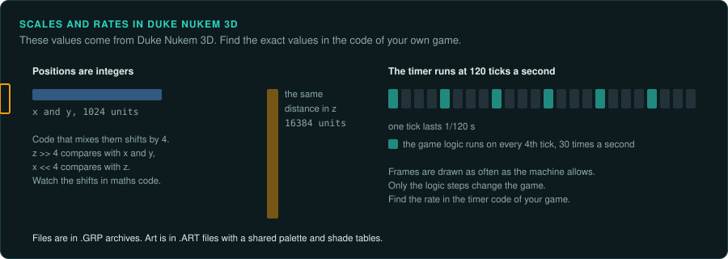

# Build, Jedi and other 2.5D engines

Between Doom (1993) and true 3D engines (Quake, 1996), several engines drew 3D-looking worlds
from 2D maps with heights. They are called 2.5D engines. The map is a set of polygons
(sectors) seen from above, each with a floor and a ceiling height. The renderer draws walls
column by column and floors and ceilings row by row. Most of these engines added features that
Doom lacked: sloped floors, rooms over rooms, mirrors.

## Build

Ken Silverman wrote the Build engine for 3D Realms. It was licensed widely.

| Game | Year | Developer | Notes |
|---|---|---|---|
| Duke Nukem 3D | 1996 | 3D Realms | Game logic partly in CON script files |
| Shadow Warrior | 1997 | 3D Realms | Its own game code in C |
| Blood | 1997 | Monolith | Heavily changed engine and its own game code |
| Redneck Rampage | 1997 | Xatrix | Built from the Duke Nukem 3D code |

The engine source was released in 2000 and the Duke Nukem 3D game source in 2003.

**How it works.** Sectors are polygons. Each wall points to the next wall of the same sector
and, through a portal, to the wall of the neighbouring sector. The renderer walks from the
player's sector through portals, drawing what it can see. Two sectors may overlap in the map,
because the engine never checks that the world is consistent, so rooms can be in the same place
on the map. Sprites can be flat on the floor or on a wall, or face the camera.

**What to note.**

- Positions are integers. Heights use a different scale from horizontal positions (a factor
  of 16 in Duke Nukem 3D). Watch the shifts when you read maths code.
- Duke Nukem 3D's CON files define actors, weapons and sounds in a small script language.
  The game compiles them when it starts and interprets the result. Read the CON files before
  you trace actor behaviour in machine code.
- The game timer runs at 120 ticks per second in Duke Nukem 3D; the game logic runs at a
  fraction of that (30 updates per second). Find the exact rate in the timer code of your game.
- Files are packed in `.GRP` archives. Art is in `.ART` files with a shared palette and
  shade tables (`PALETTE.DAT`, `LOOKUP.DAT`).

**Projects to learn from.** EDuke32 (a source port that keeps old CON scripts working), NBlood
(Blood's game code reimplemented from reverse engineering, on EDuke32's engine), and Raze
(several Build games in one modern engine).

## The Jedi engine

LucasArts wrote the Jedi engine for Star Wars: Dark Forces (1995) and reused a much changed
version of it for Outlaws (1997). Like Build, it has sectors with floor and ceiling heights, plus rooms above rooms and
3D object models.

- Level logic is in `.INF` files: a text language that defines elevators, doors, switches and
  triggers as small state machines.
- Dark Forces keeps its data in `.GOB` archives; Outlaws uses `.LAB` archives instead. Levels
  are `.LEV` (geometry) and `.O` (objects).
- The source was never released. The Force Engine is a reimplementation built from reverse
  engineering. Its documents explain the formats and the INF language.

## Other engines of the type

| Engine | Games | Notes |
|---|---|---|
| Doom engine variants | Heretic, Hexen, Strife | See [The id Software engines](id-tech.md) |
| ROTT engine | Rise of the Triad (1994) | Built from the Wolfenstein 3D engine. Each map keeps one floor and one ceiling height; raised areas are built from floating platform objects |
| Voxel Space (NovaLogic) | Comanche (1992), Delta Force (1998) | Terrain drawn from a height map and a colour map, one column at a time |
| XnGine (Bethesda) | The Elder Scrolls: Daggerfall (1996) | True 3D for its time; Daggerfall Unity documents its formats |
| Ultima Underworld engine (Looking Glass) | Ultima Underworld (1992), System Shock (1994) | Texture-mapped 3D with sloped floors, before Doom |

## How to approach a 2.5D game

1. Decode the map format first. With the sectors, walls and objects in hand, you can draw the
   map from above and see the level's layout.
2. Find the renderer's main loop. In these engines it is usually one large function that walks
   sectors or columns. It is the slowest code in the game, so it is often in assembly.
3. Separate the renderer from the game logic. You can rebuild the renderer to match its output.
   The game logic must be exact.
4. Find the timer rate and the game update rate. They are often different.
5. Compare frames from the same position and angle with the original
   ([Running the original](../observe/running-the-original.md)). A software renderer's output is
   exact, so compare pixel by pixel.
