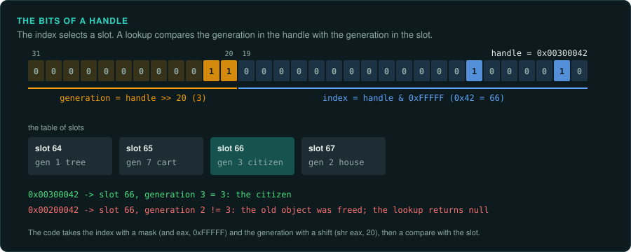

# Run-time systems in machine code

Under the rendering, sound and game rules, every engine has the same plumbing: its own memory
allocators, names stored as hashes, handles in place of pointers, a registry of loaded
resources, settings that can be changed while the game runs, an order of updates within a
frame, events, threads, and debugging aids that the shipped build may still hold. None of this
is the game, but each piece decides something the player can see: the order of objects, which
object a saved reference points at, what happens when two objects act in the same frame. This
page describes the shape of each system in a binary, and what a port must take from it. It
follows [Engine structures](engine-structures.md), which covers type records, factories,
streaming and the scene graph. Jason Gregory's *Game Engine Architecture* describes these
systems from the builder's side.

## Memory

| Allocator | Its shape in machine code | What the port needs from it |
|---|---|---|
| Stack (linear) | A pointer that only moves up: add the size, rounded up with `(size + align - 1) & ~(align - 1)`, compare with the end, return the old value. "Free" sets the pointer back to a saved marker | Nothing, unless objects are placed in the order they are allocated and something later walks memory in that order. Then the walk order is the allocation order |
| Double-ended stack | The same with two pointers, one from each end of one block. Level data at one end, temporary data at the other | As above |
| Pool | A block cut into equal slots. Free slots are a linked list, with the next pointer stored in the first bytes of each free slot. Allocate takes the head; free pushes the slot back | The order of reuse. A freed slot is the next one handed out, so a new object takes the most recently freed place. If anything iterates the pool by address, or ids are slot numbers, the port must reuse slots in the same order |
| Frame (scratch) | A stack reset once per frame, often two of them swapped each frame (double buffering) | Which data lives for one frame and which for two |
| Heap with relocation | Blocks moved to close gaps, with handles updated after each move | That objects are found by handle. The addresses do not matter |

To find the allocators, look for the functions called with a size by most `new` sites
(Ghidra's references to `operator new` lead to them), and for an alignment mask applied to a
size. A freelist pop is a load of `[head]` followed by a store of that value back into `head`.
Memory statistics strings ("pool exhausted", "out of memory in", allocator names) name them.
[Memory](../observe/memory.md) covers finding where a running game keeps a value.

## Names as hashes

Engines compare names as 32-bit or 64-bit numbers. A string id is the hash of the name,
computed at build time or when the name is first used. The binary then holds the hash where
the code compares names: an immediate in a `cmp`, a key in a table of resources or classes, a
field in a data file. The text is often gone.

- `tools/triage/hashnames.py BINARY` hashes every string in the binary with common hash
  functions (CRC-32, FNV-1 and FNV-1a, djb2, sdbm, the x31 string hash, the ELF hash), as
  written and in lower and upper case, and counts the matches against the values in the file.
  The function with far more matches than chance is the game's. Each match names a constant.
- Some engines compute their hashes when the game starts, so the code holds only the names and
  the hashes appear only in the data files. Search the data folder and take the names from the
  program: `hashnames.py DATA_DIR --aligned --names-from GAME.EXE`. Banished is an example: its
  type ids are CRC-32 hashes of UTF-16 class names, found in the header of every resource.
- Names missing from the binary may be in other places: a list in a mod tool, file names in
  an archive, debug symbols of a related build, another game on the same engine. Pass them
  with `--names FILE`.
- `--value` names one constant at a time, for the hashes in a lookup table or a switch.
- When nothing matches, find the hash function in the code. `tools/triage/constants.py` names
  CRC tables and FNV primes. Read the function for a seed, a case rule (lower case, slashes
  turned round, only the file name) or a final mix.
- Record each recovered name in the labels. A port can keep the hashes as numbers, but the
  names make the code readable, and data files written by modders use them.

## Handles and references

Objects that may be deleted are referred to by handle, not by pointer. A handle is an index
into a table plus a generation counter that changes each time the slot is reused, packed into
one integer. The code shows the packing: a mask such as `and eax, 0xFFFF` or `0xFFFFF` gives
the index, and a shift gives the generation. Looking an object up compares the stored
generation with the handle's. A mismatch means the object is gone, and the lookup returns null.

What the port needs: the bit layout, if handles are saved or sent over the network; the order
in which free slots are reused (as with pools); and the null case. A port with ordinary
references must still behave as if a stale handle returns nothing.

## The resource registry

A loaded resource is found by its id (a hash of its path, a GUID or an index) in a hash table.
Each entry holds a reference count and a pointer to the loaded data. Loading a file of
several resources usually follows the same steps:

1. Read the whole file into one block.
2. Fix up the pointers. The file stores each pointer as an offset from the block's start, and
   a table of fix-ups lists where they are. The loader adds the block's address to each. A
   loop that adds one base address to many words at offsets read from a list is this step.
3. Resolve references to other resources by id, loading them if needed.
4. Run each type's after-load step: build the GPU buffers, register the sounds.

Pointer fix-ups explain values in a data file that look like small, rising offsets. Fill a
resource's offsets in by hand, and its structures read like a C struct. The order of step 3
decides which resource loads first, which matters when resources share memory or draw random
numbers when they load.

## Settings changed while the game runs

Most engines keep a table of named settings: a name, a type, a default, a pointer to the
variable, a description, and flags (saved to the settings file, cheat only, read only). Quake's
console variables are the best known. The table is filled before `main` by static
constructors, or from a list in the data. Each entry links a name in the strings to the
variable the code reads, which names a global. Settings marked as debug or cheat only often
still work in the shipped game.

## The order of updates within a frame

A frame updates many objects. The order is part of the behaviour:

- **Phases.** The loop runs the game objects before animation, animation before physics,
  physics before the rendering's culling. An object that reads another's position sees this
  frame's value or last frame's, depending on which ran first.
- **Buckets.** Objects that depend on others (a rider on a horse, a weapon in a hand) update
  in a later bucket than what they depend on.
- **The order inside a list.** The order of the active objects list: creation order, or the
  order left by swap-and-pop deletion, which moves the last object into the gap.
- **One frame late.** When an object reads a value that another object will change later in
  the same frame, it uses the old one. A port that changes the order gives results one frame
  apart, and these differences add up.

Record the order of the calls in the main loop, and the order of the lists each one walks.
[Game patterns](../GAME-PATTERNS.md) covers the fixed-step loop around them.

## Events and messages

An event is a type (an enum or a name hash) and a few arguments, often as name and value
pairs. Handlers are a table keyed by type, or a virtual method that switches on the type.
Queued events run later, at a fixed point in the frame, in the order they were posted, or in
order of a delivery time. What the port needs: whether an event runs at once or is queued, and
where in the frame the queue is emptied.

## Threads and jobs

Older games run the rules on one thread, with loading or sound on others. Later engines split
each frame into jobs on a pool of worker threads, with counters or fences to wait for groups of
jobs. Look for `CreateThread` or `_beginthreadex`, `WaitForSingleObject`, interlocked
instructions (`lock xadd`, `lock cmpxchg`), and a queue of function pointer and argument pairs.

A port must reproduce only what the player can see. Work that runs in parallel and joins
before its results are used can run in any order. Work whose results depend on which thread
finishes first, such as a shared random generator, objects added to a list by several workers,
or floating-point sums in different orders, needs the original order. If the original itself
varies from run to run, record that as a finding.

## Streaming a world

Large worlds load in chunks while the game runs. The signs are a list of chunks with
bounding boxes or trigger volumes, an asynchronous file reader (`ReadFile` with `OVERLAPPED`,
or a loader thread), and states for each chunk: requested, loading, loaded, unloading. Some
games use a small corridor or lift (an air lock) where the next area loads while the
previous one is released. The port needs the chunk layout and the triggers. It can load in its
own way if the player never sees the difference, but any rule that runs only on loaded chunks
(objects that stop when far away) must match.

## Debugging aids left in the build

Shipped games often keep their development tools, switched off:

| Aid | How to find it | What it gives |
|---|---|---|
| Log channels | A function with a channel or verbosity argument and a format string, called everywhere, whose output goes to `OutputDebugString` or a file only when a flag is set | Turning the flag on prints the game's own account of what it does. Each message names the function that prints it |
| Debug drawing | Functions that queue lines, spheres and text for one frame | Seeing hidden volumes, paths and triggers in the running game |
| Menus and a console | Strings of menu items and commands; a table of command names and functions | Teleporting, spawning, changing the time of day: quick ways to reach a state to measure |
| Cheats | Strings of cheat names, or a hash compared with typed input | Some are in the docs of the time. [Game patterns](../GAME-PATTERNS.md) covers cheat codes |
| Profiler markers | Pairs of calls around blocks with a name string, which read a timer | The names of whole systems and the structure of the frame |
| Assertions | Calls with a file name, a line number and an expression string | The source file names, line numbers and the names of variables, for nearby functions |

Turning an aid back on is a patch to the original, for study only. Note each one in the
evidence log, and keep the flags out of the port, unless the project chooses to keep an aid as a marked deviation.

## Open questions to ask of any engine

- Which allocator gives out each kind of object, and is its reuse order visible?
- Which hash function names things, with which case rule?
- How are handles packed, and are they saved?
- In what order do the phases of a frame run, and in what order is each list walked?
- Are events run at once or queued, and where is the queue emptied?
- Does any result depend on which thread finishes first?
