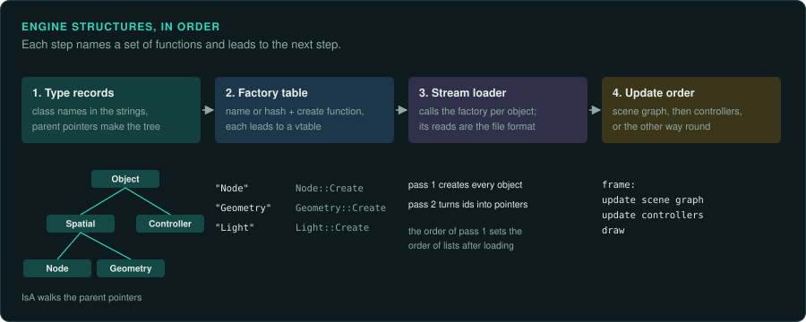

# Engine structures in machine code

The C++ engines of the late 1990s and 2000s share a set of internal systems: their own
run-time type information, reference counting, factories that create objects by name, a
streaming system that saves and loads object graphs, a scene graph, and controllers that
animate values over time. Each has a recognisable shape in the binary. Recognising the shape
names dozens of functions at once, and tells you which details the port must copy. David
Eberly's *3D Game Engine Architecture* (2005) describes one complete engine of this kind. Its
systems are typical of the period. [Game patterns](../GAME-PATTERNS.md) covers the parts most
games share. [Recognising an engine](recognising.md) covers telling engines apart.

| System | Its shape in machine code | What the port needs from it |
|---|---|---|
| Run-time type information | Each class has a static record holding its name string and a pointer to its parent class's record. A function walks the parent pointers to answer "is this object derived from that class?" | The class tree. The name strings name the classes, and the parent pointers order them. Label every class from these records |
| Reference counting | Two small functions that add or subtract one at a fixed offset in the object, and delete the object at zero. Smart pointer wrappers call them on every copy | Usually only that objects are freed. Leave lifetime to the port's language, unless the order of destruction shows, as with sounds stopping or effects ending |
| Factories | A table of class names, or hashes of names, paired with creation functions, filled at start-up | The list of classes the data files can create. It is the vocabulary of the file format |
| Static initialisation | Functions that run before `main`, each adding an entry to a list: factories, console commands, settings | Where the lists come from. The CRT start-up code calls them (an `_initterm` table in MSVC programs) |
| Streaming | Save: write each object with an id, then its fields, with pointers written as the target's id. Load: read every object first, then a second pass replaces ids with pointers | The file format, and the order of the two passes. The order decides which object is created first, and so the order of lists and random draws after loading |
| Scene graph | Nodes with a local transform, a world transform, a bounding volume and a list of children. An update pass goes down the tree computing world transforms, then back up merging bounds | The order of the update, and the maths of each transform (a quaternion or a matrix, scale before or after rotation). Float operations in a different order give different positions |
| Controllers | Objects attached to a node that update a value from the time: with a start and end time, a frequency, a phase and a repeat mode (clamp, wrap, cycle back and forth) | The time each controller sees and its repeat mode, exactly. Animations drift when either differs |
| Render state | Objects for blending, depth, culling and materials, pushed and popped as the scene graph is drawn | Which state applies to which object, and the draw order |
| Level of detail | Switch nodes that choose a child by distance, or meshes that collapse edges step by step | The distances and the measure of distance: from the camera or its plane, squared or not |

## How to work with them

1. **Find the type records first.** Search the strings for class names, then the references to them. Each lands in a type record. The parent pointers link the records into the class
   tree. With MSVC RTTI present, Ghidra names the classes already. An engine with its own
   system needs the records labelled by hand.
2. **Find the factory table.** It pairs names (or hashes) with functions. Each function
   creates one class, and its vtable leads to all that class's methods.
3. **Find the stream loader.** It calls the factory for each object in a file. Its field reads,
   class by class, are the file format ([re-format](../../.claude/skills/re-format/SKILL.md)).
4. **Find the update order.** The main loop calls the scene graph's update and then the
   controllers, or the other way round. Write the order down. It decides what each frame
   shows.

Engines that were later released as source, or that are documented by modders, can shorten
this work. Confirm each detail against the binary you study, as [Engines and middleware](README.md)
warns.
