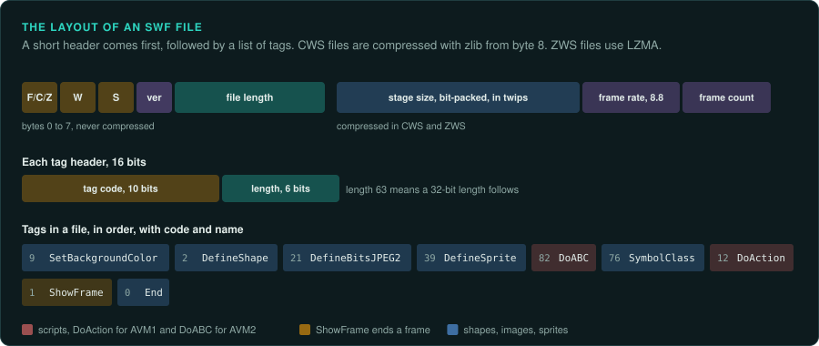
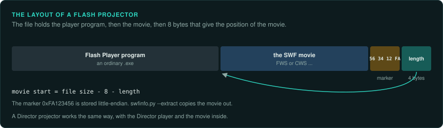
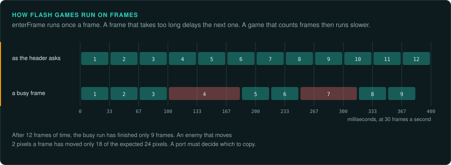
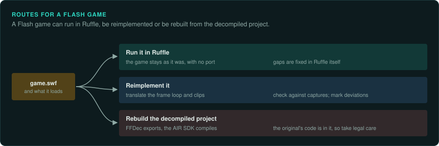
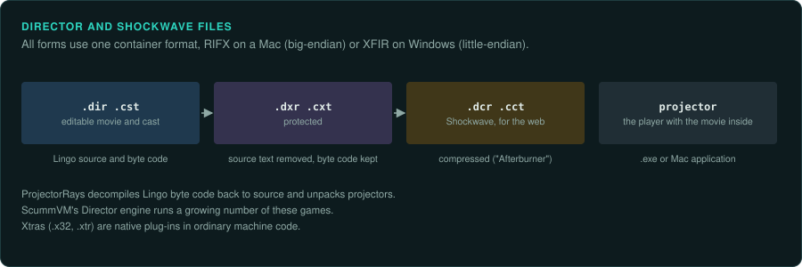

# Flash and Shockwave games

Thousands of games were made for Adobe Flash Player and for Macromedia Shockwave (Director)
between the late 1990s and the 2010s. Most were played in a web browser. Adobe ended Flash
Player on 31 December 2020 and blocked Flash content from 12 January 2021
([Adobe: Flash Player end of life](https://www.adobe.com/products/flashplayer/end-of-life.html)).
Shockwave Player ended in April 2019. Many of these games survive only as files in archives,
with no way to run them in a current browser. This page describes how the files are built, how
to read their code and their assets, and the routes to a working version.

## What a Flash game is



A Flash game is an SWF file, sometimes several. It holds vector shapes, bitmaps, sounds, fonts,
a timeline of frames, and compiled scripts. Adobe published the format as the SWF File Format
Specification (version 19 is the last) and the script machine as the AVM2 Overview.

| Part | Where it is | Notes |
|---|---|---|
| Header | The first bytes | `FWS` uncompressed, `CWS` zlib from byte 8, `ZWS` LZMA. Then the version, the length, the stage size in twips (1/20 pixel), the frame rate and the frame count |
| Tags | After the header | Each tag has a code and a length. Shapes, bitmaps, sounds, sprites (movie clips with their own timeline), text, buttons, scripts |
| ActionScript 1 and 2 | `DoAction`, `DoInitAction` tags | Byte code for the first script machine (AVM1). Scripts sit on frames, buttons and clips |
| ActionScript 3 | `DoABC` tags | Byte code for AVM2, introduced with Flash Player 9 in 2006. Classes, linked to library symbols by `SymbolClass` |
| Saves | Local shared objects (`.sol` files) | Written by `SharedObject`, encoded in AMF0 or AMF3, in Flash Player's `#SharedObjects` folder |



A Flash **projector** is a standalone program with the movie inside. A Windows projector is
the Flash Player program with the SWF appended at the end. The last 8 bytes hold the marker
`0xFA123456` and the movie's length.

`tools/formats/swfinfo.py` reads any of these:

```bash
python3 tools/formats/swfinfo.py target/game.swf                     # version, stage, scripts, content
python3 tools/formats/swfinfo.py target/game.exe --extract derived/game.swf   # the movie from a projector
python3 tools/formats/swfinfo.py target/game.swf --decompress derived/game-fws.swf --tags
python3 tools/triage/filetypes.py target --summary                   # finds every SWF in a folder
```

## Reading the code and the assets

[JPEXS Free Flash Decompiler](https://github.com/jindrapetrik/jpexs-decompiler) (FFDec) is
the main tool. It is open source. It decompiles ActionScript 1, 2 and 3. It exports shapes as
SVG, bitmaps as PNG, sounds, fonts, texts and the timeline. It also has a command line, which
suits agents (`ffdec -export script,image,sound,shape derived/ffdec target/game.swf`). It can
also debug a running movie.

Things to look for in the code:

- **The main loop.** Flash games run on frames. Look for `enterFrame` handlers (AS3
  `Event.ENTER_FRAME`, AS2 `onEnterFrame`) and timers. The frame rate in the header sets the
  step. When the player cannot keep up, frames run late, and a game that counts frames runs
  slower.
- **Randomness.** `Math.random()` takes no seed, so a run cannot be repeated. A port that must
  match a recording has to record the draws, or replace the generator with a seeded one
  ([re-verify](../../.claude/skills/re-verify/SKILL.md)).
- **Numbers.** ActionScript `Number` is an IEEE double. AS3 also has 32-bit `int` and `uint`.
  Integer overflow, string to number conversion and `Math` functions follow the player's rules.
  Port those rules exactly where the game depends on them.
- **Loaded content.** A game can load other SWFs, images and XML at run time, by URL or from
  bytes in its own library (`Loader.loadBytes`). Some games hide their real movie this way,
  encrypted inside a small loader. Let the loader run in a debugger or in Ruffle, and save the
  bytes it loads.
- **Site locks and services.** Many games check the web address they run from
  (`loaderInfo.url`, `_root._url`) and refuse to start elsewhere. Many also called score,
  advertising or account services that no longer exist. Note each check and each service.
  The port leaves them out, or replaces a service with a local one.
- **Obfuscation.** Some games were run through an obfuscator, which renames classes and
  methods to meaningless or unprintable names and adds junk code. FFDec has options to rename
  identifiers and to remove some of the junk. The behaviour is still all there.



## Running the original

[Ruffle](https://ruffle.rs/) is a Flash Player emulator written in Rust. It runs in a browser
through WebAssembly and as a desktop program. Its support for ActionScript 1 and 2 is
broad. Its ActionScript 3 support is growing, and its site lists what is missing. Ruffle is
the usual place to watch and capture the original today ([Observing the original](../observe/README.md)).
For games Ruffle cannot run yet, the Flash Player projector (the "content debugger" build)
still runs on Windows.

[Flashpoint Archive](https://flashpointarchive.org/) is a preservation project that collects
Flash, Shockwave and other web games. It runs them in their original players with a local
web server, which also answers site locks. It records each game's source and launch
settings. It is often the best place to find a game's files and the other files it loads.

## Routes to a port



1. **Run it in Ruffle.** This is preservation. The game stays as it was. It needs no port.
   Where Ruffle lacks a feature the game uses, the work is in Ruffle, and Ruffle's
   developers welcome reports and fixes.
2. **Reimplement it with GameFrame's method.** The decompiled scripts are much closer to the
   source than machine code is. Most of the work is translation of the frame loop and the movie clips. The vector art is exported as assets or redrawn. Check the port against
   captures from Ruffle or the projector. Mark every difference as a Deviation.
3. **Rebuild the decompiled project.** FFDec can export an AS3 project that the AIR SDK
   compiles again. This keeps the code as it was. It also needs the most care about the law,
   because the result contains the original's code ([Legal](../LEGAL.md)). The owner of the
   project decides.

## Shockwave and Director



Macromedia Director made CD-ROM games and Shockwave web games, with scripts in Lingo.

| File | What it is |
|---|---|
| `.dir`, `.cst` | A Director movie and cast, editable |
| `.dxr`, `.cxt` | The same, protected: the scripts' source text removed, the byte code kept |
| `.dcr`, `.cct` | Shockwave movie and cast for the web, compressed ("Afterburner") |
| A projector `.exe` or Mac application | The Director player with the movie inside |
| Xtras (`.x32`, `.xtr`) | Native plug-ins in machine code, for features Director lacked |

The files are RIFF containers: `RIFX` from a Mac (big-endian), `XFIR` from Windows
(little-endian). `swfinfo.py` and `filetypes.py` recognise them.
[ProjectorRays](https://github.com/ProjectorRays/ProjectorRays) decompiles Lingo byte code
back to source and unpacks projectors. [ScummVM](https://www.scummvm.org/) runs a growing
number of Director games with its Director engine. Its compatibility list shows which ones.
An Xtra is ordinary machine code. Trace it with the method's usual tools.

## Other web players

Java applets and Unity Web Player games were lost in the same way. A Java applet's classes
decompile well with CFR, Procyon or Vineflower. A Unity Web Player file (`.unity3d`) is a
Unity asset bundle. [Engine-era PC games](../computers/modern-pc-engines.md) covers Unity.

## What to record

- Each SWF or Director file: its hash, its version, its compression, and which file loads it.
- The ActionScript version, the main classes or frames, the frame rate, and every loaded file
  or service.
- Site locks, services, and any obfuscation, with how the port treats them.
- Where the copy came from: the site, the archive, the date.

## Ask your agent

```text
In my GameFrame project, look at the Flash game in target/.

1. Read docs/engines/flash-and-shockwave.md.
2. Run tools/formats/swfinfo.py on each SWF or projector, and extract any movie from a
   projector into derived/.
3. If JPEXS FFDec is installed, export the scripts and assets into derived/ffdec. Ask me
   before installing it.
4. Record in docs/FINDINGS.md the version, the ActionScript version, the frame rate, the main
   classes, every file or service the game loads, and any site lock.
5. Suggest a route: Ruffle, a reimplementation, or both. Commit nothing from target/ or derived/.
```
