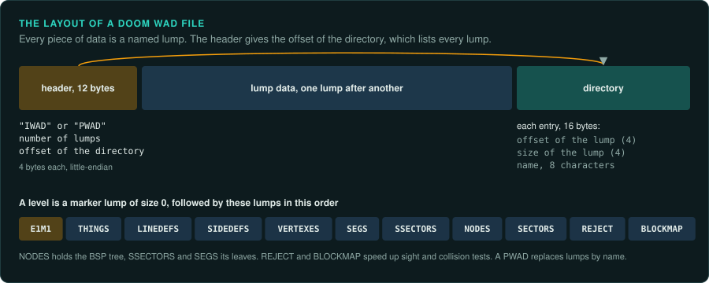
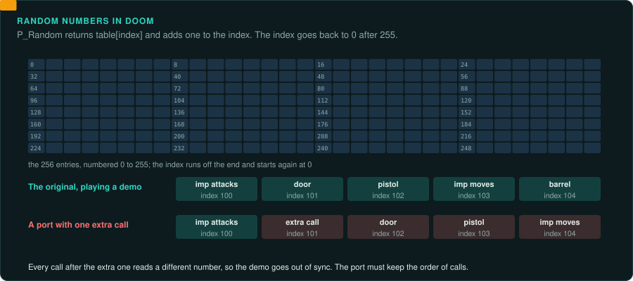
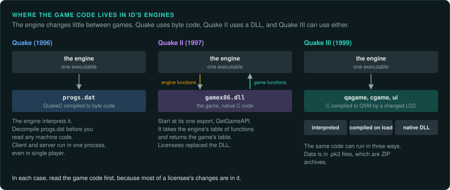
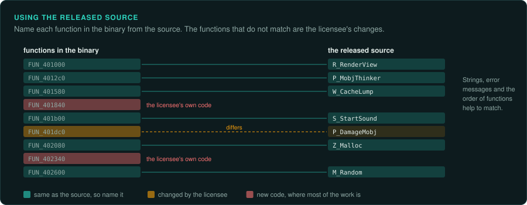

# The id Software engines

Many first-person games of the 1990s ran on id Software's engines. Many other studios licensed
them. id released the source code of each engine some years after its games, so these engines
are the best documented of the era. Use them to learn how a game engine of the time worked. Use the released source as a reference when you study a game built on a licensed copy.

| Engine | First game, year | Source released | Platform of the original |
|---|---|---|---|
| Wolfenstein 3D | Wolfenstein 3D, 1992 | 1995 | DOS, 16-bit real mode, Borland C++ and assembly |
| id Tech 1 | Doom, 1993 | 1997, GPL from 1999 | DOS, 32-bit protected mode (DOS/4GW), Watcom C |
| Quake engine | Quake, 1996 | 1999 | DOS (DJGPP), later Windows |
| Quake II engine | Quake II, 1997 | 2001 | Windows |
| id Tech 3 | Quake III Arena, 1999 | 2005 | Windows, Linux, Mac OS |

## Wolfenstein 3D

The world is a 64 × 64 grid of tiles. The renderer casts one ray per screen column against the
grid and draws a scaled wall slice for each. Sprites are drawn after the walls, clipped against
a per-column depth buffer. Game time runs at 70 ticks per second, from the reprogrammed timer.

What to note when you study a game built on it:

- Most of the game logic is in C. Most of the drawing is in 16-bit assembly.
- Actors use state tables: each state has a sprite, a duration in tics, a "think" function and
  the next state.
- Maps are compressed with RLEW and Carmack compression; graphics use Huffman compression.

## id Tech 1 (Doom)

The world is a 2D map of sectors with floor and ceiling heights. A precomputed binary space
partition (BSP) tree orders the walls from front to back, so the renderer draws each screen
column once. All world positions are 16.16 fixed point.

- **Time.** The game runs at 35 tics per second. The renderer draws as often as it can, but
  the game state changes only once per tic.
- **Thinkers.** Every moving object, door and lift is a thinker in a linked list, updated in
  list order every tic.
- **Random numbers.** Doom has no random generator in the usual sense. `P_Random` returns the
  next entry of a fixed table of 256 bytes, and an index wraps around it. Demos depend on that
  index, so the port must keep the order of calls.
- **Demos.** A demo file stores the game settings and then one command per player per tic
  (forward move, side move, turn, buttons). Playing it back runs the same game, so any change
  in the order of thinkers or random calls breaks old demos. Chocolate Doom exists to keep
  every quirk that demos depend on.
- **Data.** Everything is in WAD files as named lumps. Levels are a group of lumps
  (`THINGS`, `LINEDEFS`, `SIDEDEFS`, `VERTEXES`, `SEGS`, `SSECTORS`, `NODES`, `SECTORS`,
  `REJECT`, `BLOCKMAP`).

Heretic, Hexen and Strife licensed this engine and changed it. Hexen added a byte-code script
language (ACS) and a different map format.

## Quake

Quake has a true 3D world in a BSP tree with precomputed visibility (PVS) and light maps. The
game logic is written in **QuakeC** and compiled to `progs.dat`, a byte-code file the engine
interprets. Even single-player Quake runs as a client and a server in one process.

- To study a Quake mod or a game on this engine, decompile `progs.dat` with a QuakeC
  decompiler before you look at machine code. The engine's own code changes far less between
  games.
- The software renderer was written for the Pentium. It overlaps the floating-point divide for
  perspective correction with integer work, every 16 pixels. If an inner loop looks strange,
  look for this overlap.
- id released GLQuake, an OpenGL version, as a separate free download in 1997. It ran on 3dfx
  cards through a "MiniGL" driver ([3D accelerators](../hardware/graphics-3d.md)).

## Quake II

The game logic moved from byte code to a native DLL, `gamex86.dll`, written in C. The engine calls it through a table of functions. It calls the engine through another table. Licensees
replaced the DLL to make their own games. When you study a Quake II-engine game, start at the
DLL's single export, `GetGameAPI`, which returns the table of game functions.

## id Tech 3 (Quake III)

Game code is C compiled to **QVM** byte code by a modified LCC compiler. The engine can run the
QVM in an interpreter, compile it to machine code when it loads, or load a native DLL of the
same code instead. Three modules exist: the server game (`qagame`), the client game (`cgame`)
and the user interface (`ui`). Data is in `.pk3` files, which are ZIP archives.

Licensees changed it heavily. Call of Duty's engine began as id Tech 3 and changed further with each
game.

## How to use the released source

1. Find the version of the source that matches the game. Patches changed behaviour; the
   released code is usually the last patch.
2. Name the engine functions in your Ghidra project by matching them to the source. Strings,
   error messages and the order of functions in the binary help.
3. Mark every function that differs from the source. Those are the licensee's changes. Spend most of your reverse engineering on them.
4. Check that your project's rules allow reading the source. id's sources are under the GPL;
   reading them to understand behaviour is common. Copying them makes your project a derivative under the GPL ([Legal](../LEGAL.md)).

## Projects to learn from

| Project | Engine | What it shows |
|---|---|---|
| Chocolate Doom | id Tech 1 | Keeping demo compatibility by keeping the original's quirks |
| Wolf4SDL | Wolfenstein 3D | A port of a 16-bit DOS engine to modern systems |
| ioquake3 | id Tech 3 | Long-term maintenance of an engine with QVM modules |
| QuakeSpasm, vkQuake | Quake | Keeping the original's look with new renderers |
