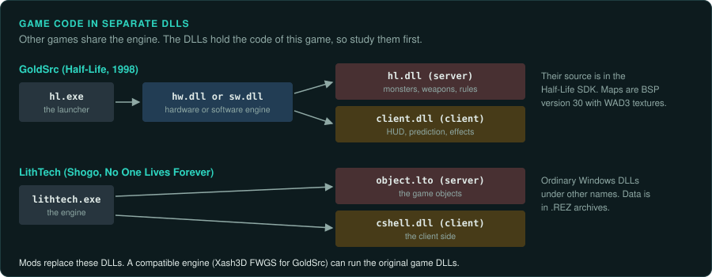
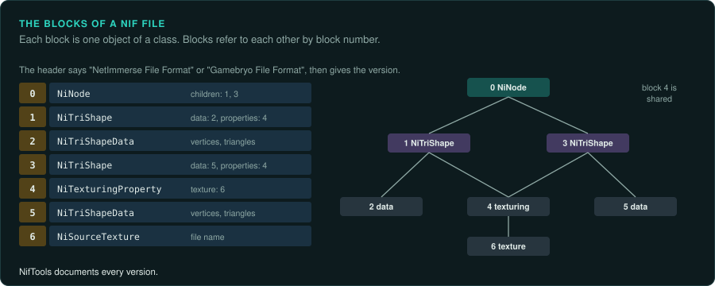
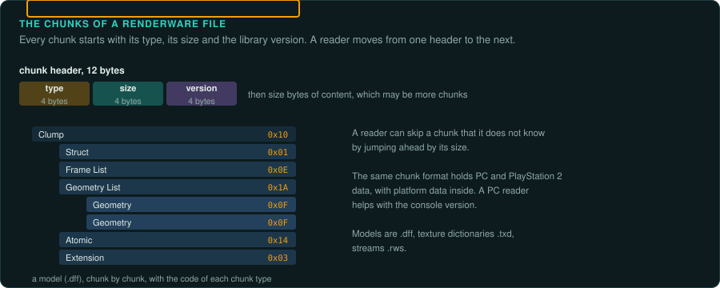

# Other licensed 3D engines

Besides the id engines and Unreal, several engines were sold to other studios in the late 1990s
and early 2000s. Each has well-known file formats that modders documented.

## GoldSrc

Valve built GoldSrc for Half-Life (1998), starting from the Quake engine and adding parts of
Quake II's code and its own systems.

- `hl.exe` loads the engine from `hw.dll` (hardware rendering: OpenGL or Direct3D) or `sw.dll`
  (software rendering).
- The game logic is in two native DLLs: `hl.dll` (the server: monsters, weapons, rules) and
  `client.dll` (the client: the HUD, prediction, effects). Mods replace them. The Half-Life SDK,
  released by Valve, contains their source code.
- Maps are BSP version 30 with external textures in `.wad` files (`WAD3`). Models are `.mdl`
  with skeletal animation.
- Scripted sequences, triggers and entity connections are in the map's entity list as text.
- Xash3D FWGS is a compatible engine reimplementation that runs the original game DLLs.

## LithTech

Monolith Productions made LithTech for Shogo (1998) and Blood II (1998), then licensed it. Later
games include No One Lives Forever (2000) and Aliens versus Predator 2 (2001).

- Data is in `.REZ` archives. Worlds are `.dat`, models `.abc` or `.ltb`, textures `.dtx`.
- The game code is in DLLs (`object.lto` for the server objects, `cshell.dll` for the client),
  which the engine loads. They are ordinary Windows DLLs under other names.
- Some LithTech games shipped with tools and SDK source for modding. Use them.

## NetImmerse and Gamebryo

NetImmerse, from Numerical Design Limited (NDL), was renamed Gamebryo in 2003. NDL became part
of Emergent Game Technologies in 2005. It is a scene-graph library more than a full engine. Studios wrote the game around it.

- Games include Morrowind (2002), Dark Age of Camelot (2001), Oblivion (2006) and
  Civilization IV (2005).
- Models and scenes are `.nif` files: a list of blocks, each a class (`NiNode`, `NiTriShape`,
  `NiTexturingProperty`), with references between blocks by index. The NifTools project
  documents every version of the format.
- RTTI names starting with `Ni` identify the library code in the executable. Label it and move
  on to the game's own classes.

## RenderWare

Criterion Software's RenderWare was a cross-platform graphics library used on PC and consoles
(PlayStation 2, Xbox, GameCube). Games include Grand Theft Auto III (2001), Vice City (2002),
San Andreas (2004) and Burnout (2001).

- Files are chunks with a type, a size and a library version: `.dff` (models), `.txd` (texture
  dictionaries), `.rws` (streams). A reader can walk a file chunk by chunk from the headers.
- The same game on PC and PlayStation 2 uses the same chunk format with different platform
  data inside, so a PC reader helps with the console version.

## How these engines change the work

- The game code is often in separate DLLs. Study those first; the engine code is shared with
  other games and often documented by modders.
- Look for an SDK. GoldSrc, LithTech and several Unreal licensees released SDKs with the game
  code's headers or source for modders.
- Check the version of each format in its header before using a community reader.
