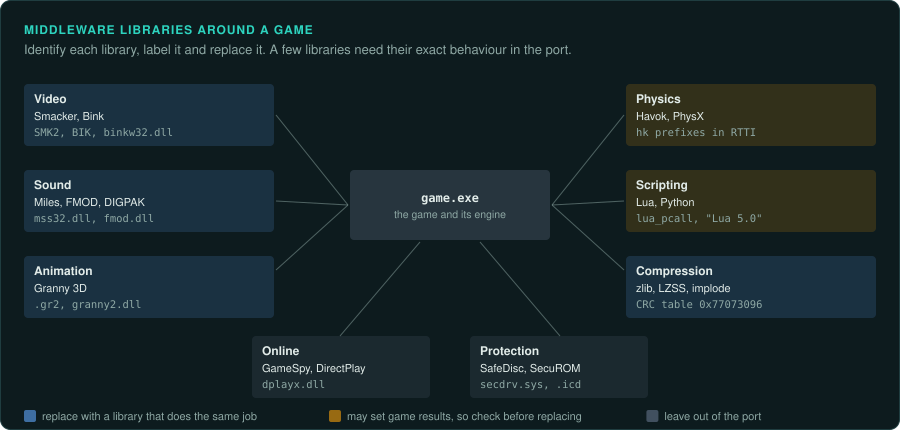

# Middleware

Middleware is a library that a game licenses for one job. In most cases it does not need to be reverse engineered. Identify it, label its functions, and replace it in
the port with a library that does the same job. Check whether the game depends on any exact
behaviour of the library, such as its random numbers, its rounding or its timing.

## Common libraries of the era

| Job | Library | Signs in the files | In the port |
|---|---|---|---|
| Video | Smacker (RAD Game Tools, 1994) | `.SMK` files starting `SMK2` or `SMK4`; `smackw32.dll` | FFmpeg decodes Smacker |
| Video | Bink (RAD, 1999) | `.BIK` files starting `BIK`; `binkw32.dll` | FFmpeg decodes most Bink 1 files |
| Video | Westwood VQA, Sierra VMD, Cinepak in AVI | `.VQA`, `.VMD`, `.AVI` | FFmpeg, or a small decoder from the documented format |
| Sound | Miles Sound System (RAD), earlier the Audio Interface Library | `mss32.dll`, `MSS` strings; in DOS, `AIL` driver files (`.DIG`, `.MDI`) | A modern audio library; MIDI through a software synthesiser |
| Sound | DIGPAK and MIDPAK, HMI Sound Operating System | DIGPAK drivers as `.COM` files and MIDPAK music drivers as `.ADV` files, called through `INT 66h`; `HMI*.386`; `SOS` strings | The same |
| Sound | FMOD | `fmod.dll`, `fmodex.dll`; `FMOD` strings | A modern library; FMOD's tracker-module playback has its own quirks to match |
| Sound | DirectSound, DirectMusic, A3D, EAX | imports from `dsound.dll`, `dmusic`; `a3d.dll`; `EAX` strings | See [Sound hardware](../hardware/sound.md) |
| 3D graphics | Direct3D, OpenGL, Glide | imports from `ddraw.dll`, `d3d8.dll`, `opengl32.dll`, `glide2x.dll` | See [3D accelerators](../hardware/graphics-3d.md) |
| Physics | Havok (from 2000), MathEngine, PhysX (from 2005) | `hk` prefixes in RTTI and strings; `PhysX` DLLs | Physics middleware results must be matched only if the game's rules depend on them; often they are cosmetic |
| Animation | Granny 3D (RAD) | `.gr2` files; `granny2.dll` | A reader for the format, documented by modders |
| Scripting | Lua (from 1993), Python, Tcl | `lua_pcall`, `Lua 5.0` strings; `python2x.dll` | Use the same language version; decompile compiled scripts (unluac) |
| Compression | zlib, LZSS, LZW, Huffman, PKWARE DCL ("implode") | zlib's version strings and CRC table; `PKWARE` strings | A standard library, or the documented algorithm |
| Online | GameSpy SDK, DirectPlay, Kali | `gamespy` strings; `dplayx.dll` | Replace with your own networking; do not contact old services ([Online games](../games/online.md)) |
| Protection | SafeDisc, SecuROM, StarForce, CD checks | `.icd` files, `secdrv.sys`, `~df394b.tmp`; checks for a disc label | Breaking it is restricted in many countries ([Legal](../LEGAL.md)); the port reads the player's files and does not need it |

## When the port must match the middleware

Most middleware can be replaced freely. A few cases need care:

- **Music timing.** If the game logic waits for the music (a level ends when a song ends, a
  cut scene follows the music), the port must match the music library's timing. Measure it.
- **Random numbers.** A few libraries use the C runtime's `rand`. If the game also uses `rand`,
  the library's calls change the game's sequence. Trace every caller of the random function.
- **Video frame counts.** Some games count video frames to time events. Use the same frame rate
  and frame count as the original file.
- **Scripting.** Use the same script language version as the game. Lua 4.0 and
  5.0 differ in their libraries and byte code, and Lua 5.3 added an integer type.
- **Physics.** If physics sets a game result (a ball's bounce in a sports game), the port must
  match the physics library's exact results. This is hard to match without the same library. Decide
  early whether your project can accept a deviation and record it.

## How to identify a library inside the executable

Libraries are often linked statically, so there is no separate DLL.

1. Search the strings for version and copyright notices. Most libraries include one.
2. Look for the library's constant tables: CRC tables, Huffman tables, DCT coefficients.
3. Compare the function with the library's source if it is open (zlib, Lua). The structure of a
   compiled zlib inflate loop is easy to recognise once you have seen it.
4. Label the whole library's functions in Ghidra with a prefix (`zlib_`, `lua_`, `smk_`), so you
   can skip them while tracing.
