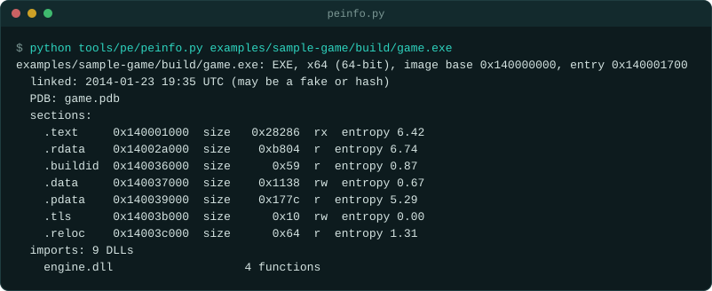
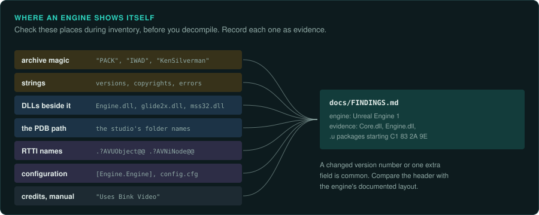

# Recognising an engine

A game built on an engine usually shows it in its files: archive formats, file extensions, DLL names,
version strings, copyright notices and debug paths. Check these during inventory, before you
decompile anything. `tools/pe/peinfo.py` prints imports, exports, the PDB path and engine
fingerprints for Windows binaries; `tools/dos/dosinfo.py` does the same for DOS programs.



## Ask your agent

Identify the engine. Copy this prompt into your coding agent:

```text
In my GameFrame project, identify the engine and the libraries the game uses.

1. Read docs/engines/recognising.md and docs/engines/middleware.md.
2. Check the file extensions and magic numbers, the DLLs, the strings, the PDB path and the
   RTTI names (tools/pe/peinfo.py or tools/dos/dosinfo.py).
3. Write the engine and each library into docs/FINDINGS.md with the evidence for each.
4. Label the library code in Ghidra with a prefix, so later tracing skips it.
5. If the engine's source was released, tell me its version and licence before reading it.
```

## Where to look



| Place | What to look for | How |
|---|---|---|
| File extensions and archive magic | `.WAD` with `IWAD`/`PWAD`, `.PAK` with `PACK`, `.GRP` with `KenSilverman`, `.u` packages | `xxd FILE | head`, the table below |
| Strings in the executable | engine names, version strings, copyright notices, error messages, console commands | `strings -n 6 GAME.EXE | less`; `strings.txt` in the Ghidra export |
| Libraries beside the executable | `glide2x.dll`, `Engine.dll`, `mss32.dll`, `binkw32.dll`, `fmod.dll`, `smackw32.dll` | `ls`; `peinfo.py` lists imports |
| The PDB path in a Windows binary | the studio's folder names, the engine's folder names | `peinfo.py` prints it |
| RTTI class names (MSVC C++) | `.?AVUObject@@`, `.?AVNiNode@@`, `.?AVRwFrame@@` | `peinfo.py`; `strings` for `.?AV` |
| Configuration files | `[Engine.Engine]` sections, `config.cfg` with console variables | open them |
| The credits and the manual | "Uses Bink Video", "Build engine by Ken Silverman" | read them |

## Signatures of common engines

| Engine | Typical games | Signatures |
|---|---|---|
| Wolfenstein 3D engine | Wolfenstein 3D, Spear of Destiny, Blake Stone | `VSWAP`, `GAMEMAPS`, `MAPHEAD`, `AUDIOT` files |
| id Tech 1 (Doom) | Doom, Doom II, Heretic, Hexen, Strife | `.WAD` starting `IWAD` or `PWAD`; lumps `THINGS`, `LINEDEFS`, `SECTORS` |
| Quake engine | Quake, Hexen II | `.PAK` starting `PACK`; `progs.dat` (QuakeC byte code); `.BSP` version 29 |
| Quake II engine | Quake II, Heretic II, Kingpin, SiN, Soldier of Fortune | `gamex86.dll`; `.PAK`; `.BSP` starting `IBSP` version 38; `.wal` textures |
| Quake III engine (id Tech 3) | Quake III Arena, Return to Castle Wolfenstein, Star Trek: Elite Force, Call of Duty | `.pk3` (ZIP) files; `.qvm` modules; `.BSP` `IBSP` version 46 or 47 |
| GoldSrc | Half-Life, Counter-Strike, Team Fortress Classic | `hl.exe`, `hw.dll`, `sw.dll`, `client.dll`, `hl.dll`; `.wad` starting `WAD3`; `.BSP` version 30 |
| Build engine | Duke Nukem 3D, Shadow Warrior, Blood, Redneck Rampage | `.GRP` starting `KenSilverman`; `.ART` tiles; `.MAP` with version 7 |
| Jedi engine | Star Wars: Dark Forces, Outlaws | `.GOB` starting `GOB\x0a` (Dark Forces), `.LAB` archives (Outlaws); `.LEV`, `.INF`, `.O` files |
| Unreal Engine 1 and 2 | Unreal, Unreal Tournament, Deus Ex, Rune, Splinter Cell | `Core.dll`, `Engine.dll`; packages `.u`, `.utx`, `.unr` starting with `C1 83 2A 9E` |
| LithTech | Shogo, Blood II, No One Lives Forever, AvP 2 | `.REZ` archives; `lithtech.exe`; `.dat` worlds, `.abc` models |
| NetImmerse and Gamebryo | Morrowind, Oblivion, Civilization IV, Dark Age of Camelot | `.nif` files starting `NetImmerse File Format` or `Gamebryo File Format` |
| RenderWare | Grand Theft Auto III, Vice City, San Andreas, Burnout | `.dff` models, `.txd` texture dictionaries, `.rws` streams; `RenderWare` strings |
| Infinity Engine | Baldur's Gate, Planescape: Torment, Icewind Dale | `chitin.key`, `.bif` archives; `.bcs` compiled scripts; `.are`, `.cre`, `.itm` |
| Westwood engines | Dune II, Lands of Lore, Command & Conquer, Red Alert, Dune 2000 | `.PAK` archives (Dune II, Lands of Lore); `.MIX` archives (from Command & Conquer); `.SHP`, `.VQA`, `.AUD` |
| Blizzard engines | Diablo, StarCraft, Diablo II, Warcraft III | `.MPQ` archives starting `MPQ\x1a`; `storm.dll` |
| SCUMM | Monkey Island, Day of the Tentacle, Sam & Max | `.LFL`, `.000`, `.LA0`, `.SOU` files; resource blocks `ROOM`, `SCRP`, `LECF` |
| Sierra SCI | King's Quest IV to VII, Space Quest III to 6, Gabriel Knight | `RESOURCE.MAP`, `RESOURCE.000`; `SCIV.EXE` or `SIERRA.EXE` |
| AGS (Adventure Game Studio) | many independent adventures | `acsetup.cfg`; data appended to the executable, starting `CLIB` |
| Unity | from 2005 | `UnityPlayer.dll`, `*_Data` folder, `globalgamemanagers` (see `re-inventory`) |
| Unreal Engine 3 and later | from 2006 | `.upk` or `.pak`; `UE3` or `UE4` strings (see `re-inventory`) |

A game may also use a modified engine with new formats. When the signatures are close but do not
match, compare the header layout with the engine's documented format. A changed version number
or one extra field is common.

## Libraries that are not the engine



The executable often contains code from libraries the game linked in. Ghidra cannot tell your
game's functions from a library's. Find and label the library code first, so you do not trace
it by mistake.

| Library code | How to spot it | What to do |
|---|---|---|
| The C runtime (MSVC, Watcom, Borland, DJGPP) | `malloc`, `printf`, `qsort`, `_ftol`, startup code before `main`; copyright strings | Apply function signatures for the compiler (Ghidra's Function ID, FLIRT-style signatures), or label by hand from the strings |
| The C++ standard library | `std::` names in RTTI, `basic_string` | Label, do not trace |
| zlib | `deflate 1.1.3 Copyright` and similar strings; the CRC table `0x77073096` | Label; use zlib in the port |
| Middleware | see [Middleware](middleware.md) | Label; replace in the port |
| Compiler helpers | `__allmul`, `__aullrem`, `_chkstk`, Watcom's register-call helpers | Label; they implement plain arithmetic |

Once these are labelled, the remaining unlabelled code is the game and its engine.
