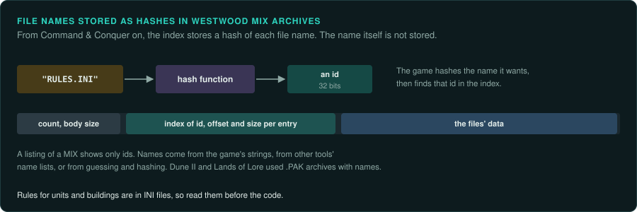
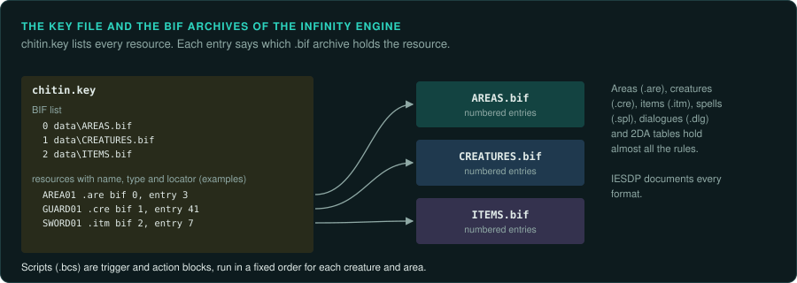
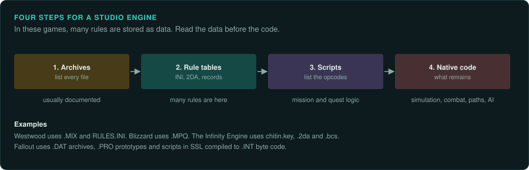

# Studio engines for 2D and isometric games

Strategy games, role-playing games and adventures of the 1990s mostly ran on engines a studio
built for itself and reused across its games. They were rarely sold, but each studio's games
share formats and code, so work on one game helps with the others.

## Westwood Studios

Dune II (1992), Lands of Lore (1993), Command & Conquer (1995), Red Alert (1996) and Dune 2000
(1998) share many formats. The formats changed between games, so check each header.

- Dune II and Lands of Lore keep their files in `.PAK` archives. From Command & Conquer, the
  games use `.MIX` archives with entries named by a hash of the file name.
- `.SHP` sprites (the layout differs between generations), `.VQA` video, `.AUD` audio with
  Westwood's ADPCM.
- Rules for units and buildings are in INI files (`RULES.INI` in Red Alert), so many rules are
  data. Read them first.
- Electronic Arts released the source of Command & Conquer and Red Alert in 2020. For these
  two games, read the source before you reverse engineer.

## Blizzard Entertainment

Diablo (1996), StarCraft (1998), Diablo II (2000) and Warcraft III (2002) share `storm.dll`
and the MPQ archive format.

- `.MPQ` archives with a hash table of file names, optional compression (several methods) and
  encryption with keys derived from the file names. StormLib reads them.
- `storm.dll` also holds shared code: memory, files, networking and drawing helpers. Its
  functions are exported by ordinal; community lists name many of them.
- StarCraft's replays store commands per game tick. The simulation is fully deterministic.
  OpenBW reimplemented it exactly enough to play replays.
- Diablo's Devilution project reconstructed the source with help from debug information left
  in the Japanese PlayStation port. Look for such builds of your game: demos, other
  platforms and beta versions sometimes kept symbols.

## The Infinity Engine (BioWare)

Baldur's Gate (1998), Planescape: Torment (1999), Icewind Dale (2000) and their sequels.

- `chitin.key` lists every resource and the `.bif` archive that holds it.
- Areas (`.are`), creatures (`.cre`), items (`.itm`), spells (`.spl`), dialogues (`.dlg`) and
  2DA tables (`.2da`, plain text tables of rules) hold almost all the game's rules.
- Scripts (`.bcs`) are compiled lists of trigger and action blocks, run in a fixed order for
  each creature and area. Their trigger and action numbers are listed in `TRIGGER.IDS` and
  `ACTION.IDS`.
- GemRB reimplements the engine from these formats. The IESDP documents every format.

## The Fallout engine (Interplay)

Fallout (1997) and Fallout 2 (1998).

- `.DAT` archives; `.FRM` sprites with several directions; `.MAP` maps; `.PRO` prototypes for
  items, critters and scenery.
- Scripts are written in a C-like language (SSL) and compiled to `.INT` byte code, which the
  engine interprets. Decompilers exist.
- Fallout 2 Community Edition is a reimplementation built from reverse engineering.

## Adventure engines

Point-and-click adventures almost always ran on a script interpreter. See
[Adventure and story games](../games/adventure.md) for the families (SCUMM, SCI, AGI) and
ScummVM, which reimplements most of them.

## How to approach a studio engine

1. Find the archive format and list every file. These formats are usually documented already.
2. Read the rule tables and text formats before any code. In these games, many of the
   rules are in data.
3. Find the script interpreter if there is one. List its opcodes.
4. Trace the native code for what remains: the simulation step, combat formulas, pathfinding,
   AI. See the family pages for what must be exact ([Strategy](../games/strategy.md),
   [RPGs](../games/rpg.md)).
