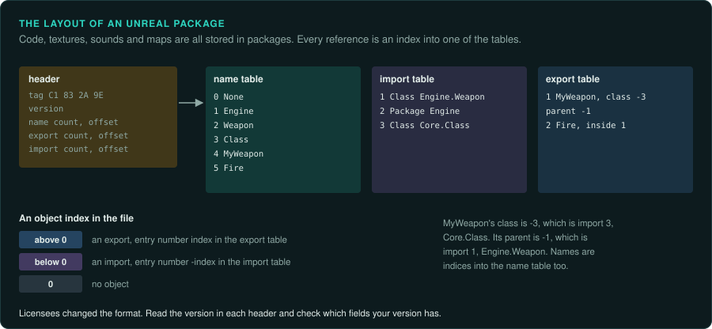
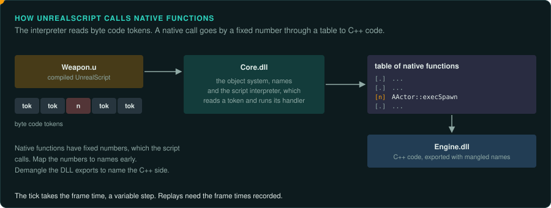

# Unreal Engine 1 and 2

Epic Games' Unreal Engine 1 (Unreal, 1998) and Unreal Engine 2 (2002) were the main competitors
to the Quake engines. They were licensed for many games, from first-person shooters to role-
playing and stealth games.

| Engine | Games |
|---|---|
| Unreal Engine 1 | Unreal (1998), Unreal Tournament (1999), Deus Ex (2000), Rune (2000), The Wheel of Time (1999), Undying (2001) |
| Unreal Engine 2 | Unreal Tournament 2003 and 2004, Splinter Cell (2002), Postal 2 (2003), Lineage II (2003), Thief: Deadly Shadows (2004) |

Epic never released the full source of these engines publicly. Licensees received it, and
public headers came with the editing tools and some patches. Unreal Tournament's public headers
(for native mods) describe many classes in detail.

## How the engine is organised

- **Packages.** Everything is in package files: code (`.u`), textures (`.utx`), sounds
  (`.uax`), music (`.umx`), meshes (`.usx` in UE2) and maps (`.unr`, `.ut2`). A package has a
  header, a name table, an import table and an export table. Objects refer to each other by
  index into these tables. Readers for the format exist in many modding tools.
- **Objects and classes.** Every object derives from `UObject`. Classes are defined in
  UnrealScript; some classes also have **native** parts written in C++ in the engine DLLs. A native class's C++ code is in a DLL such as `Engine.dll` or the game's own DLL. Its script code is in a `.u` package.
- **UnrealScript.** The game logic is mostly UnrealScript, compiled to byte code inside the
  `.u` packages. The engine interprets it. Tools decompile the byte code back to readable
  script. Start there for game rules, as for QuakeC.
- **The DLLs.** `Core.dll` holds the object system, the name table and the script
  interpreter. `Engine.dll` holds the actor system, levels and the renderer interface. Each
  renderer is a separate DLL (`GlideDrv.dll`, `D3DDrv.dll`, `OpenGLDrv.dll`, `SoftDrv.dll`). Each audio device is one too (`Galaxy.dll`).

## What to note

- The DLLs export many C++ functions with their mangled names. Demangle them to get the class
  and method names before you start tracing. `tools/pe/peinfo.py` lists exports.
- The script interpreter dispatches on byte codes through a table of native functions. Native
  functions have fixed numbers, which the script calls. Map the numbers to names early.
- The game's tick takes the frame time. It is a variable time step, so replays need the frame
  times recorded ([The main loop](../GAME-PATTERNS.md#the-main-loop)).
- Licensees changed the engine and the package format version. Read the version field in each package header. Check which fields your game's version has.

## How to approach an Unreal Engine game

1. List the packages and read their name, import and export tables with an existing reader.
2. Decompile the `.u` packages to script. Most game behaviour is there.
3. Use the engine DLLs' exports to name the native functions in Ghidra.
4. Trace the native code that the script calls for the rules you need: physics, movement,
   collision, damage.
5. Reimplement the script interpreter and the native functions, or translate the scripts. A
   reimplemented interpreter keeps mods working. Translating the scripts is simpler if you only
   need one game.
