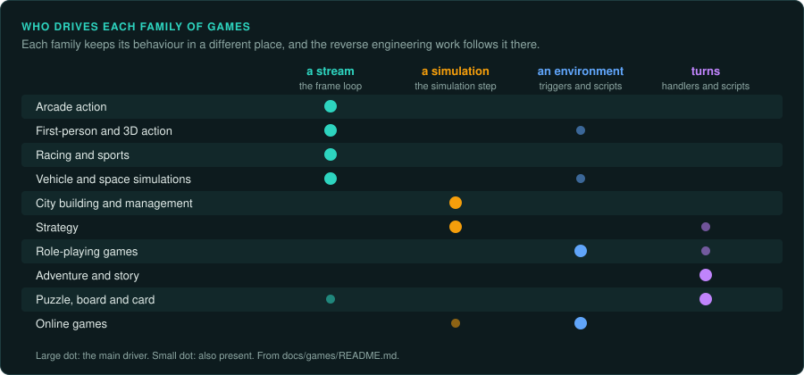
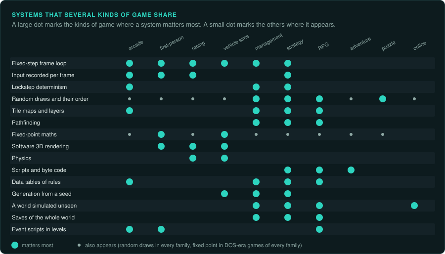
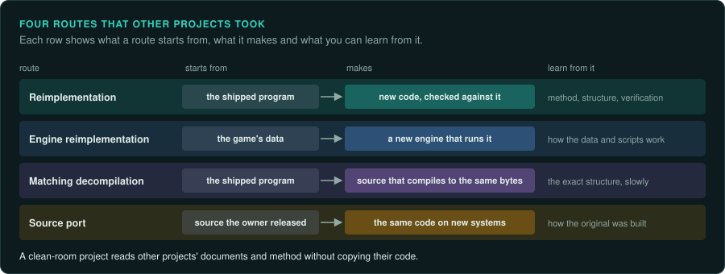

# A taxonomy of games



Games are not all reverse engineered the same way. The hard part differs by kind of game:
the frame loop in a shooter, the simulation and saves in a city builder, the script engine in
an adventure game. This
section sorts games into families, gives each family a **rule set** (what must be exact, where
the rules live, what to capture, how to check), names reference games, and lists public
projects that rebuilt such games, so you can learn from them.

Use it at the start of a project, together with the `re-inventory` skill:

1. Decide who drives: the game or the player ([Who drives](interaction.md)).
2. Place the game on the axes below.
3. Read its family page (or pages, for a mixed game) and copy the rule set into the project's
   `AGENTS.md`.
4. Follow the connections to the systems your game shares with other families.

## Ask your agent

Classify my game. Copy this prompt into your coding agent:

```text
In my GameFrame project, classify the game.

1. Read docs/games/README.md and docs/games/interaction.md.
2. Look at the game's files and its manual. Ask me how it plays if you cannot tell.
3. Decide who drives (a stream, a simulation, an environment, or turns), the time model,
   where the rules live and what must repeat exactly. Name the family.
4. Read that family's page. Write the kind of game, its axes and its family into
   docs/FINDINGS.md, with the evidence for each.
5. Copy the family's rule set into the project's AGENTS.md and adjust it to this game.
6. Ask me how exact the interface must be, and record my answer.
```

## Axes

Find your game's value on each of these axes. The values show where most of the work will be.

| Axis | Values | Why it matters |
|---|---|---|
| Who drives | a stream with controls; software over a simulation; an environment; turns and choices ([details](interaction.md)) | Where the behaviour lives: a frame loop, a simulation step, triggers, or handlers and scripts |
| Time model | fixed-step real time; variable-step real time; pausable real time; turn-based; waits for input | What "the same run" means, and how to replay one ([The main loop](../GAME-PATTERNS.md#the-main-loop)) |
| Where the rules live | machine code; data tables; a script language and its interpreter; an engine plus data | Whether you port code, read data, or write an interpreter |
| What must repeat exactly | demos; lockstep multiplayer; saves; nothing beyond play | How strict the verification must be, down to float rounding |
| Era and platform | DOS real mode; DOS protected mode; Windows 9x with DirectX; 64-bit Windows; consoles; managed engines (Unity, .NET) | Tools, ABI, and how to run the original ([DOS games](../DOS.md), [ABI](../ABI.md), `re-inventory`) |
| Presentation | text; 2D tiles and sprites; 2.5D (ray casting, sectors); 3D | What the renderer must reproduce, and how pictures are compared |
| Interface | drawn by the game's own code; data-driven layouts; a platform toolkit | How much of the interface is code to trace ([Capturing the interface](../observe/ui.md)) |

## Families



| Family | Who drives | Typical time model | The hardest part |
|---|---|---|---|
| [Arcade action](arcade-action.md): shoot 'em ups, platformers, beat 'em ups, fighting | stream | fixed step, 60 or 70 per second | frame-exact order, collision, demo sync |
| [First-person and 3D action](first-person.md) | stream, environment | fixed tick or variable | the renderer, movement physics, demo sync |
| [Racing and sports](racing-sports.md) | stream | fixed step | vehicle or ball physics, AI drivers and players |
| [Vehicle and space simulations](vehicle-sims.md) | stream, environment | fixed step, time acceleration | fixed-point or float maths, orbits, flight models |
| [City building and management](management.md) | simulation | fixed step, game speeds | the simulation step, random draws, saves |
| [Strategy](strategy.md): real-time, turn-based, tactics | simulation, turns | lockstep ticks or turns | determinism for multiplayer, AI, pathfinding |
| [Role-playing games](rpg.md) | environment, turns | mixed | rules tables, scripts, dialogue, saves |
| [Adventure and story games](adventure.md) | turns, waiting | waits for input | the script engine and its byte code |
| [Puzzle, board and card games](puzzle-board.md) | turns, stream | turns or fixed step | exact rules and random draws; often small |
| [Online games](online.md) | environment, simulation | server ticks | the client-server split; legal limits |

## Connections



Many systems appear in several families. A family page says "see also" when a system it
describes also appears in another kind of game. You trace such a system once. The table shows the main shared systems and
where to read about each.

| System | Families where it matters most | Read |
|---|---|---|
| Fixed-step frame loop, steps per frame | arcade action, first-person, racing, vehicle sims, management, real-time strategy | [The main loop](../GAME-PATTERNS.md#the-main-loop) |
| Input recorded per frame (demos, replays) | arcade action, first-person, racing, strategy | [Inputs](../observe/inputs.md) |
| Lockstep determinism | real-time strategy, management with multiplayer, fighting games with rollback | [Networking](../GAME-PATTERNS.md#networking-if-any) |
| Random generators and draw order | every family; most critical in management, strategy, RPGs, card games | [Random number generators](../GAME-PATTERNS.md#random-number-generators) |
| Tile maps and layers | platformers, shoot 'em ups, strategy, RPGs, management | [Arcade action](arcade-action.md), [Strategy](strategy.md) |
| Pathfinding | strategy, management, RPGs | [Management](management.md), [Strategy](strategy.md) |
| Fixed-point maths | DOS-era games of every family; vehicle sims, first-person | [DOS games](../DOS.md), [ABI](../ABI.md) |
| Software 3D rendering | first-person, vehicle sims, racing | [First-person](first-person.md), [Vehicle sims](vehicle-sims.md) |
| Physics (vehicles, balls, bodies) | racing, sports, vehicle sims, pinball | [Racing and sports](racing-sports.md) |
| Script languages and byte-code interpreters | adventure, RPGs, some strategy (mission scripts), visual novels | [Adventure](adventure.md) |
| Data tables of rules (units, items, spells) | strategy, RPGs, management, shoot 'em ups (weapons) | [Resources and data](../GAME-PATTERNS.md#resources-and-data) |
| Procedural generation from a seed | vehicle sims (galaxies), management (maps), roguelikes, strategy (random maps) | [Vehicle sims](vehicle-sims.md) |
| A world simulated while unseen | management, strategy, RPGs, online | [Management](management.md) |
| Saves as a full world state | management, strategy, RPGs | [Saves](../GAME-PATTERNS.md#saves) |
| Event and trigger scripts in levels | shoot 'em ups, first-person, RPGs | [Arcade action](arcade-action.md) |

## Approaches you will see in other projects



The family pages list public projects that rebuilt games. What you can learn from each one depends on the route it took.

| Approach | What it means | What you can learn from it |
|---|---|---|
| **Reimplementation** | New code written from reverse engineering the shipped program, usually checked against it | Method, structure, how they verified; never copy their code into a clean-room project |
| **Engine reimplementation** | A new engine that runs the original game's data (scripts, maps, models) | How the data and scripts work |
| **Matching decompilation** | Source code that compiles back to the identical original binary | The original's structure, exactly; it is the slowest route |
| **Source port** | A port of source code the rights holder released | How the original was built; no reverse engineering was needed |

A clean-room project (see [Legal](../LEGAL.md)) reads other projects' documents and method,
not their code. Write in your project's rules which of them may be read.

Projects change, move and sometimes are taken down. Check each link before relying on it. Check the descriptions here before you cite them.
