# Adventure and story games

Point-and-click adventures, text adventures, interactive fiction and visual novels. They are
[turns and choices](interaction.md#the-four-kinds): nothing happens until the player acts. The story is a script that waits at every choice. Most were built on a **script engine**: the
game is byte code in data files, run by an interpreter in the executable.

## Reference games

| Game | Year, platform | Why it is a good example |
|---|---|---|
| Zork I | 1980, many | Z-machine byte code: the same story file runs on any interpreter |
| King's Quest | 1984, PC | Sierra's AGI: logic scripts, pictures drawn from vector commands |
| Maniac Mansion, The Secret of Monkey Island | 1987 and 1990 | LucasArts' SCUMM: rooms, verbs, scripts and threads |
| Space Quest IV | 1991, DOS | Sierra's SCI: an object-oriented script language and its VM |
| Myst | 1993, Mac and Windows | Slide-show navigation over HyperCard-like stacks |
| Grim Fandango | 1998, Windows | 3D characters on pre-rendered rooms; Lua scripts |
| Visual novels on NScripter | 1990s onward, Windows | A text script with commands for images, music and choices |

## Projects to learn from

| Project | Games | Approach |
|---|---|---|
| ScummVM | SCUMM, AGI, SCI, Myst (Mohawk), Grim Fandango and hundreds more | engine reimplementations, one per original engine |
| Frotz and other Z-machine interpreters | Infocom games | interpreters written from the published Z-machine standard |
| ONScripter | NScripter visual novels | engine reimplementation |

ScummVM is the largest body of work on this family. Its engines and wiki document many script
formats and interpreter quirks.

## The rule set

**What must be exact.** The interpreter: every opcode, its operand formats, its effect on
variables, flags and objects, and its timing where scripts wait. Text, parsers and verb
handling. The object and room state that saves record.

**Where the rules live.** Almost entirely in data, as scripts. The executable is the
interpreter, the graphics and sound drivers, and a few hard-coded puzzles. Find the
interpreter's dispatch table first: it is a loop over opcodes calling one function each.

**Inputs.** Clicks on verbs and objects, typed commands (text parsers), dialogue choices, and
keyboard shortcuts. Store recordings as commands.

**Interface.** The verb bar, inventory, dialogue choices, text windows, the cursor and its
changes over hotspots. Fonts and text rendering, including line breaking, are part of the look.

**Time and determinism.** Mostly waits for the player. Animations and timed scenes run on a
tick the scripts can wait on. A few puzzles are timed or random: find those scripts.

**How to verify.** Run the same command list in the original and the port and compare the
variables after each command. Walk through the whole game from a known solution script.
Disassemble every script with your decoder and check it consumes every byte of every file.

**Pitfalls.**
- Several versions of the same engine, with opcodes added, removed or changed between games.
- Scripts that rely on interpreter bugs (an uninitialised variable, an overflow).
- Text parsers with dictionaries and synonyms in data, and word matching that truncates.
- Copy protection inside the scripts (questions from the manual). Do not bypass protection in
  a way the law where you live forbids ([Legal](../LEGAL.md)).

## Connections

- [RPGs](rpg.md): dialogue scripts and byte-code interpreters.
- [Puzzle and board games](puzzle-board.md): logic that waits for the player.
- [First-person](first-person.md): scripted sequences and in-game script languages.
