# Arcade action: shoot 'em ups, platformers, beat 'em ups, fighting

Games where things come at the player every frame and the player steers, jumps, fires and
dodges. They are [streams with controls](interaction.md#the-four-kinds): the game drives and the
player reacts. The game runs its rules inside one frame loop at a fixed rate.

## Reference games

| Game | Year, platform | Why it is a good example |
|---|---|---|
| Tyrian 2000 | 1999, DOS | Vertical shooter in Borland Pascal; level event scripts, per-frame demos, an AdLib music driver ([case study](../case-studies/tyrian.md)) |
| Commander Keen 4 | 1991, DOS | Smooth-scrolling platformer on EGA; tile maps, sprite actors with state tables |
| Prince of Persia | 1989, DOS | Platformer with rotoscoped animation tables and exact frame timing |
| Jazz Jackrabbit | 1994, DOS | Fast platformer with a custom mode-X engine |
| Super Mario Bros. | 1985, NES | Sub-pixel physics in fixed point; well documented by speedrunners |
| Street Fighter II | 1991, arcade | Frame data, hit boxes, input buffers for special moves |
| Double Dragon | 1987, arcade | Beat 'em up: lanes, enemy waves, simple AI states |

## Projects to learn from

| Project | Game | Approach |
|---|---|---|
| Omnispeak | Commander Keen 4-6 | reimplementation from disassembly |
| SDLPoP | Prince of Persia | reimplementation based on a disassembly |
| OpenTyrian | Tyrian 2.1 | source port (the original Pascal source was released, then converted to C) |
| OpenClaw | Captain Claw | reimplementation |
| OpenTitus | Titus the Fox, Moktar | reimplementation |
| sm64 (n64decomp) | Super Mario 64 | matching decompilation |
| MAME | thousands of arcade games | emulation of the hardware; its drivers document each board |

## The rule set

**What must be exact.** The order of the steps in a frame; positions in the game's own units
(often fixed point, sub-pixels); collision boxes and the order of collision tests; animation
frame counts; every random draw. Speedrunners and players notice a one-frame difference.

**Where the rules live.** In code, in the frame loop and the actor update functions. Levels
are data: tile maps, enemy placement, and often an **event script** (a list of
"at position *n*, do *x*" records) that starts waves, changes speed and ends the level. Weapon
and enemy stats are usually tables. Read the tables and the event format before porting the
code that uses them.

**Inputs.** Keys, joystick and mouse, read once a frame in most games. A demo is the input of
each frame plus the starting seed. Fighting games buffer the last few frames of input to
detect special moves. Port the buffer length and the matching rules exactly.

**Interface.** The HUD (score, lives, energy bars) is drawn by the frame, usually straight to
video memory. Menus, shops and the title screen are separate loops. Fonts are the game's own
bitmaps. Port each screen from its code.

**Time and determinism.** A fixed rate set by a timer interrupt or the display's refresh (70 Hz
on VGA mode 13h; 60 Hz on NTSC consoles; 50 Hz on PAL). If the game waits for the vertical
retrace, the refresh rate sets its speed. On consoles and arcade boards, a port may need to copy
the slowdown (fewer updates when the screen is busy).

**How to verify.** Play the game's own demos in the original and in the port, and compare every
frame's state and screen. Fuzz the frame's fragments from real states (random enemies, shots,
positions) to reach branches the demos never reach. Check collision code with many random
pairs of boxes.

**Pitfalls.**
- An actor list processed in slot order, with new actors taking the first free slot: the slot
  order changes who is drawn on top and who is hit first.
- Hit tests against the previous frame's positions.
- Integer division and shifts on negative positions (see [ABI](../ABI.md#integers)).
- Palette effects (flashes, fades, colour cycling) are part of the frame and are easy to miss.
- Music and sound effects often run on their own timer interrupt at a different rate from the
  frame.

## Connections

- [First-person and 3D action](first-person.md) shares the frame loop, demos and actor states.
- [Strategy](strategy.md) and [RPGs](rpg.md) share tile maps and layered scrolling.
- [Racing and sports](racing-sports.md) shares per-frame physics in fixed point.
