# First-person and 3D action

Shooters and action games seen from the player's eyes or just behind them: Wolfenstein 3D to
Half-Life, and the immersive simulations (System Shock, Thief). They are [streams with
controls](interaction.md#the-four-kinds) in the fight, and [environments](interaction.md) in
the exploration: levels full of triggers, doors, switches and scripted events.

## Reference games

| Game | Year, platform | Why it is a good example |
|---|---|---|
| Wolfenstein 3D | 1992, DOS | Ray-casting renderer on a grid; the simplest complete first-person engine |
| Doom | 1993, DOS | BSP renderer, fixed-point maths, 35 Hz ticks, demos that are pure input |
| Duke Nukem 3D | 1996, DOS | Build engine: sectors, portals, a game written on top of a licensed engine |
| Quake | 1996, DOS | True 3D, a byte-code language (QuakeC) for game logic, client-server even in single player |
| System Shock | 1994, DOS | Immersive simulation: physics, an interface inside the game view, scripted level events |
| Half-Life | 1998, Windows | A licensed engine (GoldSrc) with a game DLL, scripted sequences, entity I/O |

## Projects to learn from

| Project | Game | Approach |
|---|---|---|
| Chocolate Doom | Doom | source port that keeps every quirk, so old demos still play in sync |
| Wolf4SDL | Wolfenstein 3D | source port |
| EDuke32 | Duke Nukem 3D | source port of the Build engine and the game |
| NBlood | Blood | reimplementation of the game code from reverse engineering, on EDuke32's engine |
| ioquake3, QuakeSpasm | Quake III, Quake | source ports |
| Shockolate | System Shock | source port |
| Xash3D FWGS | Half-Life | engine reimplementation that runs the original game code and data |

Doom and Quake were released as source code, so their ports are not reverse engineering. They are still the best references for how such engines work. Chocolate Doom shows how much work it
takes to keep every quirk. Old demos play in sync only when every quirk is kept.

## The rule set

**What must be exact.** Movement: acceleration, friction, step-up height, sliding along walls,
all in the game's units (often 16.16 fixed point). The tick rate and the order of thinkers
(the per-object update functions). Hit scans and projectile collision. Random draws: Doom reads
a fixed table of 256 numbers through an index instead of running a generator. Demos stay in
sync only if the index matches.

**Where the rules live.** In code (thinkers, weapons, monsters as state tables of frames,
durations and actions) and in level data: sectors or brushes, special lines and tags that link
switches to doors, scripted sequences. Later games move logic into a script language or a game
DLL with an entity interface. Read the level format and the state tables before porting code.

**Inputs.** Keyboard and mouse. Mouse movement adds up between ticks; the game reads the total
once per tick and scales it. Record the per-tick command (forward move, side move, turn,
buttons). Most of these games store that command in their demo files.

**Interface.** The status bar, automap and menus are drawn by the game. The weapon sprite and
crosshair are part of the 3D view. Text uses the game's own fonts.

**Time and determinism.** A fixed tick (35 Hz in Doom), with the renderer drawing as fast as it
can, sometimes interpolating between ticks. The tick must be exact; the renderer need not run
at the same rate in the port.

**How to verify.** Play recorded demos and compare object positions and states each tick. For
the renderer, compare frames of the same tick from the original and the port. Software
renderers are exact enough to compare pixel by pixel; hardware renderers need image
comparison with a tolerance.

**Pitfalls.**
- Thinker lists in insertion order, with removal during iteration.
- Fixed-point multiply and divide helpers with their own rounding and overflow checks.
- Trigonometry from lookup tables (fine angles), not from a maths library.
- Renderers that depend on the screen size (field of view, aspect correction) differently from
  what the documentation says.

## Connections

- [Arcade action](arcade-action.md): frame loops, actor state tables, demos.
- [Vehicle and space simulations](vehicle-sims.md): software 3D, fixed-point maths.
- [Adventure](adventure.md): script interpreters (QuakeC, scripted sequences).
- [Online games](online.md): client-server split, prediction.
