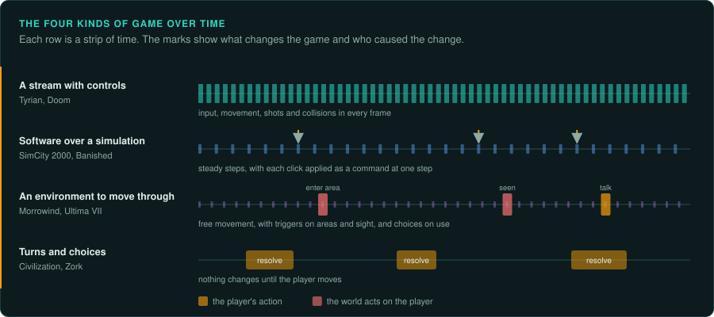
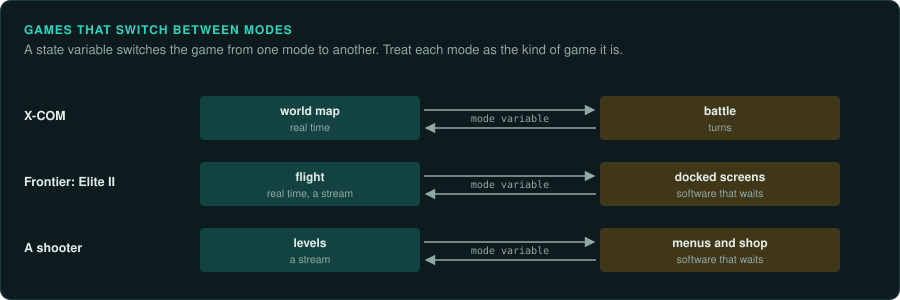

# Who drives: the game or the player

Before you read a game's code, decide what kind of control system you are rebuilding. The answer tells
you where the hard parts are, what must be exact, and how to check the result. This page
describes the four kinds of interaction; the [family pages](README.md#families) apply them to
each kind of game.

## Games that run on their own clock

Most software waits for the user. It shows a window, the user presses a button, and the program
reacts through an event handler. Most games work the other way round. The game makes things
happen on its own clock (enemies arrive, shots fly, the level scrolls, the town grows), and the
player reacts through the few controls the game gives. This affects the code in these ways:

- **Look for the loop.** Find the loop that runs every frame or every tick, before the code
  behind any button. Almost everything happens inside it, in a fixed order. Find that order first. Write it down as a table.
- **Input is usually state, read at fixed points.** Keys and buttons are often bytes in memory
  (a key table that an interrupt handler fills, a button array) that the frame reads at one
  point. A recorded demo is then just the input for each frame, and replaying it reproduces
  the game. Many games work this way, but not all. Some games read input in several places in a frame
  (the menu loop and the game loop each read it), and some act on key events inside the
  window's message handler. Find every place that reads input; [Inputs](../observe/inputs.md)
  lists where to look.
- **The game draws its own interface.** The HUD, status bar and messages are drawn by the frame
  itself, often straight to the screen, with the game's own font and shapes. Menus are usually
  loops of their own, with their own input reading. Trace each screen like game
  logic ([Capturing the interface](../observe/ui.md)).
- **Time and order change the results.** Because the game starts most events, the frame
  count, the order of the steps in a frame and the random draws determine what happens. Verify frame by frame against the original. Keep the port's order exactly.
- **Take everything from outside through one entry point.** The player's input comes from outside
  the port. So do the clock, the random seed, files and
  saves, settings, the hardware the game detects and, on Windows, the order of window messages
  also come from outside. Pass all of them in as one record per frame or per tick. Then a demo, a recording or a test script can drive the port. Two runs with the same record must give the same frames. [Inputs](../observe/inputs.md) has the full list.
- **Send the outputs through the same record.** The frame's outputs leave the same way: the
  finished picture and the songs and sounds the frame asked for. The core can then run
  headless from a demo, a test or a player. Its outputs can be compared exactly with the
  original's.

## Games that wait for the player

Turn-based games, adventure games, puzzle and board games, visual novels and most menus work
like ordinary software: nothing happens until the player acts. The code is a set of handlers
around a state, or a script interpreter that stops at each choice. Here:

- The **rules** say what a move or a command does to the state. Port them from the handler or the script engine. Check them move by move.
- There may still be a loop that animates while the game waits. Its timing usually changes
  nothing in the state. Find out which parts are only animation and which change the state.
- **Order of resolution** inside one turn (who moves first, in which order effects apply,
  which random draws happen) changes the result, as frame order does in a real-time game.
- A recording is the list of commands.

Many real-time games also wait at times: a pause, a dialogue, an inventory screen. Find the
state that switches between "the game runs" and "the game waits".

## The four kinds

Look at the game before its code. Play it, or watch it played. Then decide which kind (or which mix) you have.

| Kind | What it is like | Where to look, what to keep exact | Examples |
|---|---|---|---|
| **A stream with controls** | Things arrive at the player every frame; the player steers, fires, dodges | The frame loop and its order, the input bytes read each frame, collision boxes, timing to the frame. A recorded demo replays everything | Tyrian, Doom, Super Mario Bros., Street Fighter II |
| **Software over a simulation** | The world runs slowly on its own; events happen; the player reacts through windows, menus and clicks | Two halves: an exact simulation step (fixed rate, random draws, saves) and an interface that behaves like event-driven software | Banished, SimCity 2000, RollerCoaster Tycoon, Caesar III, Command & Conquer |
| **An environment the player moves through** | The player moves freely; some things happen to them (walking into an area starts a fight), others they choose (talk, open, take) | Triggers and areas (what fires on entering, on being seen, on time), the interaction rules, the state they change; for online games, what the client decides and what the server decides | Morrowind, Ultima VII, Daggerfall, Frontier: Elite II, World of Warcraft |
| **Turns and choices** | Nothing happens until the player acts; then the game resolves the move | The rules of each move, the order of resolution inside a turn, the script engine, the save state | Civilization, X-COM's battles, Heroes of Might and Magic, Monkey Island, Zork, chess |

**How exact must the interface be?** Each project decides from its goal. A 1:1 reimplementation (such as Un-Banished)
ports the interface's layout, text, timing and quirks as exactly as the simulation, because the
player sees them.
A project that only wants the game's rules on a new interface can rebuild the screens by look
and function, but it should say so in its deviations ledger. Decide this at the start and
write it in the project's `AGENTS.md`.

## Mixed games

Many games mix the kinds. A shooter's menus and shop are software that waits; a strategy game's
battles may be a stream; X-COM alternates a real-time world map with turn-based battles;
Frontier mixes a real-time flight simulation with docked screens that wait. Name each mode,
find the state that switches between them, and treat each mode by its kind.

## What to record at the start

Write these in the project's findings before porting anything:

1. The kind of each mode, and how the game switches between them.
2. The time model: fixed-step (how many steps per second), variable-step, turn-based or
   waiting. See [The main loop](../GAME-PATTERNS.md#the-main-loop).
3. Every input from outside, and where it is read ([Inputs](../observe/inputs.md)).
4. How the original can be run and watched ([Running the original](../observe/running-the-original.md)).
5. How exact the interface must be, and why.
