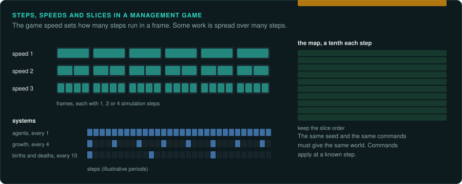

# City building and management

City builders, tycoon games and colony simulations: a world that runs on its own, slowly, and
a player who arranges it through windows, menus and clicks. They are [software over a
simulation](interaction.md#the-four-kinds). The simulation must be exact; how exact the
interface must be depends on the project's goal ([Who drives](interaction.md#the-four-kinds)).

## Reference games

| Game | Year, platform | Why it is a good example |
|---|---|---|
| Banished | 2014, Windows x64 | A complete C++ engine and game; a deterministic town simulation; a data-driven interface ([case study](../case-studies/banished.md)) |
| SimCity 2000 | 1993, DOS | Grid simulation with zoning, budgets, disasters; sub-simulations at different rates |
| Transport Tycoon Deluxe | 1995, DOS | Hand-written x86 assembly; vehicles, signals, an economy |
| RollerCoaster Tycoon 2 | 2002, Windows | Hand-written assembly; thousands of guests each with needs and thoughts |
| Caesar III | 1998, Windows | Walkers that deliver services along roads; the city's needs drawn from them |
| Theme Hospital | 1997, DOS | Patients, staff and rooms as queues |
| The Settlers II | 1996, DOS | Carriers on a road network, an economy of goods in flags and buildings |
| Dungeon Keeper | 1997, DOS | Management of creatures with needs, plus a real-time strategy layer |

## Projects to learn from

| Project | Game | Approach |
|---|---|---|
| Un-Banished | Banished | reimplementation from reverse engineering, checked bit for bit against the original |
| OpenTTD | Transport Tycoon Deluxe | began as a reimplementation from disassembly; now extended far beyond the original |
| OpenRCT2 | RollerCoaster Tycoon 2 | reimplementation from disassembly, function by function, while the game kept running |
| OpenLoco | Chris Sawyer's Locomotion | reimplementation from disassembly, the same way as OpenRCT2 |
| Julius, Augustus | Caesar III | reimplementation; Julius keeps the original's behaviour, Augustus changes it on purpose |
| CorsixTH | Theme Hospital | engine reimplementation using the original data |
| Return to the Roots | The Settlers II | reimplementation |
| KeeperFX | Dungeon Keeper | rewrite that started from a disassembly and replaced functions step by step |
| Micropolis | SimCity (1989) | source port of the released code |

OpenRCT2 and OpenLoco are useful models for method: they linked their new code into the
original program and replaced it one function at a time, so the game kept running and each
replaced function could be compared.

## The rule set

**What must be exact.** The simulation step and its order of systems; every random draw and
its order; time and the calendar in the game's own units; the economy (prices, stock, demand);
agent decisions (where a worker goes, what a guest wants). The save format, if the project
loads the original's saves.

**Where the rules live.** In code for the agents and the step, in data for buildings, goods,
needs and prices. Agents are usually state machines with timers; the jobs or tasks they take
come from queues with a fixed order. Read the data first. Many rules are numbers in tables.

**Inputs.** Mostly clicks on the interface and on the map, which become **commands** (place a
building, set a tax, assign a worker). Model the input as commands, each applied at a known
step. A recording is then a list of commands with step numbers. The same commands can drive lockstep multiplayer. Game speed is an input: it changes how many steps run per frame.

**Interface.** Large: many windows, lists, tooltips, graphs, a build menu, a map overlay. In
older games every window is code; newer games read layouts from data. Either way the interface
reads the simulation and sends commands: keep it out of the simulation's code in the port.
[Capturing the interface](../observe/ui.md) explains how to inventory it.

**Time and determinism.** A fixed step (often 10 to 60 per second) and speeds that run more
steps per frame. Sub-systems may run every *n* steps or spread their work over several steps
(a slice of the map each step). The simulation must give the same world from the same seed
and commands.

**How to verify.** Load the original's saves and continue them; compare the state after *n*
steps. Run the original and the port from one seed with the same commands and compare digests
of the world each step. Emulate the small pure parts (random generator, noise, terrain,
pathfinding, name generators) on thousands of inputs.

**Pitfalls.**
- Lists of agents or buildings iterated in creation order, with holes from removals reused.
- Sorting with an unstable sort (`qsort`): equal elements come out in an order you must copy.
- Work spread over steps ("update a tenth of the map each step"): keep the slice order.
- Numbers shown in the interface rounded differently from the numbers the simulation uses.
- Per-player state (settings, achievements, difficulty) read by the simulation: it breaks
  lockstep multiplayer ([Networking](../GAME-PATTERNS.md#networking-if-any)).

## Connections

- [Strategy](strategy.md): pathfinding, lockstep, commands.
- [RPGs](rpg.md): agents with needs and schedules.
- [Racing and sports](racing-sports.md): management modes of sports games.
