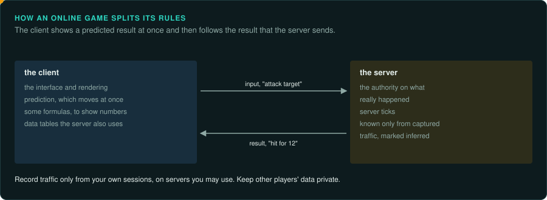

# Online games

Massively multiplayer games and other games where a server owned by the publisher holds the
world. The main rules (combat results, loot, the economy) run on a server you do not
have. They are [environments](interaction.md#the-four-kinds)
shared by many players.

Read [Legal](../LEGAL.md) before starting. Online games add limits that single-player games do
not have: terms of service you agreed to, servers whose owners forbid testing against them,
client protection that many countries' laws cover, and rights holders who have taken projects
to court.

## Reference games

| Game | Year | Why it is a good example |
|---|---|---|
| Ultima Online | 1997 | Early MMO with a documented packet protocol and long-running server emulators |
| EverQuest | 1999 | 3D MMO; zones as separate servers; a server emulator project for decades |
| Phantasy Star Online | 2000, Dreamcast and PC | A console online game still played on community servers |
| City of Heroes | 2004 | Shut down in 2012; a community server was later licensed by the publisher |
| World of Warcraft | 2004 | The best known case of server emulation, and of legal action against private servers |

## Projects to learn from

| Project | Game | Approach |
|---|---|---|
| RunUO, ServUO | Ultima Online | server emulators |
| EQEmu | EverQuest | server emulator |
| newserv | Phantasy Star Online | server emulator |
| City of Heroes: Homecoming | City of Heroes | a community server, licensed by NCSoft in 2024 |

These rebuilt the **server** from observing the client and its traffic, because the client was
available and the server was not. Their rules (combat formulas, loot tables) are often
approximations rebuilt from what players observed.

## The rule set

**What must be exact.** The protocol: message formats, encryption or obfuscation, ordering and
timing, so the original client accepts the server. Server rules can only be as exact as the
evidence: captured traffic, client-side formulas, players' documentation. Mark them *inferred*.

**Where the rules live.** The rules are split. The client has the interface, rendering, prediction and some
formulas (to show numbers before the server answers). The server has the authority. Data files
on the client often include tables the server also uses.

**Inputs.** For the client: the player's input and the server's messages. For a server: the
clients' messages. Record traffic only from your own sessions, on servers you are allowed to
use.

**Interface.** As large as an RPG's, plus chat, groups, trading, mail and auction houses.

**Time and determinism.** Server ticks; the client interpolates and predicts. A port is exact
when it follows the protocol and gives the server's answers.

**How to verify.** Against captured traffic from your own sessions (while the official service
exists and allows it), and against the client: does it accept every message, and show the
same thing?

**Pitfalls.**
- Testing against a live service without permission breaks its terms. It can lead to bans or legal action.
- Anti-cheat and protection in the client: bypassing it may be illegal. It is not needed to study a game you run offline.
- Traffic that contains other players' data: keep it private. Do not publish it.

## Connections

- [RPGs](rpg.md): character rules, items, quests.
- [Strategy](strategy.md): lockstep compared with client-server.
- [First-person](first-person.md): client prediction and server authority in shooters.
