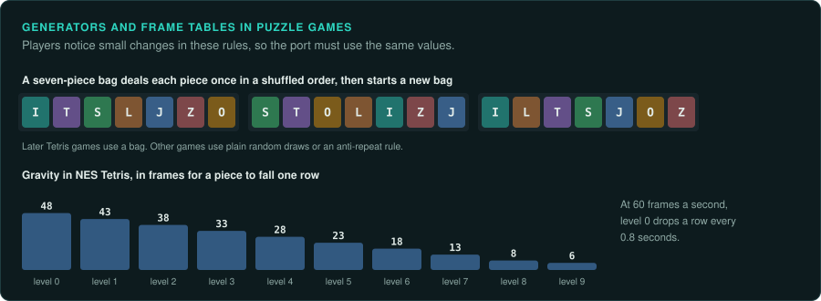

# Puzzle, board and card games

Falling-block and logic puzzles, board games, card games, and the small games that shipped
with operating systems. Board and card games are [turns and
choices](interaction.md#the-four-kinds); action puzzles (Tetris, Lemmings) are [streams with
controls](interaction.md#the-four-kinds). They are often small, so they make good first
projects for practising the whole method.

## Reference games

| Game | Year, platform | Why it is a good example |
|---|---|---|
| Tetris | 1989, NES and Game Boy | A random piece generator, gravity tables per level, input delays, all well documented |
| Lemmings | 1991, Amiga and DOS | Each lemming a small state machine on a pixel-exact terrain mask |
| The Incredible Machine | 1993, DOS | A small physics engine and parts with rules |
| Microsoft Solitaire and FreeCell | 1990 onward, Windows | Shuffles from a seed: FreeCell's numbered deals come from the C runtime's `rand` |
| Chessmaster | 1986 onward | A search engine with an opening book, a board and a rules core |
| Minesweeper | 1990 onward, Windows | Board generation from a random seed, the first-click rule |

## Projects to learn from

Few public reimplementations exist for this family: most games are small enough to rebuild
from observation, and many clones copy only the idea. Two kinds of work are useful:

| Work | What it shows |
|---|---|
| Disassemblies of NES and Game Boy Tetris by the speedrunning community | Exact piece randomisers, gravity, entry delays; the rules that competitive play depends on |
| Write-ups of FreeCell deal numbers | How a shuffle from the C runtime's `rand` makes numbered deals reproducible |

## The rule set

**What must be exact.** The random generator and how it picks pieces, cards or mines (with any
"bag" or anti-repeat rule); the rules of legal moves; scoring; timers and delays in frames.

**Where the rules live.** Almost all in code, and small. Levels and puzzles are data. Card
deals and boards come from the random generator, often the C runtime's `rand` seeded with a
number shown to the player (a deal number) or with the clock.

**Inputs.** Keys or clicks, sometimes with repeat delays (auto-shift in Tetris) that the port must
copy. Record per frame for action puzzles, per move for board and card games.

**Interface.** Simple. Players know where everything is, so keep every position exact. Animations
(a card flying, a line clearing) may block input for a number of frames. Port those frame counts.

**Time and determinism.** Turn-based games wait. Action puzzles run at the console's or the
screen's refresh rate; gravity is a table of frames per row.

**How to verify.** Emulate the generator and compare thousands of deals or pieces from many
seeds. Play recorded games move by move and compare the board.

**Pitfalls.**
- A generator seeded from the clock: record the seed, or make it an input.
- Animation frames that delay input (the "entry delay"), easy to miss without frame stepping.
- Scores that overflow or cap at the number of digits shown.

## Connections

- [Arcade action](arcade-action.md): frame-exact input for action puzzles.
- [Adventure](adventure.md): logic that waits for the player.
- [Random number generators](../GAME-PATTERNS.md#random-number-generators): most of what
  must be exact in these games.
