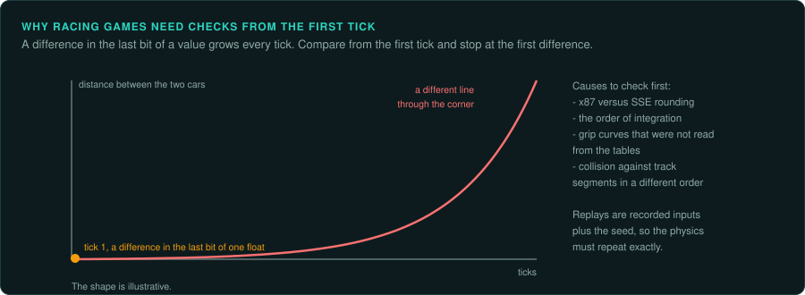

# Racing and sports

Driving games and simulations of sports: the player controls a car or a team, the game runs
physics and AI opponents. They are [streams with controls](interaction.md#the-four-kinds),
with a large share of simulation (opponents, a championship, transfers in a football game).

## Reference games

| Game | Year, platform | Why it is a good example |
|---|---|---|
| Stunts (4D Sports Driving) | 1990, DOS | 3D racing with a track editor and replays; fixed-point physics |
| Carmageddon | 1997, DOS and Windows | Vehicle physics with damage, pedestrians, a debug-symbol demo build |
| Need for Speed | 1994, DOS | Track and car data formats, AI drivers on racing lines |
| Sensible World of Soccer | 1994, Amiga and DOS | Ball physics, player AI, a huge career database |
| Super Mario Kart | 1992, SNES | Mode 7 tracks, item random draws weighted by position |

## Projects to learn from

| Project | Game | Approach |
|---|---|---|
| Restunts | Stunts | reverse engineering of the DOS program toward a reimplementation |
| dethrace | Carmageddon | reimplementation from reverse engineering, helped by Watcom debug symbols for an earlier internal build, found on the Splat Pack CD |
| SWOS 96/97 port (by zlatkok) | Sensible World of Soccer 96/97 | reimplementation from disassembly |
| OpenNFS | Need for Speed 1 to 5 | new engine that reads the original track and car data; NFS 2 and 3 load most completely |

## The rule set

**What must be exact.** The physics step: integration order, friction and grip curves (often
tables), collision response, and the tick rate. AI drivers and players: their decisions per
tick and their random draws. The race state: positions, laps, timing to the tick.

**Where the rules live.** In code (physics, AI) and in data: car parameters, track geometry,
racing lines for the AI, team and player databases in sports games. Grip curves and gear
ratios are usually tables: read them, do not refit them.

**Inputs.** Analogue steering and throttle (joystick, wheel, mouse) or digital keys with a
ramp the game applies. Record the value the game reads each tick, after its own filtering. Also find the filtering (dead zones, ramps, calibration).

**Interface.** Speedometers, position and lap counters, mini-maps are drawn by the game. Sports
games have large management interfaces (teams, transfers, tactics) that behave like
[management games](management.md).

**Time and determinism.** A fixed physics step, sometimes several per drawn frame. Replays in
most of these games are recorded inputs plus the seed, so the physics must repeat exactly.

**How to verify.** Record a lap in the original (input per tick, or the game's own replay
file) and play it in the port; compare the car's position, speed and rotation each tick. Small
differences grow fast in physics: compare from the first tick. Stop at the first difference.

**Pitfalls.**
- Floating-point physics on x87 (32-bit games) rounds differently from SSE: see
  [ABI](../ABI.md#floating-point).
- Collision against the track in a fixed order of segments.
- "Rubber banding": AI speed that depends on the player's position.
- Time trials and championships store the best times in files. Treat those files as part of the save state.

## Connections

- [Vehicle and space simulations](vehicle-sims.md): physics, 3D, fixed point.
- [Arcade action](arcade-action.md): frame loops and per-frame input.
- [Management](management.md): career modes and databases.
