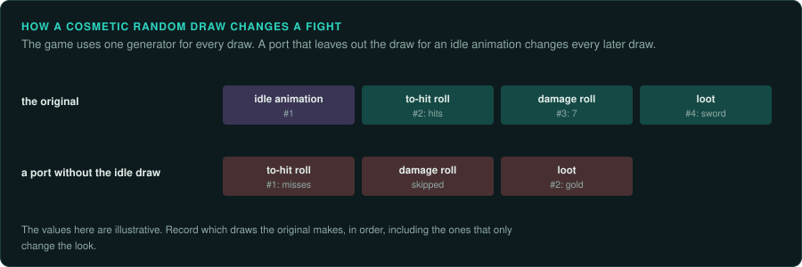

# Role-playing games

Games where the player builds characters and explores a world: computer RPGs, dungeon
crawlers, roguelikes and Japanese RPGs. They are [environments](interaction.md#the-four-kinds)
the player moves through, often with [turn-based](interaction.md#the-four-kinds) battles,
dialogue that waits for choices, and a large world state.

## Reference games

| Game | Year, platform | Why it is a good example |
|---|---|---|
| Dungeon Master | 1987, Atari ST | Real-time dungeon crawling on a grid; a world full of moving objects |
| Ultima VII | 1992, DOS | A world where every person follows a schedule; its own script byte code |
| Ultima Underworld | 1992, DOS | First-person 3D dungeon before Doom, with physics and conversations |
| The Elder Scrolls II: Daggerfall | 1996, DOS | A huge generated world, quests from templates |
| Diablo | 1996, Windows | Real-time action RPG; random dungeons, item generation, a debug build whose symbols helped Devilution |
| Fallout and Fallout 2 | 1997 and 1998, Windows | Turn-based combat, dialogue scripts in byte code, a large save state |
| Baldur's Gate | 1998, Windows | Infinity Engine: real-time with pause, D&D rules as tables and scripts |
| Morrowind | 2002, Windows | An open world, a script language for quests, plugins that can change any part of the game |
| NetHack | 1987 onward, many | Roguelike with released source; the reference for turn-based dungeon rules |

## Projects to learn from

| Project | Game | Approach |
|---|---|---|
| DevilutionX (from Devilution) | Diablo | Devilution reconstructed the source with help from debug symbols; DevilutionX ports it |
| Fallout 2 Community Edition | Fallout 2 | reimplementation from reverse engineering |
| GemRB | Baldur's Gate and other Infinity Engine games | engine reimplementation using the original data |
| Exult | Ultima VII | engine reimplementation, including the script interpreter |
| Underworld Adventures | Ultima Underworld | engine reimplementation |
| OpenMW | Morrowind | engine reimplementation, compatible with the original data and plugins |
| Daggerfall Unity | Daggerfall | engine reimplementation in Unity |
| OpenEnroth | Might and Magic VI to VIII | reimplementation |
| ReDMCSB (by Christophe Fontanel) | Dungeon Master, Chaos Strikes Back | source code reconstructed from the binaries of many versions |
| pokered, pokecrystal (pret) | Pokémon Red, Crystal | matching decompilations |

## The rule set

**What must be exact.** Character rules: attributes, levels, experience curves, skill checks,
hit and damage formulas, every random draw and its order. Item and monster generation.
Dialogue and quest state: which flags a conversation reads and sets. Turn order in battle.

**Where the rules live.** Much is in data: tables of classes, items, spells, monsters; maps with
objects and triggers; and **scripts**, often in a byte code the game interprets (Ultima VII's
usecode, Fallout's scripts, Infinity Engine's BCS). Once the interpreter is ported, the port runs
the game's own scripts. The core formulas (to-hit, damage, experience) are in code.

**Inputs.** Movement (keys or clicks to move), commands (talk, take, use, cast), menu and
dialogue choices. A turn-based battle takes one command per turn; real-time games read input
per frame. For recordings, store commands with their step or turn.

**Interface.** Large and custom: inventories with drag and drop, character sheets, spell books,
dialogue windows, maps and journals. The interface often holds rules too (what can be dropped
where, stack sizes, encumbrance). Inventory every screen ([Capturing the
interface](../observe/ui.md)).

**Time and determinism.** Mixed: real time while exploring, turns in battle, a game clock with
days and schedules. Things away from the player may be simulated in less detail or frozen.

**How to verify.** Save in the original, load in the port, and compare the whole state. Run
battles from a saved state and the same commands. Emulate formulas and generators (loot,
dungeons) on many seeds. Script conversations through every branch and compare the flags.

**Pitfalls.**
- Scripts that depend on the order objects are stored in a map file.
- Global flags shared between quests, set in unexpected places.
- Random draws spent on cosmetic things (an idle animation) that shift every later draw.
- Saves that store only part of the world and regenerate the rest from a seed.

## Connections

- [Adventure](adventure.md): script interpreters and dialogue.
- [Strategy](strategy.md): turn-based battles and rule tables.
- [First-person](first-person.md): 3D exploration and triggers.
- [Management](management.md): schedules and needs of people in the world.
