# Strategy: real time, turns and tactics

Games where the player commands many units against opponents: real-time strategy (RTS),
turn-based empire games (4X), and squad tactics. Real-time strategy is [software over a
simulation](interaction.md#the-four-kinds) that must stay identical on every player's machine;
turn-based strategy is [turns and choices](interaction.md#the-four-kinds). Many games mix them
(a real-time world map with turn-based battles).

## Reference games

| Game | Year, platform | Why it is a good example |
|---|---|---|
| Dune II | 1992, DOS | The first modern RTS: units, harvesting, a sidebar to build from |
| Command & Conquer | 1995, DOS | Lockstep multiplayer, unit tables in INI files |
| Warcraft II | 1995, DOS | Tile-based maps, lockstep over IPX and modem |
| StarCraft | 1998, Windows | Exact lockstep, replays as commands, unit AI and pathfinding studied in depth |
| Civilization | 1991, DOS | Turn-based empire on a grid; AI players; a world generated from a seed |
| UFO: Enemy Unknown (X-COM) | 1994, DOS | A real-time world map and turn-based battles; time units, line of fire |
| Heroes of Might and Magic II and III | 1996 and 1999 | Adventure map in turns, battles on a hex grid, large rule tables |

## Projects to learn from

| Project | Game | Approach |
|---|---|---|
| OpenDUNE | Dune II | reimplementation from disassembly, keeping the original's behaviour and bugs |
| OpenRA | Command & Conquer, Red Alert, Dune 2000 | new engine using the original data; changes the rules on purpose |
| Wargus (on Stratagus) | Warcraft II | the original data on a general RTS engine |
| OpenBW | StarCraft: Brood War | reimplementation of the simulation, exact enough to play replays |
| OpenXcom | UFO: Enemy Unknown, Terror from the Deep | reimplementation |
| OpenApoc | X-COM: Apocalypse | reimplementation |
| fheroes2 | Heroes of Might and Magic II | reimplementation |
| VCMI | Heroes of Might and Magic III | engine reimplementation using the original data |
| JA2 Stracciatella | Jagged Alliance 2 | source port |

Electronic Arts released the source of Command & Conquer and Red Alert in 2020. Where source
exists, read it before reverse engineering.

## The rule set

**What must be exact.** For real time: the simulation tick, the order units are updated, every
random draw, pathfinding and its tie-breaks, combat formulas, and integer rounding. Lockstep
multiplayer and replays fail on the first difference. For turns: the rules of each action,
the order of resolution (who moves first, when effects apply), the AI's choices and draws.

**Where the rules live.** Unit, weapon and building stats in data (tables, INI files, binary
records). Behaviour in code: unit state machines, the AI, pathfinding. Missions in scripts or
trigger tables (when *x* happens, do *y*). Generated maps from a seed.

**Inputs.** Commands: select, move, attack, build, each with targets. In lockstep games the
commands are what travels over the network and what a replay stores, each tagged with the tick
it takes effect. Find that command format early. The port can use it as its input record.
Selections and the camera are not commands in most games; check yours.

**Interface.** Sidebars, minimaps, unit panels, the selection box, and menus. Players rely on
hotkeys and grouping (Ctrl + number), so port them exactly. Turn-based games have dense screens
of numbers and lists.

**Time and determinism.** A fixed tick for real time, with a game speed that changes ticks per
second. Turns for turn-based games, with animations that do not change the state. Lockstep
requires that nothing per-player (the local clock, settings, the camera) reaches the
simulation.

**How to verify.** Replays give the best evidence. If the original stores replays as commands,
play them in the port and compare the state at every tick. Without replays, record commands
from the original running under a debugger, or script both. Pathfinding: emulate the original
finder on many start and end points and compare every path.

**Pitfalls.**
- Units updated in an order that changes when units are created and destroyed.
- Pathfinding ties broken by the order of the open list.
- Fog of war and visibility updated on a different schedule from movement.
- AI players that read state the human player cannot see, or that use their own random
  generator.

## Connections

- [Management](management.md): simulation steps, commands, saves.
- [RPGs](rpg.md): rule tables, turn-based battles.
- [Online games](online.md): lockstep against client-server.
