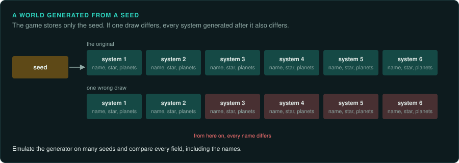

# Vehicle and space simulations

Flight simulators, space combat and space trading games: the player flies something through a
large world simulated in 3D. They mix a [stream with controls](interaction.md#the-four-kinds)
(combat, landing) with an [environment](interaction.md#the-four-kinds) the player moves
through (a galaxy, a theatre of war), and often with docked screens that wait for the player
(trading, missions, ship fitting).

## Reference games

| Game | Year, platform | Why it is a good example |
|---|---|---|
| Elite | 1984, BBC Micro | A galaxy of eight times 256 systems generated from one seed with a small generator |
| Frontier: Elite II | 1993, DOS | Real orbits, a whole galaxy generated, a software 3D engine in overlays ([case study](../case-studies/frontier.md)) |
| Wing Commander | 1990, DOS | Scaled sprite ships, a branching campaign, cut scenes in the engine |
| X-Wing | 1993, DOS | Flat-shaded 3D, mission scripts with goals and triggers |
| Falcon 3.0 | 1991, DOS | A full flight model and a dynamic campaign |
| Descent | 1995, DOS | Six degrees of freedom inside portal-connected cubes |

## Projects to learn from

| Project | Game | Approach |
|---|---|---|
| Elite, fully documented (bbcelite.com, by Mark Moxon) | Elite (BBC Micro and others) | the original source code, commented line by line, with articles on how each part works |
| JJFFE | Frontier: First Encounters | reverse engineered from the DOS program into portable code |
| GLFrontier (by Tom Morton) | Frontier: Elite II | the Amiga program's 68000 code translated to C |
| fs2_open | FreeSpace 2 | source port |
| DXX-Rebirth | Descent 1 and 2 | source port |

## The rule set

**What must be exact.** The maths core: fixed-point or float formats, multiply and divide
helpers, square roots, trigonometry tables, matrix and vector routines, and 64-bit positions
where the world is large. Orbits and physics integration (the step and its order). Generation
of the world from a seed: one wrong draw changes the whole galaxy. Players remember the names of the systems, so a wrong name is noticed.

**Where the rules live.** Mostly in code, often hand-written assembly for the maths. Ships,
weapons and goods are tables. Mission scripts and campaign trees are data. A generated world is
stored only as a seed, so the generator code must be exact.

**Inputs.** Joystick axes, mouse flight, keyboard. Throttle and view controls. Time
acceleration is an input that changes how many steps a frame runs: record it.

**Interface.** Cockpit instruments, radar and scanners are drawn by the game, often by the
same 3D engine. Docked screens (markets, ship fitting) are software that waits. Star maps are
3D views with their own picking.

**Time and determinism.** A fixed step multiplied by time acceleration. Far objects may be
updated less often than near ones. Orbits are often computed in closed form from time, not
integrated. The positions then depend on the clock's format and precision.

**How to verify.** Emulate the maths routines on millions of random inputs and compare bit for
bit. These routines are small and pure. Generate the galaxy or star systems from many seeds and compare
every field. Compare frames of the 3D view from the same state.

**Pitfalls.**
- Routines that pass values in registers or register pairs rather than by the calling
  convention: emulate with the exact register set ([DOS games](../DOS.md)).
- Overlays: code loaded on demand into the same addresses. Know which overlay is loaded when
  you read an address.
- Custom float formats in software (16-bit mantissa plus exponent), with their own rounding.
- Perspective and clipping that differ by screen size.

## Connections

- [First-person and 3D action](first-person.md): software rendering, fixed point.
- [Racing and sports](racing-sports.md): physics and flight-model tables.
- [RPGs](rpg.md) and [Management](management.md): trading and economies that run while unseen.
