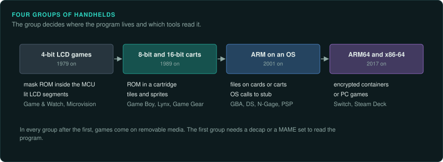

# Handhelds

This section covers the handheld game machines, from the mask-ROM LCD games of 1979 to the PC
handhelds of today. Each page covers one family. The home consoles are in
[Console games](../consoles/README.md). The arcade boards are in [Arcade](../arcade/README.md).

The handhelds fall into four groups. In the first, a 4-bit microcontroller with a segment LCD
holds the program inside the CPU chip. The second uses 8-bit cartridge systems. The third runs
ARM code on an operating system. The fourth uses modern ARM64 and x86-64 machines. In every group
after the first, games come on removable media.

## Across all handhelds

- [Handheld practices](practices.md): battery saves, real-time clocks in save files, link
  cables and infrared, sensors, LCD behaviour and the outside inputs a test records.

## Handhelds by family

- [LCD games and Game & Watch](lcd-games.md): Game & Watch, Tiger LCD games and the R-Zone,
  Elektronika, and the Microvision. Mask ROM in the MCU, MAME sets and lit segments.
- [Game Boy family](game-boy.md): the Game Boy, Pocket, Light, Color, Super Game Boy and Game
  Boy Advance. CGB modes, SGB timing, GhidraBoy, SameBoy and pret's matching builds.
- [Sega, Atari and SNK handhelds](sega-atari-snk.md): the Game Gear, Lynx and Neo Geo Pocket.
- [WonderSwan](wonderswan.md): the WonderSwan, Color and SwanCrystal on the V30MZ.
- [Virtual Boy and Pokémon mini](nintendo-oddities.md): the V810 extension, the S1C88 and
  PokeMini traces.
- [Game.com](tiger-game-com.md): Tiger's Game.com and Pocket Pro on the SM8521.
- [Nintendo DS and 3DS](ds-and-3ds.md): the ARM9 and ARM7 split, NTRGhidra, encrypted 3DS
  containers and Azahar.
- [PSP and PS Vita](psp-and-vita.md): the Allegrex extension, encrypted executables, PPSSPP
  and the Vita loaders.
- [Switch family](switch-family.md): the Switch, Switch Lite and Switch 2. NSO in NCA, keys,
  Game-Key Cards and emulator status.
- [ARM-OS handhelds](arm-os-handhelds.md): the N-Gage, Gizmondo, GP32 and GP2X, with OS stubs
  for Unicorn.
- [PC handhelds](pc-handhelds.md): the Steam Deck and other PC handhelds on the PE path.
- [Phones](phones.md): J2ME and BREW games and the Zeebo.

## How handheld work differs from console work

| Topic | Home consoles | Handhelds |
|---|---|---|
| The program | A ROM or a disc image | The same for cartridge handhelds; mask ROM inside the CPU on LCD games; files on an OS from the N-Gage onward |
| The CPU | Mostly CPUs with a Ghidra module | Several with no built-in Ghidra module and no Unicorn backend, such as the SM5xx, TMS1100, SM83, TLCS-900/H, S1C88 and SM8521 |
| The output | A frame on a TV | Lit LCD segments on LCD games; small passive or TFT screens; up to 120 Hz with VRR on the Switch 2 |
| Saves | Battery RAM, memory cards | Battery RAM, often with a real-time clock whose state is stored in the save |
| Outside inputs | Controllers | Controllers plus link cables, infrared, shock and touch sensors, GPS and cameras |
