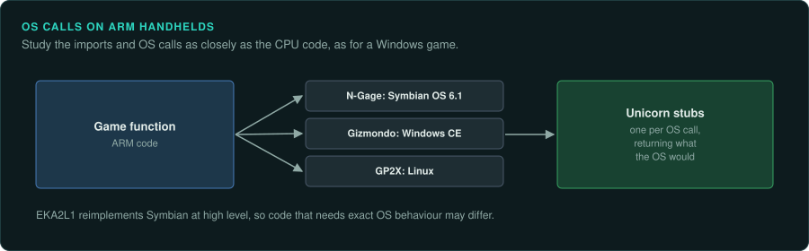

# ARM-OS handhelds

The N-Gage, Gizmondo, GP32 and GP2X run ARM code on an operating system. **Study a game's
imports and OS calls as closely as its CPU code**, as for a Windows PE game. Ghidra's ARM module covers all four devices. Unicorn's ARM support can
run their functions
([Ghidra Processors on GitHub](https://github.com/NationalSecurityAgency/ghidra/tree/master/Ghidra/Processors);
[Unicorn Engine](https://www.unicorn-engine.org/)).

## The devices

| Device | Years | CPU and clock | Media and format | Ghidra support | Emulator with a debugger |
|---|---|---|---|---|---|
| Nokia N-Gage, QD | 7 October 2003 to 26 November 2005 (West) | ARM920T at 104 MHz | MMC cards; Symbian OS 6.1, Series 60 | ARM built in | EKA2L1 (GDB stub not confirmed) |
| Gizmondo | 19 March 2005 to 6 February 2006 | Samsung S3C2440 (ARM9) at 400 MHz | SD or MMC; Windows CE | ARM built in | None sourced |
| GP32 | 23 November 2001 (KR) | Samsung S3C2400X01 (ARM920T), 20 to 133 MHz | SmartMedia, 2 to 128 MB | ARM built in | Not confirmed |
| GP2X, F-200 | 10 November 2005 and 30 October 2007 (KR) | MMSP2 MP2520F: 200 MHz ARM920T host, 200 MHz ARM940T coprocessor | SD (SDHC on the F-200 with firmware 4.0 or later); Linux | ARM built in | Not confirmed |

## Nokia N-Gage

### Hardware

Nokia's N-Gage came out on 7 October 2003. It was discontinued in Western markets on 26 November
2005. It uses an ARM920T at 104 MHz, a 2.1-inch 176 by 208 TFT with 4,096 colours, and Symbian
OS 6.1 with Series 60 (1st Edition). Games came on MultiMediaCard (MMC) cards.

The N-Gage QD shipped on 26 May 2004 in Europe, Africa and Asia-Pacific. It reached the Americas
in June 2004. It has the same S60 software, without MP3, FM radio or USB. N-Gage 2.0 was a
service on Nokia smartphones from April 2008 to October 2009. Pirated N-Gage games ran on other
phones of the time such as the Nokia 3650
([Wikipedia: N-Gage](https://en.wikipedia.org/wiki/N-Gage_(device))).

### Tools

EKA2L1 is a C++17 Symbian OS and N-Gage emulator. It emulates the Symbian kernel. It
reimplements the app servers and libraries. It supports nearly all official N-Gage and N-Gage
2.0 libraries. It also supports most game libraries from S60v1 to Symbian Belle. Builds exist
for Windows, macOS, Linux and Android ([EKA2L1 GitHub](https://github.com/EKA2L1/EKA2L1)).
Whether it has a GDB stub is not confirmed.

### For an exact reimplementation

EKA2L1 reimplements the OS at high level. Code that depends on exact OS behaviour may differ
from a real N-Gage. To run a single function under Unicorn, write stubs for the Symbian calls it
makes.

## Gizmondo

### Hardware

The Gizmondo came out in the UK on 19 March 2005 and in the US on 22 October 2005. It was
discontinued on 6 February 2006. It uses a Samsung S3C2440 (ARM9) at 400 MHz and an Nvidia
GoForce 3D 4500 GPU. It has 64 MB of SDRAM, 1.2 MB of graphics SRAM and 64 MB of ROM. Its
2.8-inch 320 by 240 TFT runs Windows CE. Games come on SD or MMC. It also has GPS, GPRS and a
camera. Fourteen games were released. Only eight reached the US
([Wikipedia: Gizmondo](https://en.wikipedia.org/wiki/Gizmondo)).

### Tools

No emulator is known for it.

### For an exact reimplementation

To run a single function under Unicorn, write stubs for the Windows CE calls it makes. GPS, GPRS
and the camera are outside inputs ([Handheld practices](practices.md#sensors-and-other-inputs)).

## GP32

### Hardware

Game Park's GP32 came out in South Korea on 23 November 2001. Its Samsung S3C2400X01 (ARM920T)
runs from 20 MHz up to 133 MHz. Some units reach 166 MHz or more. It has 8 MB of 16-bit SDRAM, a
3.5-inch 320 by 240 TFT with 16-bit colour, and SmartMedia cards of 2 to 128 MB at 3.3 V. A
free C SDK was available. Game Park's firmware launches programs. Alternative firmware removed
the need for the "Free Launcher" ([Wikipedia: GP32](https://en.wikipedia.org/wiki/GP32)).

### Tools

The GP32's executable formats are not confirmed. Neither is any emulator with a debugger.

## GP2X

### Hardware

GamePark Holdings' GP2X came out in South Korea on 10 November 2005. The F-200 followed on 30
October 2007. Its successors were the Wiz (announced 26 August 2008) and the Caanoo. The
MagicEyes MMSP2 MP2520F pairs a 200 MHz ARM920T host with a 200 MHz ARM940T coprocessor. It has
64 MB of SDRAM and 64 MB of NAND. It takes SD cards, with SDHC on the F-200 with firmware 4.0 or
later. It runs Linux on a 3.5-inch 320 by 240 screen with 65,536 colours. The F-200 added a
touchscreen and a d-pad ([Wikipedia: GP2X](https://en.wikipedia.org/wiki/GP2X)).

### Tools

No emulator with a debugger is confirmed.
