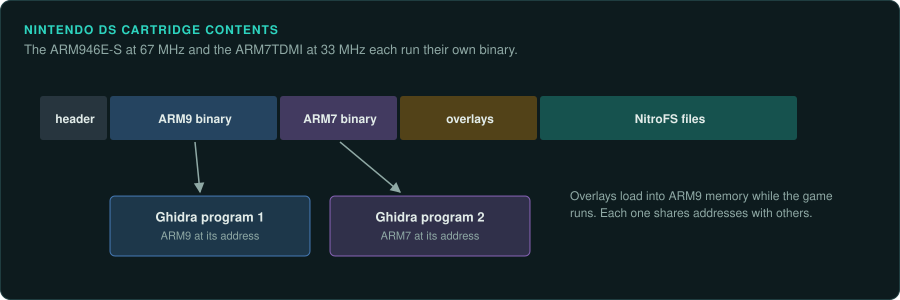
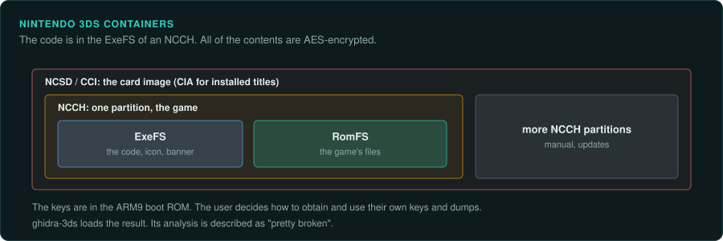
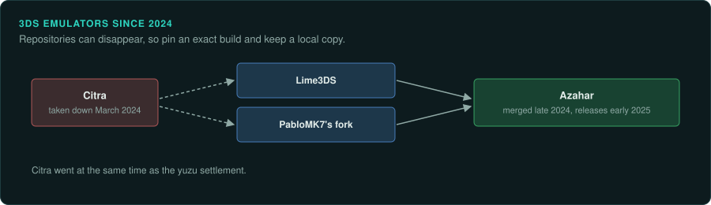

# Nintendo DS and 3DS

The DS and 3DS run ARM code from cartridges. The DS splits a game between an ARM9 and an ARM7
binary. 3DS games store their code in AES-encrypted containers. Before any analysis, you need a
decrypted dump and the right Ghidra loader.

## The devices

| Device | Years | CPU and clock | Media and format | Ghidra support | Emulator with a debugger |
|---|---|---|---|---|---|
| Nintendo DS, DSi | 21 November 2004 | ARM946E-S at 67 MHz and ARM7TDMI at 33 MHz | ARM9 and ARM7 binaries, overlays, NitroFS | [NTRGhidra](https://github.com/pedro-javierf/NTRGhidra) | melonDS, DeSmuME, no$gba |
| Nintendo 3DS | 26 February 2011 (JP) | ARM11 MPCore, 2 cores at 268 MHz; ARM9 for security | NCSD/CCI, CIA, NCCH with ExeFS; 3DSX homebrew | [ghidra-3ds](https://github.com/Stary2001/ghidra-3ds), [ghidra-3dsx-loader](https://github.com/danylokos/ghidra-3dsx-loader) | Azahar |

## Nintendo DS and DSi

### Hardware

The DS has an ARM946E-S at 67 MHz and an ARM7TDMI at 33 MHz. A game ships ARM9 and ARM7
binaries, overlays and a NitroFS file system
([Nintendo DS](https://en.wikipedia.org/wiki/Nintendo_DS);
[GBATEK](https://problemkaputt.de/gbatek.htm)).

### Tools

[NTRGhidra](https://github.com/pedro-javierf/NTRGhidra) loads DS binaries. Load the ARM9 and the
ARM7 code as separate programs. Ghidra builds in the ARM7 (ARM and Thumb). melonDS, DeSmuME and
no$gba run the games. GBATEK is the community document for the GBA and DS.

### Projects to learn from

pret's pokeplatinum and pokeheartgold are active C decompilations. An SDL3 port fork is in
progress ([gittrend: pokeplatinum](https://gittrend.io/repo/pret/pokeplatinum);
[pokeplatinum-portable](https://github.com/arcanite24/pokeplatinum-portable)).

## Nintendo 3DS

### Hardware

The 3DS has an ARM11 MPCore with 2 cores at 268 MHz. An ARM9 handles security. Formats are
NCSD/CCI, CIA and NCCH with ExeFS. Homebrew uses 3DSX
([Nintendo 3DS](https://en.wikipedia.org/wiki/Nintendo_3DS); [3dbrew](https://www.3dbrew.org/)).

### Keys and encrypted executables

3DS content is AES-encrypted, with keys in the ARM9 boot ROM ([3dbrew](https://www.3dbrew.org/)).
The user decides how to obtain and use their own keys and dumps.

### Tools

[ghidra-3ds](https://github.com/Stary2001/ghidra-3ds) loads 3DS files. Its analysis is
described as "pretty broken".
[ghidra-3dsx-loader](https://github.com/danylokos/ghidra-3dsx-loader) loads 3DSX homebrew.
Azahar runs the games.

Citra was taken down in March 2024, at the same time as the yuzu settlement
([Wikipedia: Citra](https://en.wikipedia.org/wiki/Citra_(emulator));
[Switch family](switch-family.md#keys-and-the-yuzu-settlement)). Lime3DS and PabloMK7's fork
merged into Azahar in late 2024, with first releases in early 2025
([Azahar](https://azahar-emu.org/); [tech-insider](https://tech-insider.org/?p=19264)).
Repositories can disappear, so pin an exact emulator build and keep a local copy.

### Projects to learn from

No completed 3DS matching decompilation is known.
