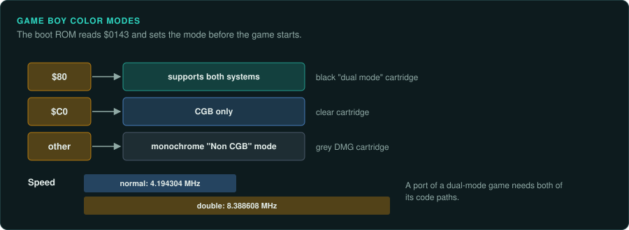
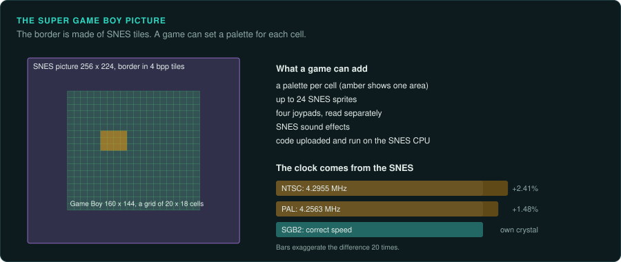
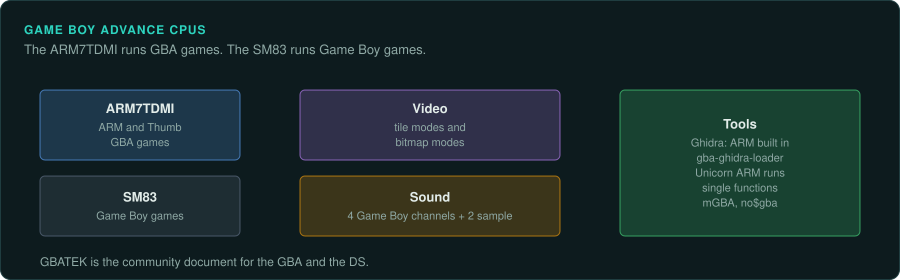

# Game Boy family

The Game Boy family has the most mature tool chain of any handheld. pret's builds produce ROMs
with the same hashes as the originals. Few other platforms have projects like them. The SM83
has no built-in Ghidra module and no Unicorn backend, so take ground truth from SameBoy or
another emulator. Super Game Boy games can also contain SNES code. Their timing depends on the
region.

## The devices

| Device | Years | CPU and clock | Media and format | Ghidra support | Emulator with a debugger |
|---|---|---|---|---|---|
| Game Boy (DMG) | 1989 | Sharp SM83 (similar to Z80 and 8080) | Cartridge, banked by a mapper | [GhidraBoy](https://github.com/Gekkio/GhidraBoy) (archived), [ghidra-sm83](https://github.com/minorum/ghidra-sm83) fork | SameBoy, Emulicious, BGB, Mesen 2 |
| Game Boy Pocket and Light (MGB) | 1996 and 1998 | Sharp SM83 | Cartridge | As the DMG | SameBoy |
| Game Boy Color (CGB) | 21 October 1998 (JP) | Sharp SM83 at 4.194304 MHz; 8.388608 MHz in double speed | Cartridge; grey, black "dual mode" and clear CGB-only carts | As the DMG | SameBoy, Emulicious |
| Super Game Boy, SGB2 | Not covered here | SM83 in a SNES cartridge, with SNES-side 65C816 code | SNES cartridge running Game Boy carts | As the DMG; SNES side through 65C816 extensions | SameBoy (high level) |
| Game Boy Advance | 2001 | ARM7TDMI plus SM83 | Cartridge | ARM built in; [gba-ghidra-loader](https://github.com/pudii/gba-ghidra-loader) | mGBA, no$gba |

Community documents are Pan Docs for the Game Boy and GBATEK for the GBA and DS.

## Game Boy

### Hardware

The Sharp SM83 is similar to the Z80 and the 8080. The video has tiles, sprites, one background
and a window. Sound has four channels. Cartridges hold more than the CPU can address, so a
mapper chip switches banks. Name functions as `bank:address`
([Console platforms](../consoles/platforms.md)).

SameBoy treats the **Game Boy Pocket (1996)** and **Game Boy Light (1998)** as one model, MGB,
separate from the DMG ([SameBoy features](https://sameboy.github.io/features/)). Release dates
and hardware differences for the Pocket and Light are not covered here.

### Tools

GhidraBoy (Gekkio, Apache-2.0) adds SM83 SLEIGH support and a Game Boy ROM loader. The loader
handles banked and unbanked ROMs and boot ROMs. It sets up memory blocks, hardware register
symbols and header data types. It is marked "very experimental" with no compatibility
guarantees. It supports Ghidra 11.1 to 11.4.2. Its decompiler output is hard to read around
rotates and `JP HL` jump tables
([GhidraBoy README](https://raw.githubusercontent.com/Gekkio/GhidraBoy/main/README.markdown)).
The repository is archived. [minorum/ghidra-sm83](https://github.com/minorum/ghidra-sm83) is a
fork ([Gekkio/GhidraBoy](https://github.com/Gekkio/GhidraBoy)).
[yaxpeax-sm83](https://github.com/iximeow/yaxpeax-sm83) is a Rust SM83 disassembler.

Unicorn has no SM83 backend, so take ground truth from SameBoy or another emulator
([Unicorn Engine](https://www.unicorn-engine.org/)).

SameBoy emulates the DMG, MGB, CGB, the AGB in GBC mode, and the SGB and SGB2 at high level. It
passes all of mooneye-gb's test suite plus Wilbert Pol's and blargg's tests. Its LCD timing is
T-cycle accurate. It claims over 99.9% success across about 2,800 games. Its debugger has
conditional breakpoints and watchpoints, call stack tracing, a disassembler with symbol
support, an expression evaluator and back-stepping. It emulates the RTC. Link cable and
infrared work only in its macOS (Cocoa) front end
([SameBoy features](https://sameboy.github.io/features/)).

Emulicious covers the Game Boy, Game Boy Color, Master System, Game Gear and MSX. It has a
profiler, tracer, memory tracer, source-level debugging and a VS Code debug adapter. Its
accuracy is checked against the gbdev test ROM corpus (GBEmulatorShootout)
([Emulicious](https://emulicious.net/)). BGB also has a good debugger. Mesen 2 adds the Game
Boy to Mesen. Gambatte and mGBA debugger features are not covered here.

## Game Boy Color

### Hardware

The Game Boy Color came out in Japan on 21 October 1998. It reached North America on 18 November
1998 and Europe on 23 November 1998. Its Sharp SM83 runs at 4.194304 MHz. A double-speed mode
runs it at 8.388608 MHz. It has 32 KiB of WRAM and 16 KiB of VRAM. The 160 by 144 reflective
TFT has no backlight. It shows up to 56 of 32,768 colours at once. The infrared port runs up to
9.5 kbit/s at under 2 m within 45°. Few games used it. The GBA has no infrared port. The GBC is
slightly thicker and taller than the Pocket
([Wikipedia: Game Boy Color](https://en.wikipedia.org/wiki/Game_Boy_Color)). Pan Docs gives the
speeds in M-cycles as about 1.05 MHz and 2.10 MHz
([Pan Docs: CGB Registers](https://gbdev.io/pandocs/CGB_Registers.html)).

Grey cartridges are DMG games shown with a limited palette. Black "dual mode" carts run on both
systems. Clear carts are CGB-only
([Wikipedia: Game Boy Color](https://en.wikipedia.org/wiki/Game_Boy_Color)).

### The CGB registers

These registers control the CGB features a game uses
([Pan Docs: CGB Registers](https://gbdev.io/pandocs/CGB_Registers.html)).

| Register | Address | What it does |
|---|---|---|
| Header byte | $0143 | `$80`: supports both systems. `$C0`: CGB only. Any other value runs the cart in the monochrome "Non CGB" mode |
| KEY1 | $FF4D | Speed switch. The game sets bit 0 and executes `stop`. Bit 7 reads the current speed. The switch pauses the CPU for 2050 M-cycles |
| VBK | $FF4F | Selects VRAM bank 0 or 1. Bank 1 holds extra tiles and tile-map attributes |
| SVBK | $FF70 | Maps WRAM banks 1 to 7 at D000 to DFFF. Writing 0 selects bank 1 |
| HDMA1 to HDMA5 | $FF51 to $FF55 | VRAM DMA of $10 to $800 bytes. With bit 7 of HDMA5 clear, general-purpose DMA runs at once and halts the CPU. With bit 7 set, HBlank DMA copies $10 bytes per HBlank, at about 8 µs per block |
| KEY0 | $FF4C | Selects DMG compatibility mode. Only the boot ROM writes it before it locks |
| OPRI | $FF6C | Selects CGB or DMG object priority |
| RP | $FF56 | Infrared. Bit 0 drives the LED. Bit 1 reads the receiver. Bits 6 and 7 must be set to enable reading |

**Double speed speeds up the CPU, timers, serial port and OAM DMA.** The LCD, VRAM DMA and sound
keep normal timing.

### Projects to learn from

pret/pokecrystal builds Pokémon Crystal (UE) v1.0 and v1.1 and the Australian release. Each
matches a listed SHA-1. It also builds two later rebuild files and a patch. It pins its RGBDS
version in `.rgbds-version`. Other pret projects are listed at pret.github.io
([pret/pokecrystal](https://github.com/pret/pokecrystal)). A rebuild with the same hash
proves that the disassembly is complete. A GBC reimplementation can use such a project as
ground truth.

### For an exact reimplementation

A dual-mode game has a DMG code path and a CGB code path. A port needs both. Treat the mode
the boot ROM picks as an input. For a cartridge with an MBC3 clock, the save must include the
clock state ([Handheld practices](practices.md)).

## Super Game Boy

### Hardware

The Super Game Boy is a SNES cartridge that holds a Game Boy chip, an ICD2 bridge and SNES-side
system software. It shows the 160 by 144 screen inside a 256 by 224 SNES picture. The border uses
4 bpp tiles in 16 colours per tile. Palettes can be set per cell of a 20 by 18 grid. A game can
add up to 24 SNES sprites, read four joypads separately and play SNES sound effects. Games can
also upload code or data into SNES memory and run it on the SNES CPU
([Pan Docs: SGB Functions](https://gbdev.io/pandocs/SGB_Functions.html)).

**The SGB clock comes from the SNES, so Game Boy timing runs fast.** It runs about 2.41% fast
on NTSC (4.2955 MHz) and 1.48% fast on PAL (4.2563 MHz). The SGB2 has its own 20.972 MHz
crystal and runs at the correct speed
([Pan Docs: SGB Functions](https://gbdev.io/pandocs/SGB_Functions.html)).

### For an exact reimplementation

An SGB-enhanced game contains 65C816 code as well as SM83 code. Its timing depends on which SGB
and which region it ran on. Trace both CPUs' code.

## Game Boy Advance

### Hardware

The GBA has an ARM7TDMI plus an SM83. The video has tile modes and bitmap modes. Sound has the
four Game Boy channels and two sample channels
([Copetti: Game Boy Advance](https://www.copetti.org/writings/consoles/game-boy-advance/)).

### Tools

Ghidra builds in the ARM7 (ARM and Thumb).
[gba-ghidra-loader](https://github.com/pudii/gba-ghidra-loader) loads GBA ROMs. Unicorn's ARM
support can run single functions ([Tools for console work](../consoles/tools.md)). mGBA and
no$gba run the games. mGBA's debugger features are not covered here.
