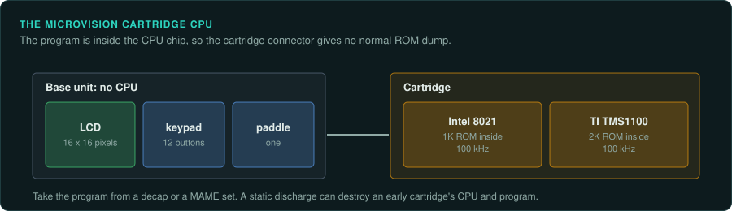

# LCD games and Game & Watch

On Game & Watch, Tiger LCD games and the Microvision, the program is mask ROM inside a 4-bit
microcontroller. It cannot be read through a cartridge connector the usual way. It is read from a
decap (a die photo) or with a special electronic dump. In practice, projects take it from the
MAME set. A test compares the set of lit LCD segments.

## The devices

| Device | Years | CPU and clock | Media and format | Ghidra support | Emulator with a debugger |
|---|---|---|---|---|---|
| Game & Watch | 28 April 1980 to 1991 | Sharp SM5A, SM510 to SM512, SM530; 32.768 kHz crystal | Mask ROM in the MCU | None for the SM5xx | MAME (hh_sm510.cpp) |
| Tiger LCD games, R-Zone | Not covered here | Sharp SM5xx family, by MAME's hh_sm510.cpp driver | Mask ROM in the MCU | None for the SM5xx | MAME (hh_sm510.cpp, rzone.cpp) |
| Elektronika LCD games | Not covered here | Clones of the Sharp chips | Mask ROM in the MCU | None | MAME (hh_sm510.cpp) |
| Microvision | November 1979 to 1981 | Intel 8021 or TI TMS1100 in each cartridge, at 100 kHz | Cartridge holding its own CPU | 8048 may decode the 8021 (not confirmed); none for the TMS1100 | Not covered here |

Unicorn supports none of these CPUs.

## Game & Watch

### Hardware

Nintendo's Game & Watch first went on sale on 28 April 1980. Original production ran until
1991. It has about 60 games in 11 series. The Multi Screen series uses two LCD panels.

The CPU is a 4-bit Sharp SM5xx-family microcontroller with ROM, RAM and the LCD driver on the
chip. The SM5A and SM510 to SM512 are rated for a 61 µs cycle time and use a 32.768 kHz
crystal. Wikipedia equates that to about 16.384 kHz (not confirmed). RAM is 80 to 128 nibbles.
ROM runs from 1,792 bytes on the SM5A to 4,032 bytes on the SM511 and SM512. Those two also add
a melody ROM. Wikipedia's figures for that melody ROM disagree with each other. The text gives
256 6-bit words. The chip table gives 192 bytes.

The display is a segmented LCD. Every possible image is a fixed printed segment
([Wikipedia: Game & Watch](https://en.wikipedia.org/wiki/Game_%26_Watch)).

The 2020 *Game & Watch: Super Mario Bros.* is a different machine. It has a colour backlit LCD,
USB-C and a Cortex-M7 (STMicroelectronics STM32H7B0VB) with over 1 MB of RAM and flash
([Wikipedia: Game & Watch](https://en.wikipedia.org/wiki/Game_%26_Watch)).

### Tools

MAME's driver covers games on the SM5A, SM510, SM511, SM512 and SM530. The SM5A and SM510 are
the most common
([MAME hh_sm510.cpp](https://raw.githubusercontent.com/mamedev/mame/master/src/mame/handheld/hh_sm510.cpp)).
MAME notes that an accurate electronic method now dumps the SM511 and SM512 melody ROM. Some
melody ROMs are still marked BAD_DUMP pending decap checks. Many program entries are marked
"(no decap)". In MAME, the LCD screen graphics come from an SVG file inside the driver. The
driver credits hap and Henrik Algestam, with thanks to Sean Riddle, Igor, Lee Robson and Milan
Galcik ([MAME hh_sm510.cpp](https://raw.githubusercontent.com/mamedev/mame/master/src/mame/handheld/hh_sm510.cpp)).

MAME release notes credit Sean Riddle on Game & Watch drivers such as Donkey Kong Jr. (new wide
screen), Mario Bros. and Ball ([MAME forum](https://forum.mamedev.org/viewtopic.php?p=732);
[MAME changelog via Softpedia](https://games.softpedia.com/progChangelog/MAME-Changelog-40.html)).
A MiSTer FPGA Game & Watch core can use the MAME ROMs and artwork. So far only SM510 games
convert ([MiSTer forum](https://misterfpga.org/viewtopic.php?p=53100)).

No Ghidra module exists for the SM5xx. MAME's own disassemblers cover it, through its debugger
or its `unidasm` tool.

### Projects to learn from

Sean Riddle's decap index has die-shot pages for the Sharp SM510, SM511, SM512 and SM530. His
site documents his decapping method, with a microscope camera, an automated X-Y table and
stitched die images ([Sean Riddle: Chip Decap Info](https://www.seanriddle.com/decap.html)).
How mask-ROM bits are read from a die photo is not described here.

### For an exact reimplementation

**Compare the lit segments in each frame.** The MCU's LCD RAM holds them. A pixel comparison
against MAME's SVG gives no extra information. MAME's debugger with hap's SM5xx cores is the
only known way to get ground truth.

## Tiger LCD games and Elektronika

### Tools

MAME's hh_sm510.cpp also covers Tiger's LCD games. The Tiger R-Zone is a child driver
(rzone.cpp). The same file covers the Soviet Elektronika games, whose MCUs cloned the Sharp
chips ([MAME hh_sm510.cpp](https://raw.githubusercontent.com/mamedev/mame/master/src/mame/handheld/hh_sm510.cpp)).
A MAME changelog notes Konami, Tiger and other hh_sm510 games being added to the Experimental
category ([MAME forum](https://forum.mamedev.org/viewtopic.php?p=1346)).

Mattel's LCD games of 1976 to 1977 are not covered here. Their CPUs are not confirmed.

## Microvision

### Hardware

Milton Bradley's Microvision came out in November 1979. It was discontinued in 1981. **The base
unit has no CPU.** Each cartridge holds its own processor with the program masked into it. That
processor is an Intel 8021 with 1K of ROM or a TI TMS1100 with 2K, clocked at 100 kHz. The
display is a 16 by 16 pixel LCD. Input is a 12-button keypad and one paddle
([Wikipedia: Microvision](https://en.wikipedia.org/wiki/Microvision)).

Many surviving units have LCD "screen rot". Early cartridges had no ESD protection, so a
static discharge can destroy the CPU and its program. Keypad overlays tear
([Wikipedia: Microvision](https://en.wikipedia.org/wiki/Microvision)).

### Tools

No Ghidra module exists for the TMS1100. The Intel 8021 is a reduced member of the MCS-48
family, so Ghidra's 8048 module may decode most of it (not confirmed). MAME's disassemblers
cover the rest.

### Projects to learn from

Sean Riddle's decap index has die-shot pages for the Microvision LCD controller (SCUS0488), the
TMS1000 and the TMS1100 ([Sean Riddle: Chip Decap Info](https://www.seanriddle.com/decap.html)).

### For an exact reimplementation

Take the program from a decap or a MAME set. The cartridge connector does not give a normal
ROM dump, because the program is inside the CPU chip
([Handheld practices](practices.md#lcd-behaviour)).
