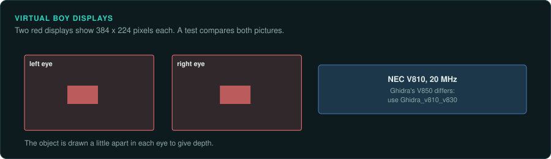
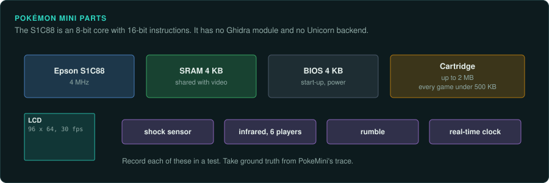

# Virtual Boy and Pokémon mini

The Virtual Boy and the Pokémon mini are Nintendo handhelds outside the Game Boy line. The
Virtual Boy's V810 needs a Ghidra extension. The Pokémon mini's S1C88 has no Ghidra module and
no Unicorn backend, so take ground truth from PokeMini's trace.

## The devices

| Device | Years | CPU and clock | Media and format | Ghidra support | Emulator with a debugger |
|---|---|---|---|---|---|
| Virtual Boy | July 1995 (JP) | NEC V810 at 20 MHz | Cartridge | Built-in V850 differs; [Ghidra_v810_v830](https://github.com/20Enderdude20/Ghidra_v810_v830) | Mednafen |
| Pokémon mini | 16 November 2001 (NA) | Epson S1C88 at 4 MHz | Cartridge up to 2 MB | None | PokeMini (development package) |

## Virtual Boy

### Hardware

The NEC V810 runs at 20 MHz. It drives red LED displays with 384x224 pixels for each eye
([Virtual Boy](https://en.wikipedia.org/wiki/Virtual_Boy)).

### Tools

Ghidra's built-in V850 differs from the V810.
[Ghidra_v810_v830](https://github.com/20Enderdude20/Ghidra_v810_v830) adds the V810. The
extension has few users, so test it on a known binary before trusting it. Mednafen has a
debugger in its SDL front end
([Mednafen docs](https://mednafen.github.io/documentation/)).

## Pokémon mini

### Hardware

The Pokémon mini came out on 16 November 2001 in North America. It reached Japan on 14 December
2001 and Europe on 15 March 2002. Nintendo R&D3 designed it. Epson made it. The CPU is an Epson
S1C88, an 8-bit core with 16-bit instructions, at 4 MHz. It has 4 KB of SRAM shared with video.
A 4 KB BIOS handles start-up and power. Cartridges hold up to 2 MB. Every commercial game is
under 500 KB. **The monochrome 96 by 64 LCD runs at 30 fps.**

Built in are a reed-switch shock sensor, an IR port (about 1 m, up to six players), a rumble
motor and a battery-backed real-time clock
([Wikipedia: Pokémon mini](https://en.wikipedia.org/wiki/Pok%C3%A9mon_Mini)).

### Tools

PokeMini by JustBurn is GPLv3. Its last version is 0.60 from 16 June 2015. Its debugger ships
only in the development package. It keeps a 10,000-instruction trace history
([PokeMini on SourceForge](https://www.sourceforge.net/projects/pokemini);
[libretro docs: PokeMini](https://docs.libretro.com/library/pokemini/)). No Ghidra module or
Unicorn backend exists for the S1C88.

### Projects to learn from

An official emulator inside the GameCube game *Pokémon Channel* (2003) ran demo versions of
some games. Homebrew games appeared after people reverse engineered the system. The demo *SHizZLE* was shown at Breakpoint
2005 ([Wikipedia: Pokémon mini](https://en.wikipedia.org/wiki/Pok%C3%A9mon_Mini)).

### For an exact reimplementation

Take ground truth from PokeMini's trace. The shock sensor, IR, rumble and RTC are outside
inputs and state that a test records ([Handheld practices](practices.md)). The S1C88 programs
are small, so writing a SLEIGH module or a purpose-built core would take modest effort.
