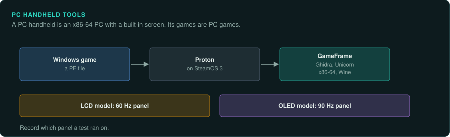

# PC handhelds

The Steam Deck and the other PC handhelds are x86-64 PCs with a built-in screen and controls.
GameFrame's Windows PE path (Ghidra, Unicorn x86-64, Wine)
applies to them directly.

## The devices

| Device | Years | CPU and clock | Media and format | Ghidra support | Emulator with a debugger |
|---|---|---|---|---|---|
| Steam Deck (LCD) | 25 February 2022 | AMD Aerith (7 nm): Zen 2, 4 cores and 8 threads at 2.4 to 3.5 GHz | Downloads; SteamOS 3, Windows games through Proton | x86-64 built in | Not needed; the games are PC games |
| Steam Deck OLED | 16 November 2023 | AMD Sephiroth (6 nm): Zen 2, as above | As above | x86-64 built in | As above |
| Asus ROG Ally, Lenovo Legion Go | 2023 | Not covered here | Not covered here | x86-64 built in | As above |
| MSI Claw A1M | 2024 | Not covered here | Not covered here | x86-64 built in | As above |
| ROG Xbox Ally | Announced June 2025 | Not covered here | Windows | x86-64 built in | As above |

## Steam Deck

### Hardware

Valve's Steam Deck came out on 25 February 2022 in North America and Europe. The OLED model
followed on 16 November 2023. Its custom AMD APU is codenamed Aerith (7 nm) on the LCD model.
The OLED model uses Sephiroth (6 nm). The Zen 2 CPU has 4 cores and 8 threads at 2.4 to 3.5
GHz. The RDNA 2 GPU has 8 CUs at 1.0 to 1.6 GHz. It has 16 GB of LPDDR5 on the LCD model and
LPDDR5X on the OLED model. The 1280 by 800 screen is a 7-inch LCD at 60 Hz or a 7.4-inch OLED
at 90 Hz ([Wikipedia: Steam Deck](https://en.wikipedia.org/wiki/Steam_Deck)).

SteamOS 3 is built on Arch Linux with an immutable file system and a KDE Plasma desktop. Windows
games run through the Proton compatibility layer
([Wikipedia: Steam Deck](https://en.wikipedia.org/wiki/Steam_Deck)). Proton is Wine-based (not
confirmed).

### Tools

Use GameFrame's Windows PE path: Ghidra, Unicorn x86-64 and Wine
([Home computers and the PC](../computers/README.md)).

### For an exact reimplementation

The LCD model's panel runs at 60 Hz. The OLED model's runs at 90 Hz. Record which panel a test
ran on.

## Other PC handhelds

### Hardware

Other PC handhelds include the Asus ROG Ally and Lenovo Legion Go (2023) and the MSI Claw A1M
(2024). The ROG Xbox Ally was announced in June 2025 and runs Windows
([Wikipedia: Steam Deck](https://en.wikipedia.org/wiki/Steam_Deck)).

### Tools

These run PC games, so the Windows PE path applies as for the Steam Deck.
