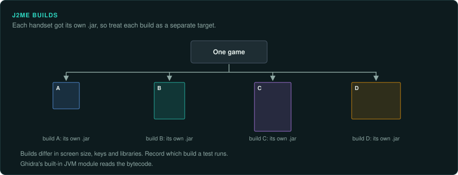
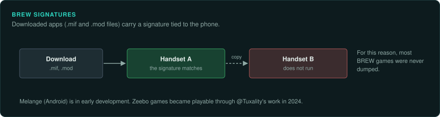

# Phones

Before smartphones, phone games ran as J2ME or BREW apps. J2ME games are JVM bytecode, which
Ghidra reads. Downloaded BREW apps are signed for one handset, so most were never dumped. One
game often shipped in many builds for different handsets. Treat each build as a separate
target.

## The platforms

| Platform | Years | CPU and clock | Media and format | Ghidra support | Emulator with a debugger |
|---|---|---|---|---|---|
| J2ME | Not covered here | A Java VM on the phone | .jar files | JVM built in | FreeJ2ME, J2ME Loader (debuggers not covered here) |
| BREW | Developer site shut 23 July 2021 | Not covered here | .mif and .mod files, signed per handset | Not covered here | Melange (early development) |
| Zeebo | Not covered here | Not covered here | BREW | Not covered here | @Tuxality's emulator work |

## J2ME

### Hardware

J2ME games ship as .jar files and run on a Java VM on the phone. Community estimates put the
total above 3,000 unique games ([techtactician roundup](https://techtactician.com/?p=58218);
[GameTechWiki: J2ME](https://emulation.gametechwiki.com/index.php/J2ME)).

### Tools

Ghidra's built-in JVM module reads the bytecode
([Ghidra Processors on GitHub](https://github.com/NationalSecurityAgency/ghidra/tree/master/Ghidra/Processors)).
FreeJ2ME is a free J2ME emulator with AWT, SDL2 and libretro front ends. Its README states
neither its licence nor its MIDP and CLDC coverage
([FreeJ2ME GitHub](https://github.com/hex007/freej2me)). J2ME Loader is an Android J2ME
emulator under Apache 2.0. It runs most 2D and 3D games, including Mascot Capsule 3D
([J2ME Loader GitHub](https://github.com/nikita36078/J2ME-Loader)).

### Projects to learn from

Kahvibreak is a J2ME launcher and collection. It has been inactive since its maintainer
(Nokia64) disappeared. Sources disagree on the year. One gives 2022. Users report quality problems
in its database ([GameTechWiki: Kahvibreak](https://emulation.gametechwiki.com/index.php/Kahvibreak);
[techtactician roundup](https://techtactician.com/?p=58218)). Other efforts include a J2ME
Preservation archive and the Cell Phone Game Preservation Wiki
([awesome-j2me list](https://www.context-awesome.com/list/hstsethi/awesome-j2me)).

### For an exact reimplementation

One game often shipped in many builds for different handsets. Treat each build as a separate
target. Record which build a test runs.

## BREW and the Zeebo

### Hardware

BREW apps use .mif and .mod files. **Downloaded BREW apps are tied to one handset by a digital
signature, so most were never dumped.** Qualcomm shut the Brew MP developer site on 23 July 2021
([GameTechWiki: BREW](https://emulation.gametechwiki.com/index.php/BREW)).

### Tools

Melange is an Android BREW emulator. It is open source but relies on proprietary Qualcomm
components. It is in early development. Qualcomm's SDK BREW Simulator does not emulate handset
hardware ([GameTechWiki: BREW](https://emulation.gametechwiki.com/index.php/BREW)).

### Projects to learn from

The Zeebo console ran on BREW. @Tuxality's emulator work in 2024 made its games playable
([Time Extension, May 2024](https://www.timeextension.com/news/2024/05/zeebo-emulator-makes-lost-double-dragon-and-crash-bandicoot-games-playable-again)).

Early iOS and Android games are not covered here.
