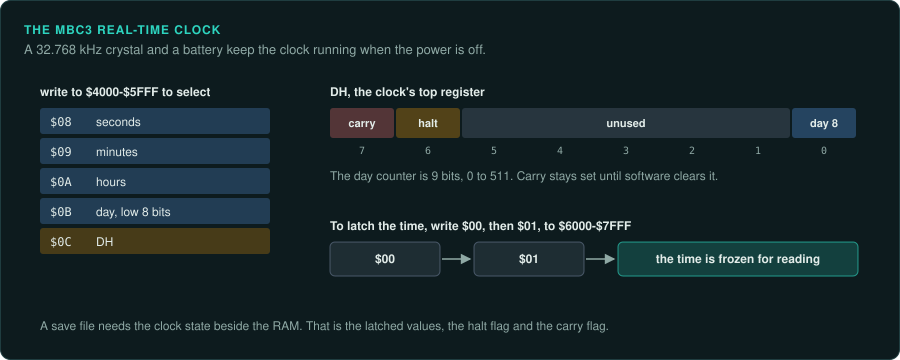
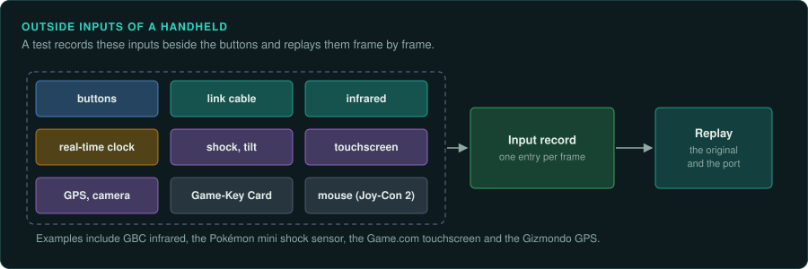
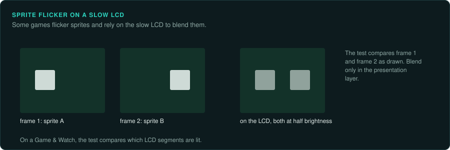

# Handheld practices

Handhelds keep state in battery-backed RAM and real-time clocks. They connect to other units over
link cables and infrared. Some read sensors. **A reimplementation must reproduce these parts as
well as the CPU.** This page covers what every handheld project records beside the CPU
state. Each family page covers its own hardware.

## Saves and real-time clocks

The Game Boy's MBC3 mapper holds up to 2 MB of ROM, RAM and a real-time clock. The clock needs
a 32.768 kHz crystal and a battery
([Pan Docs: MBC3](https://gbdev.io/pandocs/MBC3.html)).

| Action | Address | Effect |
|---|---|---|
| Write `$08` to `$0C` | 4000 to 5FFF | Selects the RTC registers: seconds, minutes, hours, the low byte of the day counter, and DH |
| Write `$00` then `$01` | 6000 to 7FFF | Latches the time |

DH holds day bit 8, a halt flag (bit 6) and a carry flag (bit 7). The day counter is 9 bits (0
to 511). Carry stays set until software clears it. Separate RTC accesses need about 4 µs
between them. MBC30 (4 MiB ROM, 64 KiB RAM, with a timer) shipped only in the Japanese
*Pocket Monsters: Crystal Version*. Other regions used MBC3
([Pan Docs: MBC3](https://gbdev.io/pandocs/MBC3.html)).

**A save file with an RTC needs the clock state alongside the RAM.** The clock state is the latched
values, the halt flag and the carry flag. Tests can then reproduce time-based events, such as
day and night or the daily events in the Pokémon Gold, Silver and Crystal games.

The Pokémon mini also has an RTC. It adds a shock sensor, IR for up to six players and rumble
([Wikipedia: Pokémon mini](https://en.wikipedia.org/wiki/Pok%C3%A9mon_Mini)).

## Link cables and infrared

Link cables and infrared are more outside inputs.

- GBC infrared runs up to 9.5 kbit/s ([Wikipedia: Game Boy Color](https://en.wikipedia.org/wiki/Game_Boy_Color)).
- SGB games can read four joypads and run code on the SNES. Their timing differs between NTSC,
  PAL and the SGB2. Games that detect the SGB can retune their sound
  ([Pan Docs: SGB Functions](https://gbdev.io/pandocs/SGB_Functions.html)).
- The Game.com has a modem cartridge ([Wikipedia: Game.com](https://en.wikipedia.org/wiki/Game.com)).
- BREW signs each downloaded game for one handset, so the game cannot be backed up
  ([GameTechWiki: BREW](https://emulation.gametechwiki.com/index.php/BREW)).

Link-cable protocols are not covered here. Two examples are GBC serial at double speed and the
Pokémon trade protocol.

## Sensors and other inputs

- The Game.com has a touchscreen ([Wikipedia: Game.com](https://en.wikipedia.org/wiki/Game.com)).
- The Gizmondo has GPS, GPRS and a camera ([Wikipedia: Gizmondo](https://en.wikipedia.org/wiki/Gizmondo)).
- Switch 2 Game-Key Cards must stay inserted to launch. The Joy-Con 2 adds mouse input
  ([Wikipedia: Nintendo Switch 2](https://en.wikipedia.org/wiki/Nintendo_Switch_2)).
- Accelerometer cartridges such as Kirby Tilt 'n' Tumble on the GBC are commonly cited but not
  verified.

Add each of these to the list of outside inputs that a test records and replays
([Inputs](../observe/inputs.md)).

## LCD behaviour

What a picture test compares depends on the LCD. Game & Watch graphics are fixed LCD segments.
MAME draws them from SVG artwork
([Wikipedia: Game & Watch](https://en.wikipedia.org/wiki/Game_%26_Watch);
[MAME hh_sm510.cpp](https://raw.githubusercontent.com/mamedev/mame/master/src/mame/handheld/hh_sm510.cpp)).
For segment games the parity test compares lit segments per frame
([LCD games](lcd-games.md)).

Some handheld games are reported to flicker sprites. They rely on slow LCD response (ghosting)
to blend frames. Which games do this is not confirmed. For such a game, compare the raw output of each
frame. Do any blending only in the presentation layer.
