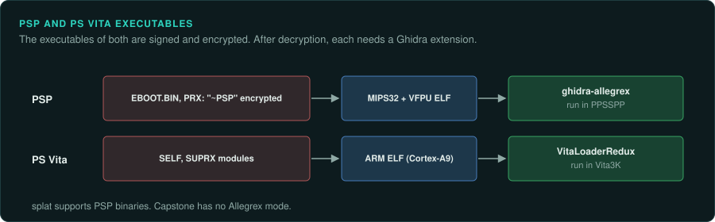

# PSP and PS Vita

Games for Sony's handhelds come as signed and encrypted executables. The PSP runs MIPS code with a vector
unit. The Vita runs ARM code. Both need a Ghidra extension or loader.

## The devices

| Device | Years | CPU and clock | Media and format | Ghidra support | Emulator with a debugger |
|---|---|---|---|---|---|
| PSP | 12 December 2004 (JP) | Allegrex, MIPS32 with VFPU, 222 MHz default | EBOOT.BIN and PRX, encrypted "~PSP" ELF | [ghidra-allegrex](https://github.com/kotcrab/ghidra-allegrex) | PPSSPP |
| PS Vita | 17 December 2011 (JP) | Quad Cortex-A9 | SELF wrapping ARM ELF; SUPRX modules | [GhidraVitaLoader](https://github.com/xerpi/GhidraVitaLoader), [VitaLoaderRedux](https://github.com/CreepNT/VitaLoaderRedux) | Vita3K |

## PSP

### Hardware

The Allegrex is a MIPS32 core with a VFPU, at 222 MHz by default. Games ship as EBOOT.BIN and
PRX files, which are encrypted "~PSP" ELFs
([PlayStation Portable](https://en.wikipedia.org/wiki/PlayStation_Portable)).

### Tools

Ghidra has no Allegrex language built in. [ghidra-allegrex](https://github.com/kotcrab/ghidra-allegrex)
adds it. Capstone has no Allegrex mode. splat supports PSP binaries
([GitHub: splat](https://github.com/ethteck/splat)). PPSSPP runs the games. It has a built-in
debugger and a WebSocket remote debugger (not confirmed) ([PPSSPP](https://www.ppsspp.org/)).

### Projects to learn from

The Castlevania: Symphony of the Night decompilation includes a PSP build. No completed PSP
matching decompilation is known.

## PS Vita

### Hardware

The Vita has a quad Cortex-A9. Executables are SELF files wrapping an ARM ELF, with SUPRX modules
([PlayStation Vita](https://en.wikipedia.org/wiki/PlayStation_Vita)).

### Tools

[GhidraVitaLoader](https://github.com/xerpi/GhidraVitaLoader) and
[VitaLoaderRedux](https://github.com/CreepNT/VitaLoaderRedux) load Vita files. Vita3K runs the
games. Vita3K's debugger status is not confirmed ([Vita3K](https://vita3k.org/)).

### Projects to learn from

No completed Vita matching decompilation is known.
