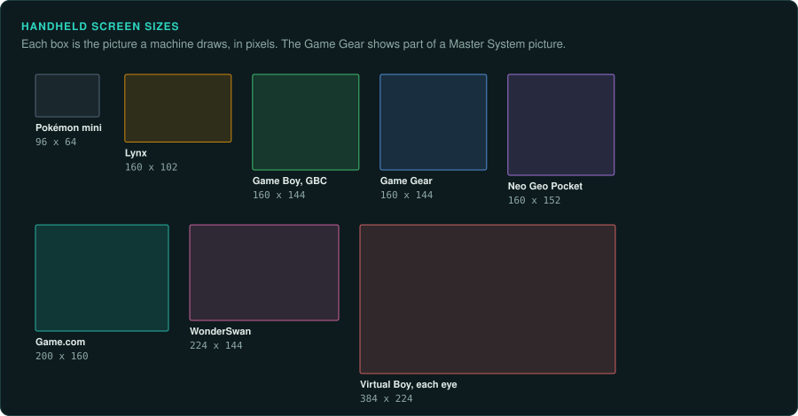
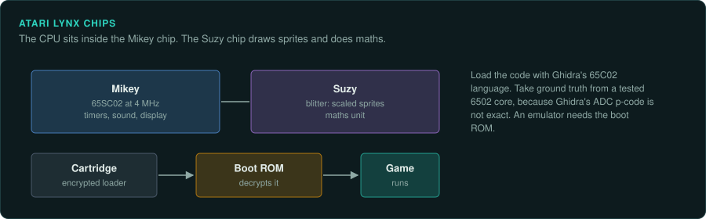

# Sega, Atari and SNK handhelds

The Game Gear, Lynx and Neo Geo Pocket are 8-bit and 16-bit cartridge handhelds. The Game Gear
and Lynx use CPUs that Ghidra builds in. The Neo Geo Pocket's TLCS-900/H has no Ghidra module.

## The devices

| Device | Years | CPU and clock | Media and format | Ghidra support | Emulator with a debugger |
|---|---|---|---|---|---|
| Sega Game Gear | 6 October 1990 (JP) | Z80 at 3.58 MHz | Cartridge | Z80 built in | MAME, Emulicious |
| Atari Lynx | September 1989 | 65SC02 at 4 MHz in Mikey | Cartridge with an encrypted loader | 65C02 built in | Handy, Mednafen (lineage not confirmed) |
| Neo Geo Pocket and Color | October 1998 and March 1999 (JP) | TLCS-900/H at 6.144 MHz; Z80 for sound | Cartridge | No TLCS-900 module; [NGDis](https://se.aminet.net/dev/asm/NGDis.readme) disassembles | MAME, Mednafen |

Mednafen covers the Neo Geo Pocket with a debugger in its SDL front end
([Mednafen docs](https://mednafen.github.io/documentation/)).

## Sega Game Gear

### Hardware

The Z80 runs at 3.58 MHz. The video chip is the Master System VDP, with 160x144 pixels visible.
Many Game Gear games are Master System ports
([Game Gear](https://en.wikipedia.org/wiki/Game_Gear)).

### Tools

Ghidra builds in the Z80. Unicorn and Capstone have no Z80, so take ground truth from a small
core such as [iz80](https://github.com/ivanizag/iz80) or from MAME. Emulicious also covers the
Game Gear, with a profiler, tracer and source-level debugging
([Emulicious](https://emulicious.net/)).

## Atari Lynx

### Hardware

The 65SC02 runs at 4 MHz inside the Mikey chip. The Suzy blitter scales sprites and has a maths
unit ([Atari Lynx](https://en.wikipedia.org/wiki/Atari_Lynx)).

### Tools

Load the code with Ghidra's 65C02 language. Ghidra's 6502 `ADC` p-code is not exact, so take
ground truth from a tested core
([Tools for console work](../consoles/tools.md#disassembly-and-decompilation)).

### For an exact reimplementation

The cartridge loader is encrypted. An emulator needs the Lynx boot ROM to run it.

## Neo Geo Pocket and Neo Geo Pocket Color

### Hardware

The main CPU is a TLCS-900/H at 6.144 MHz, with a Z80 for sound. The screen is 160x152
([Neo Geo Pocket Color](https://en.wikipedia.org/wiki/Neo_Geo_Pocket_Color)).

### Tools

Ghidra has no TLCS-900 module. [NGDis](https://se.aminet.net/dev/asm/NGDis.readme)
disassembles the code. MAME and Mednafen run the games.
