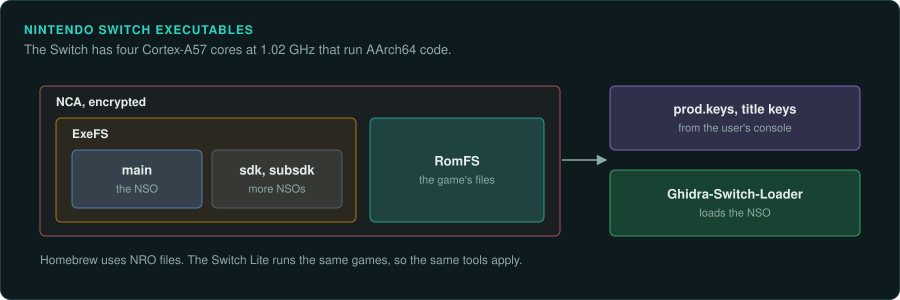
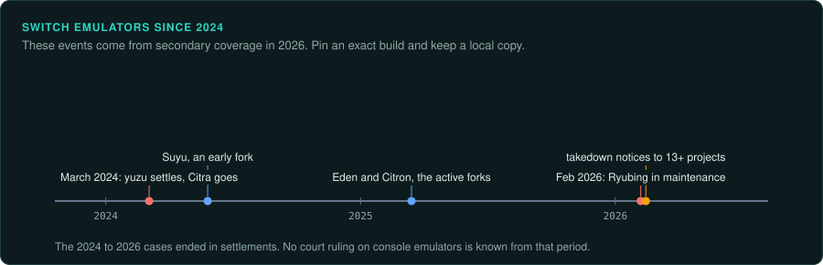
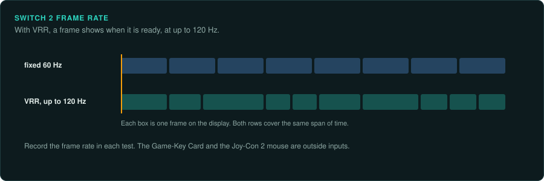

# Switch family

The Switch, Switch Lite and Switch 2 run AArch64 code. Games ship as NSO files inside encrypted
NCA containers. Before any analysis, you need a decrypted dump and the right Ghidra loader. The
Switch 2 adds Game-Key Cards and a display that runs up to 120 Hz with VRR.

## The devices

| Device | Years | CPU and clock | Media and format | Ghidra support | Emulator with a debugger |
|---|---|---|---|---|---|
| Nintendo Switch | 3 March 2017 | 4 Cortex-A57 at 1.02 GHz | NSO in encrypted NCA; NRO homebrew | [Ghidra-Switch-Loader](https://github.com/Adubbz/Ghidra-Switch-Loader) | Ryubing, Eden, Citron |
| Nintendo Switch Lite | 20 September 2019 | Tegra X1+ (16 nm) | As the Switch | As the Switch | As the Switch |
| Nintendo Switch 2 | 5 June 2025 | Nvidia T239: 8 Cortex-A78C at 998 MHz docked, 1,101 MHz handheld | Game cards, eShop downloads, Game-Key Cards | AARCH64 built in | None named |

## Nintendo Switch

### Hardware

The Switch has 4 Cortex-A57 cores at 1.02 GHz. Games ship as NSO files inside encrypted NCA
containers. Homebrew uses NRO ([Nintendo Switch](https://en.wikipedia.org/wiki/Nintendo_Switch);
[switchbrew NSO](https://switchbrew.org/wiki/NSO)).

### Tools

[Ghidra-Switch-Loader](https://github.com/Adubbz/Ghidra-Switch-Loader) loads Switch executables.
Ghidra's AARCH64 language covers v8.5-A, "missing some 8.5 vector"
([AARCH64.ldefs](https://github.com/NationalSecurityAgency/ghidra/blob/master/Ghidra/Processors/AARCH64/data/languages/AARCH64.ldefs)).

### Projects to learn from

A Breath of the Wild v1.5.0 decompilation is in progress ([GitHub: botw](https://github.com/german77/botw)).

## Keys and the yuzu settlement

Switch NCA contents are encrypted. Emulators need prod.keys, title keys and firmware dumped from
the user's own console (not confirmed) ([switchbrew: NCA](https://switchbrew.org/wiki/NCA)).

On 4 March 2024 Tropic Haze, yuzu's developer, settled with Nintendo for $2.4 million. A Rhode
Island federal court entered a permanent injunction against offering yuzu or software that
circumvents Nintendo's protections. The yuzu domain went to Nintendo
([Android Authority](https://androidauthority.com/nintendo-switch-yuzu-settlement-3422388);
[Nintendo World Report](https://www.nintendoworldreport.com/news/66510/creators-of-yuzu-emulator-settle-lawsuit-with-nintendo)).
Citra was taken down at the same time ([Wikipedia: Citra](https://en.wikipedia.org/wiki/Citra_(emulator))).
The 2024 to 2026 cases ended in settlements. No court ruling on console emulators is known from
that period. The user decides how to obtain and use their own keys and dumps.

## Emulator status

Repositories can disappear, so pin an exact emulator build and keep a local copy.

On the Switch, yuzu development stopped in March 2024. Ryubing, a Ryujinx fork at ryujinx.app, moved to
maintenance in February 2026. Eden and Citron are described as the active forks. Suyu was an
early fork. In February 2026, takedown notices reportedly targeted at least 13 Switch
projects, including Citron, Eden and Ryubing. These Switch facts come from secondary 2026
coverage ([tech-insider: Eden vs Ryubing](https://tech-insider.org/eden-vs-ryubing-best-switch-emulator-2026/);
[tech-insider](https://tech-insider.org/?p=23388)).

## Nintendo Switch Lite

### Hardware

The Switch Lite came out on 20 September 2019 on the 16 nm Tegra X1+. It has a 5.5-inch 720p
display and built-in controllers. A d-pad replaces four buttons. It plays games that support
handheld mode ([Wikipedia: Nintendo Switch Lite](https://en.wikipedia.org/wiki/Nintendo_Switch_Lite)).

### Tools

Its games are Switch games, so the Switch tools apply unchanged
([Ghidra-Switch-Loader](https://github.com/Adubbz/Ghidra-Switch-Loader);
[switchbrew NSO](https://switchbrew.org/wiki/NSO)).

## Nintendo Switch 2

### Hardware

The Switch 2 came out on 5 June 2025 in most regions. Its Nvidia T239 SoC has eight ARM
Cortex-A78C cores at 998 MHz docked and 1,101 MHz handheld. It has 12 GB of LPDDR5X on a
128-bit bus and 256 GB of UFS 3.1 storage. Only microSD Express cards can load games. The
7.9-inch 1080p display runs up to 120 Hz with HDR10 and VRR.

Games come on game cards, as eShop downloads and as Game-Key Cards. **A Game-Key Card holds
only a licence and must stay inserted while the game is downloaded and played.** The Switch 2
runs most Switch games through a mix of software and hardware emulation. The Joy-Con 2 can work
as a mouse ([Wikipedia: Nintendo Switch 2](https://en.wikipedia.org/wiki/Nintendo_Switch_2)).

### Tools

The code is AArch64, which Ghidra's AARCH64 module and Unicorn's ARM64 support cover. Its
security and homebrew status are not confirmed. No Switch 2 emulator is known.

### For an exact reimplementation

With VRR and up to 120 Hz, a Switch 2 game sets its own frame rate within what the display
allows. Record that rate in each test. The Game-Key Card and the Joy-Con 2 mouse are
outside inputs ([Handheld practices](practices.md#sensors-and-other-inputs)).
