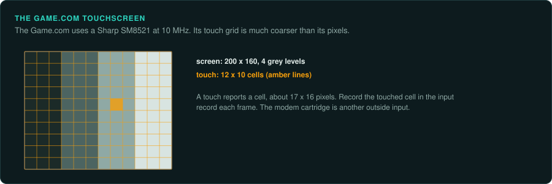

# Game.com

Tiger's Game.com is a touchscreen handheld on a Sharp SM8521. No Ghidra module exists for the
SM8521. Unicorn has no backend for it either.

## The devices

| Device | Years | CPU and clock | Media and format | Ghidra support | Emulator with a debugger |
|---|---|---|---|---|---|
| Game.com | 12 September 1997 (US) | Sharp SM8521 at 10 MHz | Two cartridge slots | None | MAME driver commonly cited (not confirmed) |
| Game.com Pocket Pro | Mid-1999 | Sharp SM8521 at 10 MHz | One cartridge slot | None | As above |

## Game.com and Pocket Pro

### Hardware

Tiger's Game.com came out in the US on 12 September 1997. The Pocket Pro followed in mid-1999.
It uses a Sharp SM8521 8-bit CPU at 10 MHz. The 200 by 160 screen has 4 grey levels and a 12 by
10 grid touchscreen. The original had no backlight. One Pocket Pro model has one. The original
has two cartridge slots. The Pocket Pro has one.

Internet use needed a separate cartridge and a 14.4 kbit/s modem for email and text web. The
Pocket Pro dropped internet use except for high-score submission
([Wikipedia: Game.com](https://en.wikipedia.org/wiki/Game.com)). The RAM size is not
confirmed.

### Tools

No Ghidra module exists for the SM8521. A MAME Game.com driver is commonly cited but not
confirmed.

### Projects to learn from

A prototype of an unreleased Game.com port of *Castlevania: Symphony of the Night* was found and
released in 2022 ([Wikipedia: Game.com](https://en.wikipedia.org/wiki/Game.com)).

### For an exact reimplementation

The touchscreen and the modem cartridge are outside inputs that a test records
([Handheld practices](practices.md)). The SM8521 programs are small, so writing a SLEIGH module or
a purpose-built core would take modest effort.
