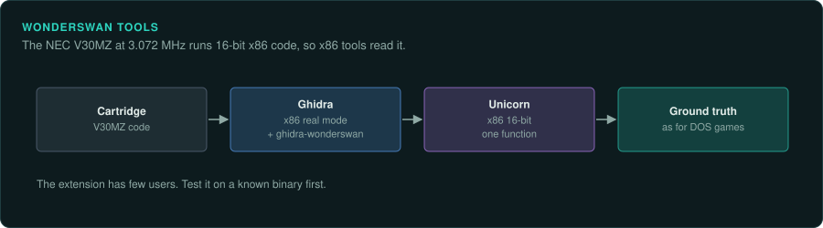

# WonderSwan

Bandai's WonderSwan family runs a CPU compatible with 16-bit x86. Ghidra's x86 real-mode
language reads it. Unicorn runs x86 16-bit code, so GameFrame's Unicorn emulator can run its
functions.

## The devices

| Device | Years | CPU and clock | Media and format | Ghidra support | Emulator with a debugger |
|---|---|---|---|---|---|
| WonderSwan, Color, SwanCrystal | March 1999 to 2002 (JP) | NEC V30MZ at 3.072 MHz | Cartridge | x86 real mode; [ghidra-wonderswan](https://github.com/JidouGhost-TL/ghidra-wonderswan) | Mednafen, Mesen 2 |

Mednafen covers the WonderSwan with a debugger in its SDL front end. Mesen 2 covers the
WonderSwan (system list not confirmed)
([Mednafen docs](https://mednafen.github.io/documentation/); [Mesen](https://www.mesen.ca/)).

## WonderSwan, WonderSwan Color and SwanCrystal

### Hardware

The NEC V30MZ runs at 3.072 MHz and is compatible with 16-bit x86. The screen is 224x144
([WonderSwan](https://en.wikipedia.org/wiki/WonderSwan)).

### Tools

Load the code with Ghidra's x86 real-mode language.
[ghidra-wonderswan](https://github.com/JidouGhost-TL/ghidra-wonderswan) adds a loader. The
extension has few users, so test it on a known binary before trusting it.

### For an exact reimplementation

Unicorn runs x86 16-bit code. Run single functions headless under GameFrame's emulator, as for
DOS code ([DOS games](../DOS.md)).
