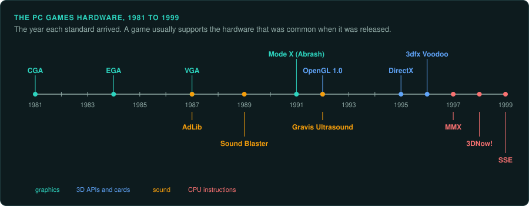

# Hardware of the era





A PC game from 1985 to 2005 uses its hardware far more directly than a modern program. DOS
games program the timer, the video card, the sound card and the joystick port themselves.
Windows games of the late 1990s use DirectX or a card maker's own 3D API. The hardware a game was
written for affects much of its code: the CPU's floating-point unit, the video
mode, the sound chip, the 3D card's features.

When you rebuild such a game, you replace the hardware with modern equivalents. To do that
exactly, you need to know what each piece of hardware did, how the game used it, and which of
its details the player can see or hear.

## Ask your agent

Find the hardware layer. Copy this prompt into your coding agent:

```text
In my GameFrame project, find every place the game touches hardware.

1. Read docs/hardware/README.md and the pages for this game's devices.
2. In the disassembly, find IN, OUT and INT instructions (tools/triage/insns.py lists them)
   and writes to A000, B800 and 0040.
   For a Windows game, list the imports from DirectX, Glide, OpenGL and WinMM.
3. Name the driver functions (set a mode, set a palette, play a sound, read the joystick).
4. List the values the game reads back from the hardware. They are inputs.
5. Propose one reference configuration (video, sound, input) and ask me to confirm it.
```

## Pages

- [CPUs and floating point](cpus.md): the x86 generations, the x87 FPU, MMX, 3DNow! and SSE,
  fixed point, timing loops, self-modifying code.
- [2D graphics](graphics-2d.md): CGA, EGA, VGA, Mode 13h, Mode X, VESA, palettes and the
  vertical retrace.
- [3D accelerators](graphics-3d.md): 3dfx and Glide, Rendition, PowerVR, S3, ATI, Matrox,
  NVIDIA, Direct3D and OpenGL, and software renderers.
- [Sound](sound.md): the PC speaker, AdLib and OPL FM synthesis, Sound Blaster, Gravis
  Ultrasound, MIDI devices, DirectSound, A3D and EAX.
- [Shaders](shaders.md): finding compiled and source shaders with `shaders.py`, reading them,
  capturing frames, and porting them exactly.
- [Pixel-exact software rendering](software-rendering.md): fill rules, edge stepping, lines,
  texture mapping, lookup tables and drawing order, and how to measure each in the original.
- [Working with the real hardware](real-hardware.md): dumping your own media and firmware,
  capturing video and sound, logic analysers, and working safely.
- [Memory, storage, input and networks](other.md): EMS, XMS and DOS extenders, CD audio, the
  game port, IPX, serial links and modems.

## General rules for hardware code

1. **Find every place the game touches hardware.** In DOS games, search the disassembly for
   `IN`, `OUT`, `INT` and writes to segments `A000`, `B800` and `0040`
   (`tools/triage/insns.py BINARY '^(in|out) ' '^int '` lists them). In Windows games, list
   the imports from DirectX, Glide, OpenGL, WinMM and the card makers' DLLs.
2. **Label the driver layer.** Most games wrap hardware access in a small set of functions
   (set a mode, set a palette, play a sample, read the joystick). Name them, and treat the rest
   of the game as their callers.
3. **Decide what the port must copy.** It must copy the picture and the sound the player
   perceives. It usually does not need to copy how the game produced them on the card. A frame drawn by Glide can be drawn
   by Vulkan, as long as it looks the same.
4. **Keep what the game logic reads back.** Some games read values from the hardware and use
   them in their rules: a timer count, the retrace state, a joystick reading, a sound
   position. Those values are inputs ([Inputs](../observe/inputs.md)).
5. **Choose one reference configuration.** The original looked and sounded different on
   different cards. Pick the configuration your project reproduces (for example "VGA, Sound
   Blaster 16, General MIDI through a Roland SC-55") and write it in the project's `AGENTS.md`.
