# CPUs and floating point

The CPU a game was written for sets the number formats and instructions it uses for arithmetic.
A port that rounds one result differently can change a whole simulation. Learn which number
formats and which instructions the game uses before you port any maths.

## The x86 generations

| CPU | Year | What it added that games used |
|---|---|---|
| 8088 and 8086 | 1979 and 1978 | 16-bit real mode, 1 MB address space in 64 KB segments |
| 80286 | 1982 | 16-bit protected mode (rarely used by games), faster |
| 80386 | 1985 | 32-bit registers and protected mode, flat memory through DOS extenders |
| 80486 | 1989 | The 486DX has the floating-point unit built in (the 486SX does not); an 8 KB cache |
| Pentium | 1993 | Two integer pipelines (U and V), a much faster FPU, the `RDTSC` cycle counter |
| Pentium MMX | 1997 | MMX: 64-bit integer vector instructions in the FPU registers |
| AMD K6-2 | 1998 | 3DNow!: vector instructions for pairs of 32-bit floats |
| Pentium III | 1999 | SSE: vector and scalar 32-bit float instructions in new XMM registers |
| Pentium 4 | 2000 | SSE2: 64-bit floats and integers in XMM registers |

A game's minimum CPU (on the box, or in the setup program) tells you which instructions to
expect. Some games had separate code paths for different CPUs: a 3DNow! path, an MMX path and a
plain path. The game chose one at start-up by testing the CPU with `CPUID`. Find that test. Then decide which path your project reproduces.

## Number formats

### Integers and fixed point

Before the Pentium, floating point was slow or absent, so most games used **fixed point**: an
integer whose low bits are the fraction. Common formats are 16.16 (16 integer bits, 16 fraction
bits, as in Doom), 8.8 and 24.8.

- Multiplying two 16.16 numbers gives a 32.32 result. The game keeps the middle 32 bits. On a
  386 this is one `IMUL` into `EDX:EAX` followed by `SHRD`. Check whether the game rounds or truncates. Check what it does on overflow.
- Division often uses a reciprocal table or a shift. Copy the table and the exact method.
- `SAR` (arithmetic shift) rounds toward minus infinity, and `IDIV` rounds toward zero. The
  two give different results for negative numbers. Keep the one the game uses
  ([ABI](../ABI.md#integers)).
- 16-bit games wrap at 65,536. Use wrapping arithmetic in the port where the original relies on
  it.

### The x87 FPU

From the 486DX until SSE2 became common (around 2004), floating point meant the x87 FPU. Before
the 486DX, the FPU was a separate chip (8087, 287, 387) that few players owned.

- Registers hold 80-bit extended precision values. A result is rounded to 32 or 64 bits only
  when it is stored to memory (`FST`, `FSTP`). Intermediate results inside one expression keep
  more precision. A port computing in 32-bit floats throughout gets different last bits.
- The **precision control** field of the FPU control word can make every result round to 24
  bits (float) or 53 bits (double). Direct3D sets 24-bit precision by default when it creates a
  device, unless the game asks it not to (`D3DCREATE_FPU_PRESERVE` in Direct3D 8 and 9,
  `DDSCL_FPUPRESERVE` in DirectX 7). So a Direct3D game's
  arithmetic may change after the device is created. Read the control word the game runs with:
  `FLDCW` instructions and calls to `_controlfp`.
- Conversion from float to integer: the C cast truncates, and MSVC called `_ftol` to do it,
  changing the rounding mode twice. Games often replaced `_ftol` with a faster trick (`FISTP`
  with the default rounding mode, which rounds to nearest even, or adding 1.5 × 2^52 and reading
  the low bits). Each gives different results at .5. Find which one your game uses.
- `FSIN`, `FCOS`, `FPATAN` and `FSQRT` are hardware instructions with their own accuracy. A C
  library may call them or use its own code. Emulate the exact path.

### MMX, 3DNow! and SSE

- **MMX** uses the x87 registers. A game must execute `EMMS` before using floating point again.
  MMX code is usually for pixels: blending, colour conversion, decompression. Its results are
  integer and exact; port it with ordinary integer code or with SIMD that gives the same bits.
- **3DNow!** gives pairs of 32-bit floats, with fast reciprocal and square-root estimates
  (`PFRCP`, `PFRSQRT`). The estimates have AMD's own accuracy. If game logic uses them, the port
  must reproduce the estimate exactly, usually with a table or by emulating it.
- **SSE** adds `RCPSS` and `RSQRTSS` estimates. Intel specifies only a maximum error, so the
  exact bits differ between Intel and AMD CPUs and between models. If a game's rules depend on them, record the CPU the original ran on.
- Games with several paths gave different results on different CPUs. Pick one path and
  document it as the reference.

## Timing

Many DOS games measured the CPU at start-up with a delay loop and used the count to time short
waits or to choose detail levels. On a fast modern CPU the count overflows or the game runs too
fast. Turbo Pascal's `CRT` unit is the best-known case: its start-up calibration fails with
"Runtime error 200" on CPUs faster than about 200 MHz.

- Find calibration loops: a loop with a counter run between two timer ticks.
- In the port, take the result of the calibration as an input with a fixed value, and record
  which value ([Inputs](../observe/inputs.md)).
- Games that time with `RDTSC` assume a fixed clock speed. Replace them with the game's frame
  or tick clock.

## Code that changes itself

Some games of the 1990s wrote into their own code to make inner loops faster: they patched
constants into instructions before running a loop (for example a texture's width into the
`ADD` of a texture mapper). Ghidra shows the instruction with the placeholder value.

- Find writes to code addresses: in the Ghidra export, look for stores whose target is in a
  code section.
- Read the patched value from the writer, and treat it as a variable in the port.
- GameFrame's emulators run self-modifying code correctly, so ground truth from them is
  still exact.

## Checklist for arithmetic

1. List the number formats the game uses: fixed point formats, float and double, packed
   integer vectors.
2. Read the FPU control word at the point the game runs its rules.
3. Find the float-to-integer conversion the game uses.
4. Find any CPU-specific code paths, and choose one.
5. Emulate every maths routine on many inputs and compare bit for bit (`re-emulate`).
