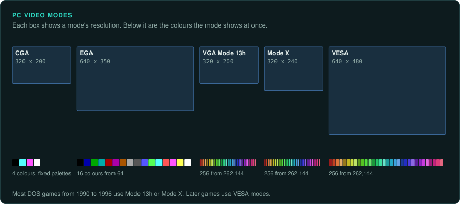
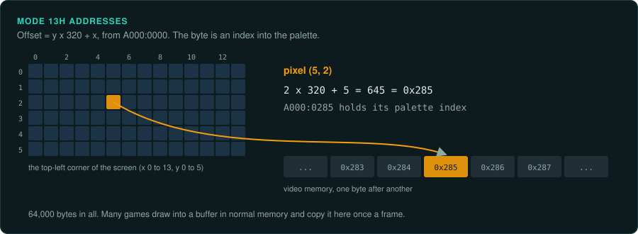
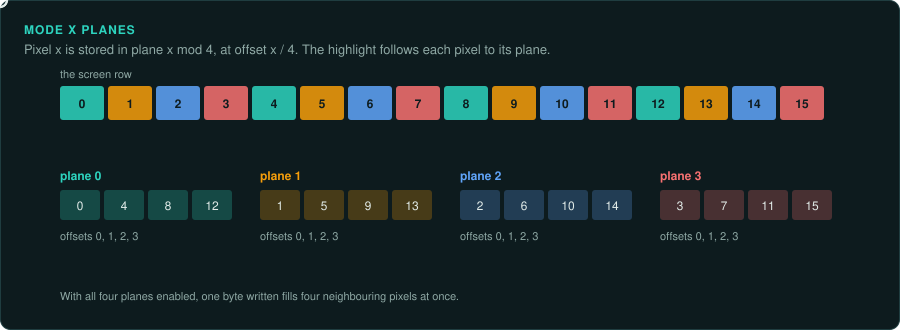
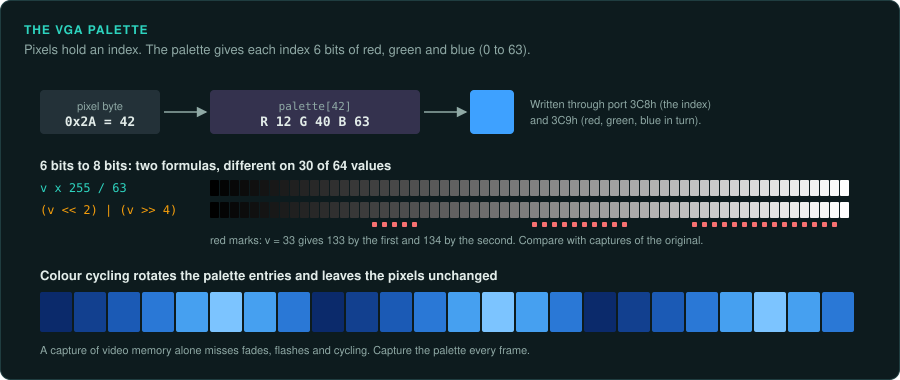
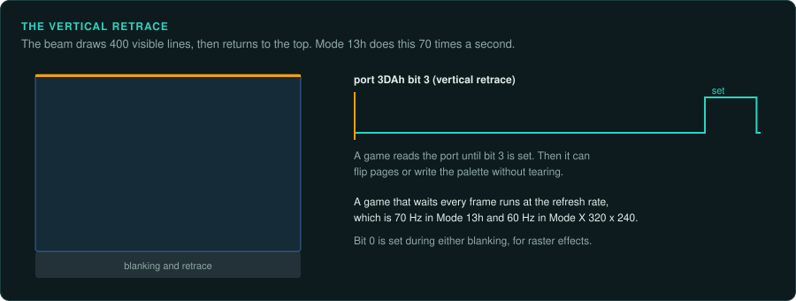
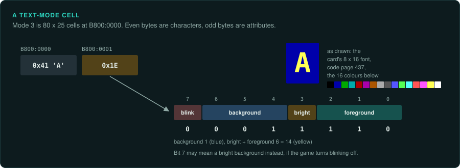
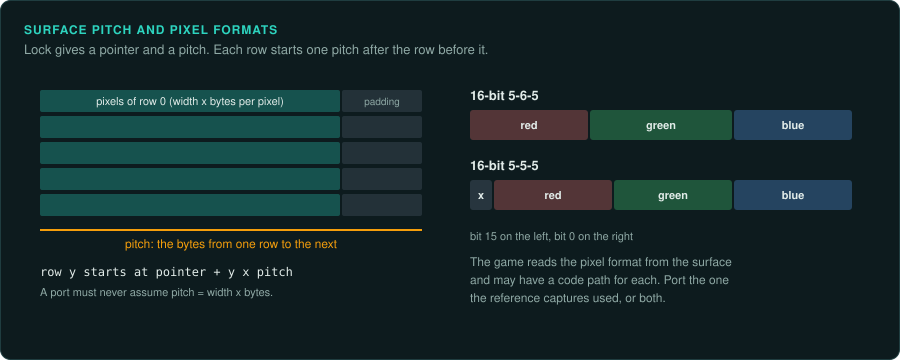

# 2D graphics

DOS games drew straight into video memory. The video mode sets how memory maps to pixels,
how many colours there are and how the palette works. To reproduce the picture exactly, the
port must handle the mode the game used.

## The video standards

| Standard | Year | Modes games used | Notes |
|---|---|---|---|
| CGA | 1981 | 320 × 200 in 4 colours from fixed palettes; 640 × 200 in 2 colours; text modes | Memory at `B800:0000`, even and odd lines in two banks |
| EGA | 1984 | 320 × 200 in 16 fixed colours; 640 × 350 in 16 colours from 64 | Planar memory at `A000:0000`: four bit planes, one per colour bit |
| VGA | 1987 | 320 × 200 in 256 colours (Mode 13h); 640 × 480 in 16 colours | Palette of 256 entries, each 6 bits per channel |
| Mode X (VGA, unchained) | used from about 1991 | 320 × 240 in 256 colours, with several pages | Planar memory; documented by Michael Abrash |
| VESA VBE (SVGA) | VBE 1.2 in 1991, 2.0 in 1994 | 640 × 480 and higher in 256 colours or more | Banked memory in VBE 1.x; a linear frame buffer from VBE 2.0 |

Most DOS games from 1990 to 1996 use Mode 13h or Mode X. Later games use VESA modes.

## Mode 13h

One byte per pixel, 320 bytes per line, at `A000:0000`, 64,000 bytes in all. It is the easiest
mode to port: the game's screen is an array of palette indexes.

- The game sets it with `INT 10h`, `AX = 0013h`.
- Many games draw into a buffer in normal memory and copy it to `A000` once a frame. Capture
  that buffer and the screen separately; HUDs are sometimes drawn straight to `A000`
  ([Capturing the interface](../observe/ui.md)).

## Mode X and other unchained modes

The game turns off the VGA's "chain 4" setting, so each byte address covers four pixels, one in
each of four planes. The game selects planes with the sequencer's map mask (port `3C4h`, index
2) before writing. Mode X allows 320 × 240 with square pixels and several screen pages for
page flipping.

- In the port, convert the four planes back into a linear picture: pixel *x* is in plane
  *x* mod 4 at offset *x* / 4.
- Page flipping changes the start address register (CRTC, port `3D4h`, indexes `0Ch` and
  `0Dh`). The visible page is the one the start address points to at the retrace.
- Games also used the VGA's latches to copy four pixels at once, and the write modes to fill
  quickly. Port the resulting pixels. You do not need to copy the method.

## Palettes

The VGA palette is written through ports `3C8h` (start index) and `3C9h` (red, green, blue,
6 bits each). Values range from 0 to 63.

- Convert 6-bit values to 8 bits the way your reference output does. `v × 255 / 63` and
  `(v << 2) | (v >> 4)` give slightly different results. Choose one and compare with captures
  of the original.
- Fades, flashes and colour cycling change the palette and leave the pixels as they are. A capture of video
  memory alone misses them. Capture the palette with every frame.
- Some games changed the palette in the middle of a frame (for example a different palette
  for the status bar). Look for palette writes timed to the horizontal retrace.

## The vertical retrace

Port `3DAh` bit 3 is set while the screen is in its vertical retrace. Games wait for it to avoid
tearing and to time their frames.

- If a game waits for the retrace each frame, the display's refresh rate sets the game's speed. VGA
  Mode 13h refreshes at 70 Hz; Mode X 320 × 240 at 60 Hz.
- Some games count retraces to time animations or the whole game. Then a frame is 1/70 or 1/60
  of a second. Use that rate in the port.
- Port `3DAh` bit 0 is set while the display is blanked, in either retrace. Games use it for
  horizontal timing in raster effects.

## Text modes

Menus, setup programs and some games use text mode 3 (80 × 25, 16 colours) at `B800:0000`, two
bytes per cell: the character and the attribute. The font is the card's 8 × 16 font, which a
game can replace. Port text screens with the original's code page 437 characters and the VGA
palette for text.

## Windows 2D

Windows games used GDI (slow), WinG (1994), and from 1995 DirectDraw. DirectDraw gives the game
a pointer to a surface in video memory, so the drawing code is often the same as in a DOS game.

- `IDirectDrawSurface::Lock` returns the pointer and the pitch. The pitch can be larger than the
  width; the game must use it. A port must not assume that the pitch equals the width.
- 8-bit modes use a DirectDraw palette (`IDirectDrawPalette::SetEntries`) with 8-bit values.
- 16-bit modes come as 5-6-5 or 5-5-5 bit layouts. The game checks which with the pixel
  format and may have two code paths.

## Checklist

1. Find the mode set calls and list every mode the game uses.
2. Find the palette writes and every place the palette changes.
3. Find the frame copy or page flip, and the retrace wait.
4. Capture the original's screen memory, palette and timing for several scenes
   ([Running the original](../observe/running-the-original.md)).
5. Rebuild the picture in the port from the same memory and palette, and compare pixel by
   pixel.
