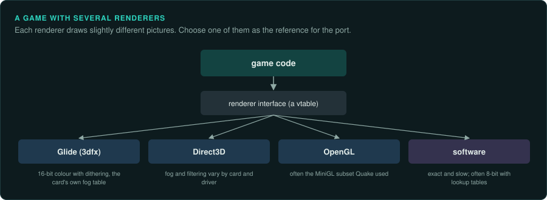

# 3D accelerators

From 1996, PC games could draw 3D with a separate graphics card. For a few years every card maker had its own API. Games shipped a separate renderer for each card. By 2000 Direct3D and
OpenGL had replaced most of them. A game of this period may contain several renderers, and the
picture the player saw depended on the card.

## The cards and their APIs

| Card | Maker | Year | API | Notes |
|---|---|---|---|---|
| ViRGE | S3 | 1995 | S3D, Direct3D | Cheap and slow; few games used S3D |
| Vérité V1000 | Rendition | 1996 | RRedline, Speedy3D | vQuake was written for it |
| PowerVR PCX1, PCX2 | NEC and VideoLogic | 1996, 1997 | PowerSGL, Direct3D | Tile-based deferred rendering; a separate card that drew into the 2D card's memory |
| Voodoo Graphics | 3dfx | 1996 | Glide | A separate card beside the 2D card; 16-bit colour; the market leader |
| Rage, Rage Pro | ATI | 1996, 1997 | ATI CIF, Direct3D | |
| Mystique, G200 | Matrox | 1996, 1998 | Direct3D, Matrox's own API (MSI) | |
| Riva 128 | NVIDIA | 1997 | Direct3D, OpenGL | |
| Voodoo2 | 3dfx | 1998 | Glide | Two cards could work together (SLI) |
| Riva TNT, TNT2 | NVIDIA | 1998, 1999 | Direct3D, OpenGL | 32-bit colour |
| Voodoo3 | 3dfx | 1999 | Glide, Direct3D, OpenGL | A single 2D and 3D card; 16-bit colour output |
| GeForce 256 | NVIDIA | 1999 | Direct3D 7, OpenGL | Hardware transform and lighting |
| GeForce 3, Radeon 8500 | NVIDIA, ATI | 2001 | Direct3D 8, OpenGL with extensions | Programmable vertex and pixel shaders |

## Glide

3dfx's Glide was a thin API close to the Voodoo hardware. It was the most used of the card makers' APIs. Many games had a Glide renderer as their best-looking option.

- Games load `glide.dll`, `glide2x.dll` or `glide3x.dll` and call functions such as
  `grDrawTriangle`, `grTexSource`, `grAlphaBlendFunction`, `grBufferSwap`.
- The game passes vertices already transformed to screen coordinates, with `1/w` for
  perspective correction. The game does all the 3D maths itself, so the maths is in the game's machine code. Port it exactly.
- The Voodoo drew with 16-bit colour and dithering. It also filtered textures in its own way.
  The player saw those effects. Decide whether the port reproduces the 16-bit look or
  draws in full colour, and record the choice as a deviation if it differs.
- Wrappers such as nGlide and dgVoodoo translate Glide calls to modern APIs. They show which
  parts of Glide a game needs. Use them to run the original on a modern machine for captures.

## Direct3D

| Version | Year | What changed |
|---|---|---|
| Direct3D 3 (DirectX 3) | 1996 | Execute buffers: a list of instructions and vertices built in memory |
| Direct3D 5 | 1997 | `DrawPrimitive`: draw calls with vertex arrays |
| Direct3D 6 | 1998 | Multitexturing, texture compression |
| Direct3D 7 | 1999 | Hardware transform and lighting |
| Direct3D 8 | 2000 | Vertex and pixel shaders (1.x), DirectDraw merged into Direct3D |
| Direct3D 9 | 2002 | Shader model 2, and shader model 3 from DirectX 9.0c (2004); used by games until well after 2010 |

- Find the version from the imports (`ddraw.dll` with `IDirect3D3`, `d3d8.dll`, `d3d9.dll`)
  and the interface identifiers the game asks for.
- Games before Direct3D 7 usually transform vertices themselves, as with Glide. From version
  7 the card may do it. Then port the matrices and lights the game sets.
- Shaders from Direct3D 8 and 9 ship compiled. Disassemble them to read the maths
  ([Rendering](../GAME-PATTERNS.md#rendering-and-ui)).
- Direct3D can change the FPU precision when it creates a device ([CPUs](cpus.md)).

## OpenGL

OpenGL 1.1 (1997) was used by id Software's games and their licensees, and by many Mac and Linux
ports. On 3dfx cards, Quake and similar games used a "MiniGL" driver: an `opengl32.dll` with only
the functions Quake needed, which translated them to Glide. Later games use extensions, which
you find by searching the strings for `GL_ARB_`, `GL_EXT_` and `GL_NV_`.

## Software renderers

Most games until about 1999 also had a software renderer. It drew every pixel with the CPU into a
frame buffer. Software renderers are exact. The same input gives the same pixels on every
machine. They are the best reference for the port's renderer, and the easiest to compare.

## How to approach a game with several renderers

1. List the renderers: separate DLLs (Unreal's `GlideDrv.dll`, `D3DDrv.dll`, `SoftDrv.dll`) or
   code paths chosen in the options.
2. Find the interface between the game and its renderers. It is usually a table of functions
   or a C++ class with virtual methods. The game sends everything it draws through it.
3. Choose one renderer as the reference. Write the choice in the project's `AGENTS.md`. The
   software renderer is easiest to compare exactly; the Glide renderer is often what players
   remember.
4. Port the interface. Write one modern renderer behind it.
5. Capture frames from the original with the reference renderer and compare. For hardware
   renderers, compare with a tolerance and look at the difference image.

## Effects that depend on the card

- **16-bit colour and dithering**: banding and a dither pattern the player saw.
- **Fog**: table fog (per pixel) and vertex fog gave different results on different cards.
- **Texture filtering and mipmaps**: cards chose mipmap levels differently.
- **Gamma**: 3dfx cards had their own gamma setting; games often set it.
- **Resolution**: a game written for 640 × 480 may show more of the world at higher
  resolutions, or stretch its interface. Decide what the port shows and record it.
