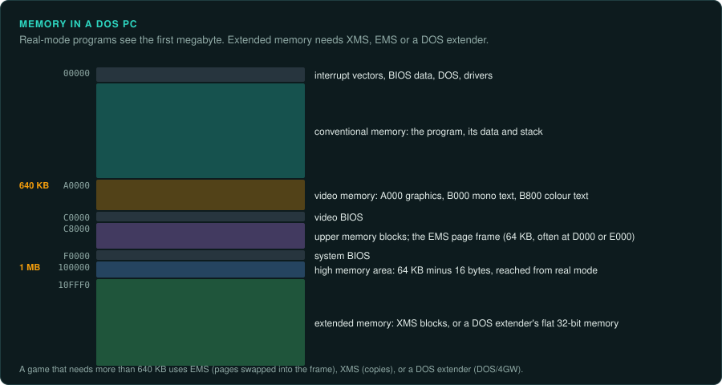

# Memory, storage, input and networks

This page covers memory beyond 640 KB, CDs, joysticks and networks, and how to recognise each
in a game's code.

## Memory in DOS

A DOS program runs in real mode with 640 KB of conventional memory. Games used several ways to
get more.

| Method | What it is | Signs in the code | In the port |
|---|---|---|---|
| EMS (expanded memory) | Pages of 16 KB mapped into a 64 KB window, through `EMM386` or a card | `INT 67h`; the string `EMMXXXX0` | Ordinary memory; keep any logic that depends on page numbers |
| XMS (extended memory) | Memory above 1 MB, copied to and from conventional memory through `HIMEM.SYS` | `INT 2Fh` with `AX = 4310h` to find the driver, then far calls | Ordinary memory |
| Overlays | Parts of the program loaded on demand into the same memory | Borland's `.OVR` files, or the game's own loader | One program; but know which overlay is loaded at which time while you read addresses |
| DOS extenders | 32-bit protected mode with flat memory, with DOS calls passed to real mode | `DOS/4GW` (Watcom, LE executables), `PMODE/W`, `CWSDPMI` (DJGPP), Phar Lap | See [DOS games](../DOS.md) for loaders and emulators |
| DPMI | The interface extenders use to ask for memory, selectors and interrupts | `INT 31h` | GameFrame's `dos_env` emulates the calls games use |

Some games lowered detail or disabled sound when memory was
short. Find the memory checks and fix their result in the port, so every run takes the same
path.

## Storage and CDs

- **Hard disk files** are read with DOS calls (`INT 21h`) or the C runtime. GameFrame's
  `fileio_trace.py` turns a DOSBox-X log into a map of the reads.
- **CD audio**: many games played music as Red Book audio tracks on the CD, through `MSCDEX`
  (`INT 2Fh`, `AX = 15xxh`) in DOS or MCI (`mciSendCommand`) in Windows. The music is then not
  in any file. The port needs the player's CD audio tracks ripped to files. Document how the
  player does that.
- **CD checks**: a game checks for its disc by reading a file or a volume label. The port reads
  the player's files and does not need the check. Breaking copy protection is restricted in
  many countries ([Your own copy and the law](../preservation/law/README.md)).
- **Streaming**: some games read from the CD while playing (video, music, level data). The read
  times then affected the game's timing. A port reads from disk and need not reproduce delays unless the
  game logic depended on them.

## Input devices

| Device | How DOS games read it | How Windows games read it |
|---|---|---|
| Keyboard | Their own `INT 9` handler reading port `60h`; BIOS `INT 16h` | Window messages, DirectInput |
| Mouse | The mouse driver, `INT 33h` | Window messages, DirectInput |
| Joystick (game port) | Write to port `201h`, then time how long each axis bit stays set | WinMM `joyGetPosEx`, DirectInput |
| Gamepads (Gravis GamePad, Sidewinder) | Through the game port, some with their own digital protocols | DirectInput |

The game port is an analogue device read by timing. The count depends on the CPU's speed, so
games calibrated the joystick at start-up. Port the result of the calibration, the position in
the game's own range, as an input ([Inputs](../observe/inputs.md)).

## Networks and multiplayer

| Method | Years | Signs in the code |
|---|---|---|
| Serial cable (null modem) | from the 1980s | The UART at port `3F8h` or `2F8h`; `INT 14h` |
| Modem | from the 1980s | Serial port code plus `AT` command strings (`ATDT`, `ATZ`) |
| IPX on a local network | 1993 to about 2000 | `INT 7Ah` or `INT 2Fh` with `AX = 7A00h` to find the IPX driver |
| NetBIOS | early 1990s | `INT 5Ch` |
| DirectPlay | 1996 to about 2003 | `dplayx.dll`, `IDirectPlay` interfaces |
| TCP/IP (Winsock) | from 1995 | `wsock32.dll`, `ws2_32.dll` |

Multiplayer games of this time are usually lockstep: every computer runs the whole game and
only commands travel ([Strategy](../games/strategy.md), [Networking](../GAME-PATTERNS.md#networking-if-any)).
The message format is the input record for multiplayer. Find it, together with the packet a game sends each turn.

- A port can replace the transport (IPX, serial) with a modern one. The port must keep the messages
  and the turn timing if two copies of the port must play together. The same holds if the port
  must play with the original, which is rarely worth it.
- Tools from the time (Kali, Kahn) tunnelled IPX over the internet. DOSBox can do the same, so
  you can run two copies of the original and capture their messages.
