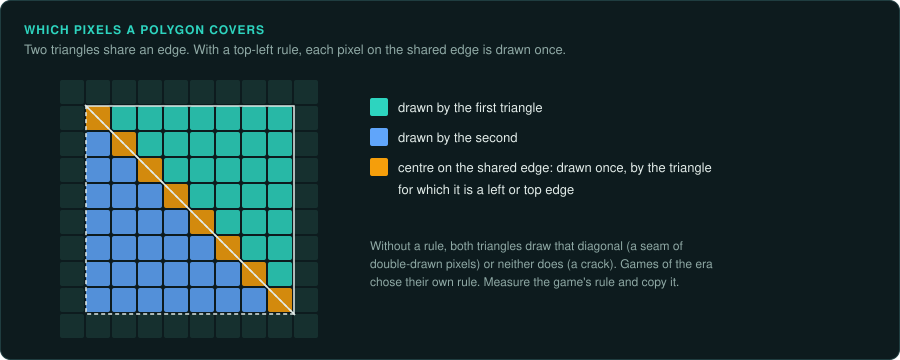
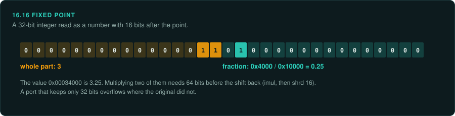

# Pixel-exact software rendering

Until 3D cards were common, a game drew every pixel itself: lines, filled polygons, sprites,
textured walls. Two renderers that draw "the same" triangle can differ in a pixel along every
edge. The differences come from how each one rounds a coordinate, steps along an edge, or
decides which pixels on a boundary to fill. A port that must match the original frame for frame has to copy
those decisions. This page lists the decisions that change pixels, and how to measure each
one in the original. The video modes themselves are on [2D graphics](graphics-2d.md). Michael
Abrash's *Graphics Programming Black Book* (1997, free from the author) explains many of these
techniques as the programmers of the time used them.

## Where pixels differ

| Decision | What varies between renderers | How to find the original's choice |
|---|---|---|
| Fill rule | Which pixels on a polygon's edge are drawn. A common rule draws a pixel whose centre lies on a left or top edge and leaves it for a right or bottom edge, so two polygons that share an edge never both draw it. Many games used their own rule | Draw two polygons that share an edge in the original, and look for gaps or double-drawn pixels |
| Edge stepping | Where each scanline's span starts and ends. Most renderers step the x position by a fixed-point slope each line. Adding the slope again and again rounds differently from computing each line's x afresh | Read the edge setup in the code. Note the fixed-point format, the starting value (often rounded up), and whether the step accumulates |
| Pixel centres | Whether a vertex at (10, 10) means the corner of a pixel or its centre. That moves every edge by half a pixel | Draw a one-pixel-high polygon at known coordinates |
| Line drawing | Which pixels a line covers when it passes exactly between two. Bresenham's method, run-length slices and fixed-point DDA lines break ties differently. Lines also differ in whether they draw their last point. Antialiased lines (Wu's method) also choose two intensities per step, from a weight table of a set size | Draw lines at each octant's angles and at 45 degrees |
| Texture mapping | Affine mapping (straight interpolation across the span) or perspective-correct mapping, and how often the perspective is recomputed. Quake recomputes it every 16 pixels and interpolates in between | Draw a textured wall at an angle and compare the texel at each pixel |
| Fixed-point formats | 16.16, 24.8, 8.8 and others. Multiplications that keep a 64-bit product (`imul` then `shrd`) give different results from ones that overflow 32 bits | The instructions around each multiply ([Reading compiled code](../COMPILED-CODE.md)) |
| Lighting and colour | Lighting by lookup tables: a colour map with one row of 256 entries per light level, chosen by distance. The table is the rule, so the port must use the same table | Find the table (`tools/triage/filetypes.py`, the code that indexes it) and copy it |
| Lit surfaces | Lighting computed once per surface in texture space and stored in a cache, as Quake does. The light map has its own resolution, so the light changes in steps of several texels. A port that lights each pixel gives a smoother result | The code that builds the cached surface, and the size of its light map cells |
| Dithering | An ordered dither matrix or error diffusion, and where the pattern is anchored (the screen or the polygon) | Capture a flat shaded area and read the pattern |
| Drawing order | The painter's algorithm draws far to near. Objects at equal depth come out in the order the sort leaves them, and an unstable sort such as `qsort` can swap them | The sort call and its compare function. Equal keys need the original's exact order |
| Polygons that are not convex | Which pixels inside a self-crossing or concave polygon count as inside. The even-odd rule leaves holes where edges cross twice. The non-zero winding rule fills them. Many games drew only convex polygons and split the rest first, so the split decides the edges | Draw a star shape, or find the code that splits polygons |
| Hidden surfaces | Which of two overlapping surfaces wins. Painter's sort, a z-buffer (with its precision and its compare, `<` or `<=`), sorted spans, a BSP order or a portal walk each settle ties their own way. Quake keeps a precomputed visible set (PVS) per leaf, so a surface outside it is never drawn, even if a gap would show it | Overlap two surfaces at equal depth; walk the camera through a door and watch what appears |
| Clipping | Clipping against the screen edges in fixed point, or with a guard band, creates new vertices with their own rounding | Draw polygons that cross each screen edge |
| Sprites | Transparent colour index, the order of overlapping sprites, scaling by stepping in fixed point (which source pixels repeat or drop) | Capture a scaled sprite at several sizes |

## How to measure

1. **Run the drawing routine alone.** Call the original's polygon, line or span function
   under emulation ([re-emulate](../../.claude/skills/re-emulate/SKILL.md)) with coordinates
   you choose, into an empty buffer. Save the buffer. Then do the same with the port's
   function, and compare the two buffers byte for byte (`tools/verify/bitcompare.py`).
2. **Choose hard cases.** Use edges that fall exactly on pixel centres, slopes of 1 and of
   1/2, polygons one pixel high, lines in every octant, and textures at steep angles. These are
   where the rules differ.
3. **Look at the result.** `tools/formats/rawimage.py` turns a buffer or a dump of video memory
   into a picture, in the original's video mode and palette. Two pictures side by side show
   where the edges differ. The [pixel explorer](https://tanepiper.github.io/game-frame/lab/pixels)
   does the same in the browser.
4. **Write each rule down** with the test that proved it, as measured evidence. The port's own
   test suite then runs the same cases.

## Porting a software renderer

- Keep the original's integer and fixed-point arithmetic. Do not replace a fixed-point edge
  walker with floating point, even where the result looks the same. It will differ in a few
  pixels.
- Keep the lookup tables as they are, including any rounding errors. Sine tables, colour maps
  and reciprocal tables are part of the rule (`tools/triage/tables.py` finds sine tables).
- Draw into a buffer of the original's size and palette. Then let the port scale and present
  the buffer with modern hardware. Comparing frames is only possible when the buffer is the
  original's.
- Mark any change you make on purpose, such as a higher resolution or smoothing, as a
  Deviation, and keep the exact path available for tests.

## What to record

- For each drawing routine: its address, its fixed-point format, its fill rule or line rule,
  and the test cases that confirmed them.
- Every lookup table it uses, with its address and size.
- The drawing order and the sort that sets it.
