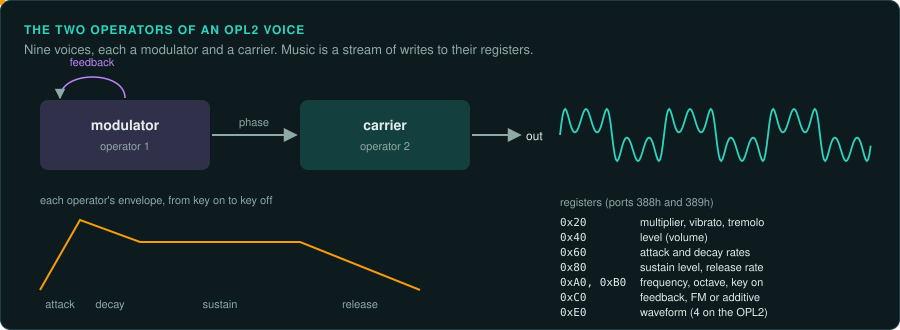

# Sound

Sound hardware in DOS games is programmed directly. A game's music may exist only as commands to a synthesiser chip. Its timing may come from the sound card's interrupts. To reproduce
the sound exactly, you need to know which device the game wrote for and how it drove it.

## The devices

| Device | Year | How games use it | Notes |
|---|---|---|---|
| PC speaker | 1981 | Tones from timer channel 2 (port `42h`), switched on through port `61h` | Some games played samples by switching the speaker very fast |
| AdLib | 1987 | The Yamaha YM3812 (OPL2) FM chip at ports `388h` and `389h` | 9 voices of FM synthesis; music is a stream of register writes |
| Roland MT-32 | 1987 | MIDI through an MPU-401 interface (port `330h`) | Its own synthesis and sounds; many Sierra games were written for it |
| Sound Blaster | 1989 | An OPL2 for music, and an 8-bit digital channel (the DSP) with DMA | Settings in the `BLASTER` environment variable: port, IRQ, DMA |
| Sound Blaster Pro | 1991 | Stereo; later models have the YMF262 (OPL3) | |
| Sound Blaster 16 | 1992 | 16-bit digital sound with 16-bit DMA | |
| Gravis Ultrasound | 1992 | 32 hardware voices playing samples from the card's own memory | Popular with tracker music and the demo scene |
| General MIDI modules (Roland SC-55) | 1991 | MIDI through an MPU-401 | General MIDI fixed the instrument numbers |

## FM synthesis (OPL2 and OPL3)

Music for AdLib and Sound Blaster is a stream of writes to the chip's registers: which voice,
which frequency, which instrument settings, key on and key off. The chip turns these into sound.

- **Capture the register writes**, with the time of each, from the original running in an
  emulator. This is exact ground truth for the music code, independent of the chip.
- **Port the music driver** so it produces the same writes at the same times. Compare the two
  lists write by write.
- **Emulate the chip** in the port to turn writes into samples. Good OPL emulators (Nuked OPL3,
  DOSBox's) are close to the real chip; Nuked OPL3 aims at exact output.
- The driver's tempo usually comes from a timer interrupt the game programmed. Find the
  interrupt rate and the driver's tick counter. Small errors in the rate change the music's
  speed over a song.

## Digital sound (Sound Blaster DSP)

The game sets up a DMA transfer from a buffer to the card and tells the card's DSP the sample
rate. When the buffer has played, the card raises an interrupt. The game then refills
the buffer.

- Sample rates are set as a "time constant": `256 - 1,000,000 / rate`. The real rate is the
  rate that constant gives, which is not exactly the rate the game asked for. Compute it.
- Games mix several effects into one buffer in software. If the sound must match, port
  the mixer's volume scaling and clipping exactly.
- If the game counts sound interrupts to time anything, that count is an input.

## MIDI

MIDI music is a list of note and controller events, often stored in a game's own format or as
standard MIDI files. The sound depends entirely on the synthesiser. The same music sounds very
different on an MT-32, a Sound Canvas and a Sound Blaster's FM.

- Port the MIDI player: the events and their timing must be exact.
- Play the events through a software synthesiser with sounds of the reference device (an
  MT-32 emulator such as Munt, or General MIDI sound fonts).
- MT-32 games often upload their own instrument settings to the device at start-up with SysEx
  messages. Capture and replay them.

## Sound drivers in DOS games

Many games used a sound library instead of programming cards themselves: the Miles Audio
Interface Library, DIGPAK and MIDPAK, the HMI Sound Operating System. Each loads a driver for
the player's card. Label the library and port what the game asks of it: play this sample,
play this song, set this volume ([Middleware](../engines/middleware.md)).

## Windows sound

| API | Year | Notes |
|---|---|---|
| WinMM (`waveOut`, `midiOut`) | 1991 | Simple and with high latency |
| DirectSound | 1995 | Mixing by the system or the card; 3D sound from DirectX 3 |
| DirectMusic | 1999 | Music with styles and segments that change with the game |
| A3D (Aureal) | 1997 | Positional 3D sound in hardware |
| EAX (Creative) | 1998 | Reverb and environment effects on top of DirectSound 3D |

A3D and EAX effects need hardware that no longer exists. Software reimplementations exist
(OpenAL Soft supports EAX effects). Decide whether the port reproduces them and record it.

## Checklist

1. Find which devices the game supports, from the setup program and the drivers it ships.
2. Choose the reference device and write it in the project's `AGENTS.md`.
3. Find the timer or interrupt that drives the music, and its rate.
4. Capture the music's register writes or MIDI events from the original, with times.
5. Port the music driver and compare the events. Then compare the audio.
