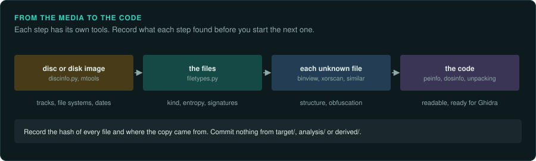

# Media, files and protection


These pages cover what a game came on and what its files are, before the code that reads them
is traced. Read them during [re-inventory](../../.claude/skills/re-inventory/SKILL.md) and
[re-format](../../.claude/skills/re-format/SKILL.md).

- [CDs and DVDs](discs.md): sectors and tracks, CD audio, Mode 2, the file systems, which
  image to work from, `discinfo.py`.
- [Floppy disks and booter games](floppies.md): image levels from sectors to flux, floppy
  protection, PC games that boot without DOS.
- [Identifying unknown files](files.md): signatures, entropy, structure from the numbers,
  comparing two files, simple obfuscation, timestamps.
- [Flash and Shockwave games](../engines/flash-and-shockwave.md): web games whose player no
  longer runs, SWF files and projectors, `swfinfo.py`.
- [Packed and protected code](protection.md): packers, getting the code out, data decoders,
  debugger checks, copy protection and the port.

[Handling the game as evidence](../working/evidence.md) covers the habits that keep each
result repeatable: identifying the copy, keeping it unchanged, and tying findings to it.



## Ask your agent

```text
In my GameFrame project, find out what the game came on and what each of its files is.

1. Read docs/media/README.md and the re-inventory skill.
2. If the game is on a CD or disk image, run tools/disc/discinfo.py on it and record the
   tracks, the file systems and the dates.
3. Run tools/triage/filetypes.py on the game folder. List each kind of file with its entropy,
   and mark the ones that look compressed, encrypted or packed.
4. Record the hashes of every file (tools/triage/compare_trees.py --hashes) and where the copy
   came from, as docs/working/evidence.md describes.
5. Write it all in docs/FINDINGS.md. Commit nothing from target/, analysis/ or derived/.
```
