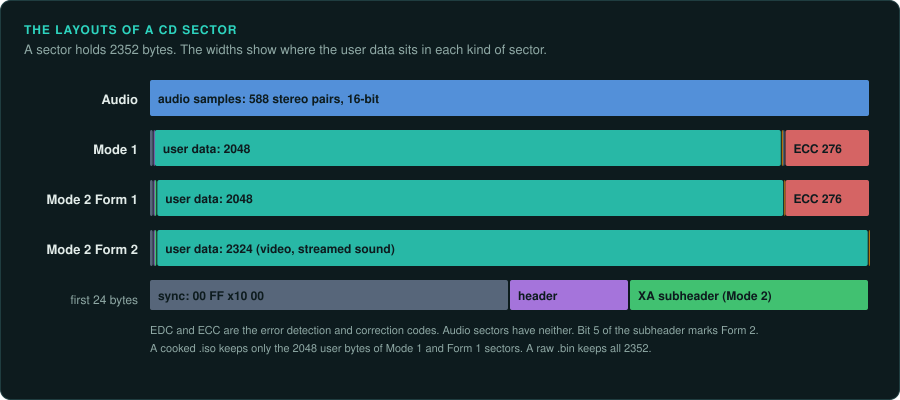
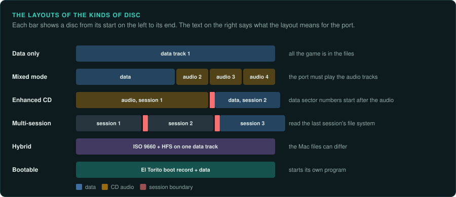
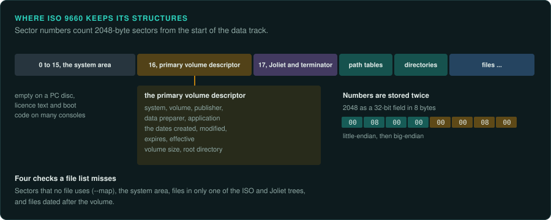
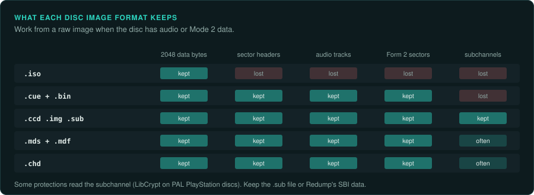

# CDs and DVDs

A game on a CD is more than the files a file manager shows. The disc can hold audio tracks,
sectors of a second kind for video and sound, more than one file system, and data that only a
raw copy keeps. This page describes what to look for on a game disc, which image to work from,
and what the port must take from it. `tools/disc/discinfo.py` reads the images and reports each
part. The standards behind it are ECMA-119 (ISO 9660), ECMA-130 (the CD sector) and the
CD-ROM XA and El Torito specifications.

## Sectors and tracks



A CD is a list of sectors of 2352 bytes. 75 sectors play in one second, so positions are
written as minutes, seconds and sectors (`MM:SS:FF`). The table of contents lists the tracks.
Each track is audio or data.

| Sector kind | User bytes | Where the data starts in the 2352 | Used for |
|---|---|---|---|
| Audio (Red Book) | 2352 | 0 | Music: 588 stereo samples of 16 bits at 44,100 Hz |
| Mode 1 | 2048 | 16 | Files on most PC discs |
| Mode 2 Form 1 (CD-ROM XA) | 2048 | 24 | Files on PlayStation, CD-i and some PC discs |
| Mode 2 Form 2 (CD-ROM XA) | 2324 | 24 | Streamed video and sound, with no error correction |

A data sector starts with 12 bytes of sync pattern and 4 bytes of header, which give its
address and its mode. A Mode 2 sector adds an 8-byte subheader, which says whether the sector
is Form 1 or Form 2. The [PlayStation's CD-ROM documentation](https://psx-spx.consoledev.net/cdromdrive/)
describes how that console reads XA audio and STR video from Form 2 sectors.

The disc's first sector is at `00:02:00`, after a two-second pregap that images do not store.
Sector numbers inside the file systems (LBAs) start at that point. The start column in
`discinfo.py` counts from the start of the image, so it does not add these two seconds.

## Kinds of disc



| Kind | Layout | What it means for the port |
|---|---|---|
| Data only | One data track | All the game is in the files |
| Mixed mode | Data in track 1, audio in tracks 2 onwards | The music is CD audio. The port must play the tracks |
| Enhanced CD (CD Extra) | Audio in the first session, data in a second session | The data's sector numbers start after the audio session |
| Multi-session | Several sessions, each with its own file system | Read the last session's file system. Earlier ones can hold older files |
| Hybrid | ISO 9660 and HFS on the same data track | The Mac files can differ from the PC files |
| Bootable | An El Torito boot record | The disc starts its own program without an installed system |

A game that plays CD audio does it through the system. A DOS game sends play requests through
MSCDEX (interrupt `2Fh`, function `1510h`, with device request 132 for play audio). A Windows
game uses MCI, such as `mciSendCommand` with the `cdaudio` device. Find those calls to find
the game's table of track numbers, which says which music plays where.

## File systems



| File system | Names | Notes |
|---|---|---|
| High Sierra | 8.3 | The format before ISO 9660. Early CD-ROMs only |
| ISO 9660 | 8.3 at level 1, with a version suffix `;1` | Every data CD has it. Numbers are stored twice, little-endian then big-endian |
| Joliet | Up to 64 UCS-2 characters | A second directory tree for Windows, added with Windows 95 |
| Rock Ridge | Long POSIX names and permissions | Unix discs. Stored inside each ISO 9660 record |
| HFS and HFS+ | Mac names, resource forks | Hybrid Mac and PC discs. Read them with hfsutils or HFSExplorer |
| UDF | Long names, large files | DVDs. A DVD usually carries ISO 9660 as well |

The ISO 9660 primary volume descriptor at sector 16 names the system, the volume, the
publisher, the data preparer and the application that mastered the disc. It also holds four
dates: created, modified, expires and effective. Each file record has its own date. These
dates help to date a release and to tell two pressings apart.

A file record can be marked hidden. Some discs also list files whose sectors lie outside the
volume's stated size, or give two files the same sectors. Some copy protections use these
tricks. `discinfo.py` reports hidden files and files outside the volume.

Four more checks show what a file list alone misses:

- **Sectors no file uses.** A mastered disc accounts for nearly every sector. `--map` reads
  every sector of the data track and lists the runs that hold data but belong to no
  descriptor, path table, directory or file, with a guess at what each run holds. A file left
  over from development, a second copy of a file, or data the game reads by sector number can
  sit there.
- **The system area.** Sectors 0 to 15 are empty on a PC disc. On a console disc they hold the
  licence text and the boot code: the PlayStation, the Saturn, the Mega-CD and the Dreamcast
  each use them. `discinfo.py` names what it finds.
- **Two trees that differ.** The ISO 9660 and Joliet trees usually list the same files. A file
  missing from the Joliet tree is hidden from Windows. A mastering tool can leave files out on
  purpose. `discinfo.py` lists each file that only one tree has, and copies it with the rest.
- **Files dated after the volume.** The volume descriptor is written last when a disc is
  mastered. A file dated later suggests changed dates or a wrong clock.

## Images



| Image | What it keeps | What it loses |
|---|---|---|
| `.iso` | 2048 bytes of each data sector | Audio tracks, Form 2 sectors, sector headers, subchannels |
| `.cue` and `.bin` (raw) | All 2352 bytes of every sector, every track | Subchannel data |
| `.ccd`, `.img`, `.sub` (CloneCD) | Raw sectors and subchannels | Little |
| `.mds` and `.mdf` (Alcohol 120%) | Raw sectors, often subchannels and timing | Little |
| `.chd` (MAME) | Raw sectors, compressed | Nothing. `chdman extractcd` writes CUE and BIN |

Work from a raw image when the disc has audio or Mode 2 data. A `.iso` of such a disc lacks the
music and the video. A file of Mode 2 Form 2 sectors, such as a PlayStation STR video or XA
sound file, is marked in its directory record. `discinfo.py --extract` copies such a file as
whole 2352-byte sectors, the form the tools for those formats read. A copy of 2048 bytes per
sector would lose part of every sector. Some protections read the subchannel. One example is LibCrypt on PAL
PlayStation discs. For those, keep the `.sub` file or the SBI data that [Redump](http://redump.org/)
publishes for each disc.

Redump also lists the hashes of every track of verified dumps. Compare the hashes of your
image with Redump's entry to learn which pressing you have.

In a few rips, the audio is stored big-endian. If an extracted track sounds like loud noise,
extract it again with `--swap`.

## The disc as an object

A pressed disc and a recordable disc (CD-R) are made differently. A pressed disc has its data
moulded in. A CD-R has a dye layer, which gives it a green, gold or blue tint, and a groove
that carries a time code (ATIP) for the writer. Prototypes, review copies and many demo discs
were burned on CD-R. A CD-R of a game is therefore often a different build from the retail
pressing. Record which kind you have.

- **The hub.** A pressed disc has codes moulded or etched around the hole: a matrix number, and
  on most discs since 1994 the IFPI mastering and mould codes. They identify the plant and the
  master. [Redump](http://redump.org/) records them with each dump. Photograph the hub and the
  label before you clean or read the disc.
- **CD-Text.** Some discs store album and track titles in the lead-in. Raw images that keep the
  lead-in (CloneCD's `.ccd`) keep it. It can name the music tracks of a mixed-mode disc.
- **A disc that will not read.** Scratches and dye that has faded make a drive retry. Read with
  a tool that keeps going and records the errors (Redump's method, or `ddrescue` for data
  tracks), so the image shows which sectors were lost.

## Using discinfo

```bash
python3 tools/disc/discinfo.py target/cd/GAME.CUE                 # tracks, file systems, dates
python3 tools/disc/discinfo.py target/cd/GAME.CUE --files          # every file with its sector and date
python3 tools/disc/discinfo.py target/cd/GAME.CUE --extract target/cd/files --audio target/cd/audio
python3 tools/disc/discinfo.py target/cd/GAME.CUE --map            # data in sectors no file uses
python3 tools/disc/discinfo.py target/cd/GAME.CUE --json > derived/disc.json
```

`scripts/extract-installer.sh` recognises CD images and calls `discinfo.py` with `--extract`
and `--audio`. The files and the audio are game material. Keep them in `target/` or
`derived/`. The report itself (track lengths, dates, identifiers) can go in
`docs/FINDINGS.md`.

## What to record

- Each track: data or audio, the mode, the length, and the session.
- The volume identifiers and dates, and the hashes of each track or of the image.
- Which tracks the game plays, and from which function. Then the port's music table can cite it.
- Any Form 2 data, hidden file, file outside the volume or second file system.
- The image format you worked from, and what it would have lost.

## Ask your agent

```text
In my GameFrame project, look at the game's CD image in target/cd/.

1. Run tools/disc/discinfo.py on it, with --files, and read docs/media/discs.md.
2. Record in docs/FINDINGS.md the tracks, the file systems, the volume identifiers and dates,
   and anything unusual: audio tracks, Form 2 sectors, hidden files, a Mac volume.
3. If there are audio tracks, find the code that plays them (MSCDEX or MCI calls) and list the
   game's track table with its address.
4. Extract the files into target/cd/files and the audio into target/cd/audio. Commit nothing
   from target/.
```
