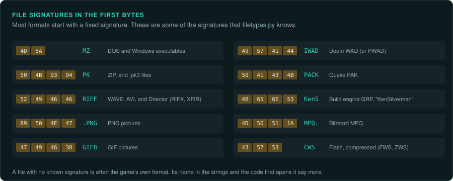
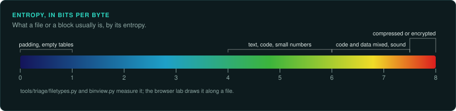
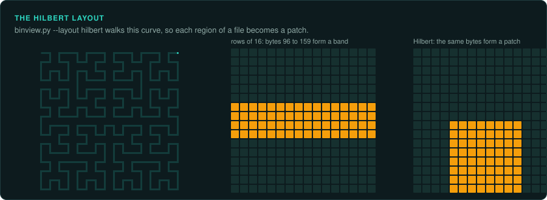
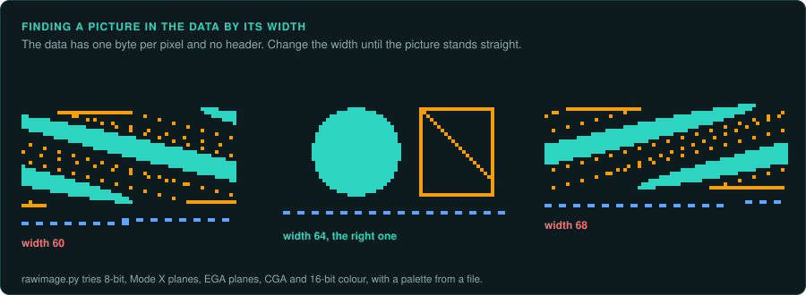
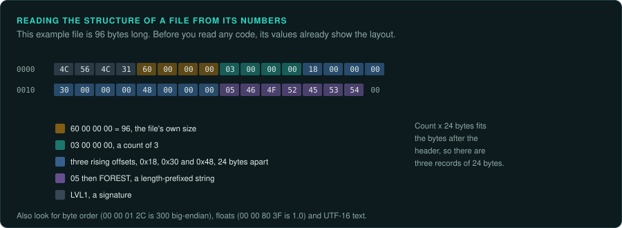
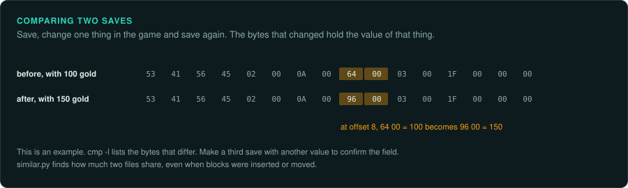
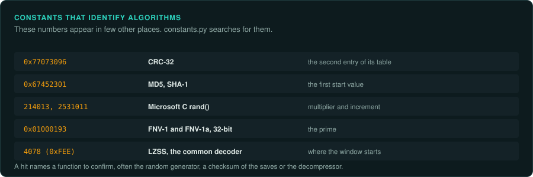
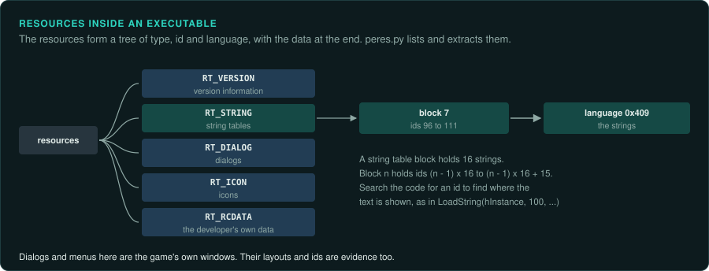
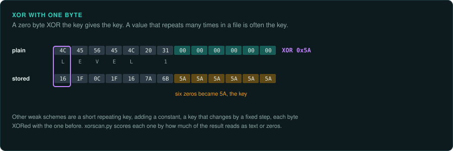
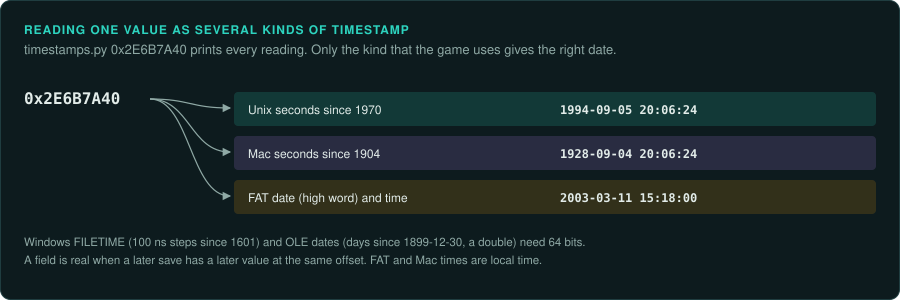

# Identifying unknown files

A game folder holds executables, archives, pictures, sounds, levels, scripts and saves. Many
use formats the developer invented. This page describes how to say what a file is, and what it
holds, before you find the code that reads it. The tools are `tools/triage/filetypes.py`,
`tools/triage/similar.py`, `tools/formats/xorscan.py` and `tools/formats/timestamps.py`. Each
result here is a lead. Confirm it in the code that reads the file ([re-format](../../.claude/skills/re-format/SKILL.md)).

## Kind, from the first bytes



Most formats start with a fixed signature. `filetypes.py` knows the common ones: executables
(MZ, NE, LE, PE, ELF, Mach-O), archives (ZIP, RAR, 7-Zip, cabinets, LHA, ARJ), game archives
(WAD, PAK, GRP, MPQ, BIF, Unreal and Unity packages), pictures (PCX, BMP, GIF, PNG, IFF ILBM,
DDS), sounds and music (WAVE, VOC, MIDI, XMIDI, HMP, MOD, S3M, XM, IT, Ogg) and video (FLI,
FLC, Smacker, Bink, AVI).

```bash
python3 tools/triage/filetypes.py target --summary
python3 tools/triage/filetypes.py target
```

A file with no known signature is often one of the game's own formats. Its extension, its
name in the executable's strings and the code that opens it say more than its bytes.

## Entropy



Entropy measures how evenly the byte values are used. It runs from 0 to 8 bits per byte.

| Entropy | Usually |
|---|---|
| Below 1 | Padding, an empty table, a mostly blank picture |
| 4 to 6 | Text, code, tables of small numbers, uncompressed pictures with few colours |
| 6 to 7.5 | Code and data mixed, 16-bit sound, tables of floats |
| Above 7.5 | Compressed or encrypted data |

`--blocks N` gives the entropy of each block of N bytes. In an archive, a flat run of high
values is compressed entries. A header or a directory shows as a dip. In an executable, a
high run where the code should be suggests a packed program ([Packed and protected code](protection.md)).

## A picture of the file



`tools/triage/binview.py` draws a file one pixel per byte. Black is zero, blue is text, red is
bytes above 0x7F, and green is control bytes. Compressed data is red speckle. A table of
fixed-size records shows as stripes, and lines up when the width is a multiple of the record
size. `--colour entropy` colours by entropy instead. `--layout hilbert` keeps neighbouring
bytes together, so each region of the file is a patch.

```bash
python3 tools/triage/binview.py target/data/level1.dat derived/level1.png --width 24
python3 tools/triage/binview.py target/GAME.EXE derived/game.png --layout hilbert --colour entropy
```

The [file explorer](https://tanepiper.github.io/game-frame/lab/files) does the same in the
browser, with an entropy graph and a hex view of any place you click.

## Pictures in the data



A block of a data file, or a dump of video memory, may be a picture with no header. Try it as
one with `tools/formats/rawimage.py`: 8 bits per pixel (VGA mode 13h), Mode X planes, EGA bit
planes, CGA, packed 4, 2 or 1 bit pixels, and 16-bit colour, with a palette from a file or the
hardware's default. A wrong width shows as slanted stripes. Change it until the picture stands
straight. The [pixel explorer](https://tanepiper.github.io/game-frame/lab/pixels) does this
interactively.

```bash
python3 tools/formats/rawimage.py target/data/TITLE.SCR derived/title.png --mode linear8 --palette target/data/GAME.PAL
python3 tools/formats/rawimage.py derived/vga-planes.bin derived/frame.png --mode modex --palette derived/dac.bin
```

## Structure, from the numbers



Before any code is read, the numbers in a file often show its layout.

- **The file's own size.** A 32-bit value equal to the file's length, or to the length minus
  a header, is a size field.
- **Counts.** A small number near the start, followed by that many records of the same size,
  is a count. Check that count times stride matches the bytes that follow.
- **Offsets.** A list of increasing values, each inside the file, is a table of offsets.
  The gaps between them are the entries' sizes.
- **Strings.** A byte or a 16-bit or 32-bit value followed by that many printable bytes is a
  length-prefixed string. A run of printable bytes ending in `00` is a C string. Text in pairs
  with zero bytes between letters is UTF-16. Japanese games may use Shift-JIS.
- **Bit fields.** Flags, small counts and packed coordinates often share a byte. Codes in
  compressed data and passwords run across byte boundaries. `reader.py`'s `bits(n)` reads
  them, low bits first by default, or high bits first.
- **Byte order.** Values like `00 00 01 2C` (300 big-endian) suggest a big-endian format: Amiga,
  Atari ST, classic Mac, most consoles and network data. `tools/formats/reader.py` reads both
  orders and LEB128 variable-length numbers.
- **Floats.** `00 00 80 3F` is 1.0 as a little-endian 32-bit float. Runs of values ending in
  `3F`, `40`, `41`, `42`, `BF` or `C0` are often floats.

## Two files compared



Comparing two versions of a file is often faster than reading one. Make a save, change one
thing in the game, and save again. The bytes that changed hold that thing.

```bash
python3 tools/triage/similar.py saves/a.sav saves/b.sav      # how much the two share
cmp -l saves/a.sav saves/b.sav | head                         # which bytes differ
```

`similar.py` cuts each file into pieces at points the content chooses, then counts the bytes in
pieces that match. An inserted or removed block changes only the pieces around it. Uses:

- how far two releases or two patches are apart, file by file (`similar.py DIR_A DIR_B`);
- a file renamed or moved between versions;
- how much of an executable matches a known library build;
- which saves or levels are near copies of each other.

`tools/triage/compare_trees.py` answers the simpler question of whether two copies are
identical.

## Algorithms, from their constants



Many algorithms carry numbers found nowhere else: the multiplier of a random number
generator, the first entries of a CRC table, the start values of MD5, the 4078-byte window
start of the common LZSS decompressor. `tools/triage/constants.py` searches for them:

```bash
python3 tools/triage/constants.py target/GAME.EXE
```

A hit names the algorithm and gives the address. `tools/triage/tables.py` finds the sine and
cosine tables, and says how each was made: steps per circle, scale, type and rounding. The function at that address is often the
random number generator, the checksum of the save files, or the decompressor of the data
files. Confirm it in the code before you port it.

## Resources inside executables



A Windows executable carries resources: version information, string tables, dialogs, menus,
icons, bitmaps, and data the developer packed in as `RCDATA`. `tools/pe/peres.py` lists them,
prints the version information and the string tables, and extracts each one:

```bash
python3 tools/pe/peres.py target/GAME.EXE                     # every resource, and the version
python3 tools/pe/peres.py target/GAME.EXE --strings           # the string tables, with their ids
python3 tools/pe/peres.py target/GAME.EXE --extract derived/resources
```

The ids in a string table are the numbers the code passes to `LoadString`. Search the export
for an id to find the code that shows the text.

## Simple obfuscation



Some games hide text, scripts and tables from casual viewing. The common schemes are weak: XOR
with one byte or a short repeating key, adding a constant, a key that changes by a fixed step
for each byte, or each byte XORed with the one before. A file with text-like entropy (4 to 6)
that shows no readable text is a candidate. So is a file whose bytes are full of one repeated
value other than zero, because XOR turns zeros into the key.

```bash
python3 tools/formats/xorscan.py target/data/script.dat
python3 tools/formats/xorscan.py target/data/sound.dat --known 52494646@0     # "RIFF" at 0
python3 tools/formats/xorscan.py target/data/script.dat --apply xor-key:1f2e3d -o derived/script.txt
```

The tool scores each scheme by how much of the result is zeros or readable text, and shows a
preview. A strong result still needs the code. The key may change per file or per entry, and
the bytes may also be compressed. If no scheme reads well and the entropy is high, the data is
compressed or uses a real cipher. Then find the decoder in the code that reads the file. Look
for a loop that changes each byte of a buffer right after the file is read.

## Timestamps



Saves record when they were made. Executables record when they were linked. Archives and file
systems record each file's date.

```bash
python3 tools/formats/timestamps.py 0x2E6B7A40                       # every reading of one value
python3 tools/formats/timestamps.py --scan saves/a.sav --from 1996 --to 1998
```

| Kind | Where it appears |
|---|---|
| Unix seconds since 1970 | C `time()`, the PE header's link time, many saves |
| FAT date and time | DOS directory entries, ZIP headers, `INT 21h AX=5700h` |
| Windows FILETIME | Windows saves and registry values: 100 ns steps since 1601 |
| Mac seconds since 1904 | Classic Mac files and HFS volumes |
| OLE date | Visual Basic and Office files: days since 1899-12-30, as a double |

A scan of a whole file finds noise as well as fields. Keep the years narrow. A field is real
when a save made later has a later value at the same offset. FAT and Mac times are local time,
so a value can be off by the time zone of the machine that wrote it.

## What to record

- Each file type: its signature, its entropy, and which code reads it, with the address.
- Each field found by comparison, with the two files and the change that showed it.
- Each obfuscation scheme, with its key and the function that applies it.
- Each timestamp field, with its kind and its offset.
