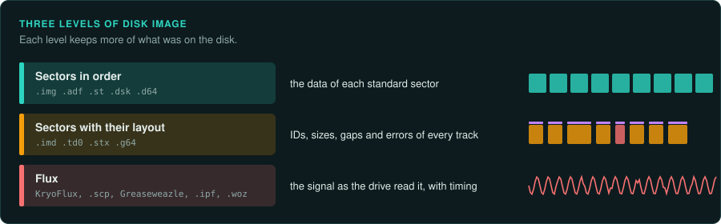

# Floppy disks and booter games

Most games before the mid-1990s shipped on floppy disks. A disk image can keep the files only,
the sectors, or the magnetic signal itself. Which one you need depends on whether the game
reads the disk through the system or in its own way. This page covers the general points and
the PC games that boot from a disk without DOS. The pages for each computer cover their own
formats and protections: [Amiga](../computers/amiga.md), [Atari ST](../computers/atari-st.md),
[Apple II](../computers/apple-ii.md), [Commodore 8-bit](../computers/commodore-8bit.md) and
[IBM PC](../computers/ibm-pc.md).

## Three levels of image

| Level | Examples | What it holds | Enough for |
|---|---|---|---|
| Sectors in order | PC `.img` and `.ima`, Amiga `.adf`, Atari `.st`, Apple `.dsk`, C64 `.d64` | The data of each standard sector, in a fixed order | A game that reads its disk through the system |
| Sectors with their layout | ImageDisk `.imd`, Teledisk `.td0`, Atari `.stx` (Pasti), C64 `.g64` | Each track's sector list: IDs, sizes, gaps, errors | Most disks with unusual sectors |
| Flux or bit level | KryoFlux streams, SuperCard Pro `.scp`, Greaseweazle, `.ipf`, Apple `.woz` | The signal as the drive read it, with timing | Any disk, including weak bits and long tracks |

A disk is tracks on one or two sides. Each track holds sectors. Each sector has an ID field (track, side, number, size) before its data. A PC disk uses MFM encoding with 512-byte
sectors: 9 per track on a 720 KB disk, 18 on a 1.44 MB disk. The Apple II and the Commodore
drives use GCR encoding with their own layouts.

Copy protection on floppies used what a sector image cannot hold. Examples are sectors with
IDs or sizes outside the normal set, a sector with a deliberate CRC error, a track longer than
normal, and weak bits that read differently each time. The game reads these through the
BIOS (interrupt `13h` on a PC) or by programming the disk controller's ports directly
(`3F0h` to `3F7h` on a PC). When the game checks for them, a plain sector image fails. Keep
the most complete image you have as the record of what shipped. Then work from the files or
from memory after the loader, as [Snapshot after the loader](../computers/README.md#snapshot-after-the-loader)
describes. Copy protection is described here as facts. The law on working around it differs
by country ([Legal](../LEGAL.md)). You decide which route to take.

## Games that use DOS's files

Most DOS games keep their data in ordinary files. Copy the files out of the image with
`mtools` (`mcopy -i disk.img -s ::* target/disk1/`) or mount the image. Then work on the files
as with any other release. Note which disk each file came from. An installer may combine or
decompress them, and the game may ask for a disk by its volume label.

## Booter games on the PC

Some early PC games boot from their own disk without DOS. The BIOS reads the first sector of
the disk (the boot sector, 512 bytes) to address `0000:7C00` and jumps there. That code loads
the rest of the game with interrupt `13h`, sector by sector, to addresses it chooses. There is
no executable file and no header to tell a disassembler where anything goes.

1. Read the boot sector. Load the first 512 bytes into Ghidra as raw 16-bit x86 code at
   `0000:7C00`. Find the calls to interrupt `13h`: each one gives a track, a side, a sector, a
   count and a destination address.
2. Build a load map. List each read as source sectors, destination address and size. A loader
   that reads more loaders repeats the step. Running the disk in an emulator with a debugger
   gives the same map as measured evidence. Log each interrupt `13h` call and its registers.
3. Load the game as memory blocks. Give Ghidra each block at its destination address, or dump
   the whole memory once the game runs and load that dump.
4. Find the game's own services. A booter talks to the hardware directly. It has its own
   keyboard handler, timer handler, video code and sound code. [Inputs](../observe/inputs.md)
   lists the ports and interrupts to look for.

Emulators that boot a disk image:

| Emulator | Use |
|---|---|
| DOSBox-X | The `BOOT` command starts a disk image. Its debugger logs interrupts and dumps memory |
| 86Box and PCem | Exact IBM PC and XT models, for timing-sensitive booters |
| Bochs | A debugger that can stop at `0000:7C00` and at each interrupt |
| MAME (`ibm5150` and others) | Cycle-accurate PCs, with a debugger and memory views |

GameFrame's emulators (`tools/emu/dos_emu` and `tools/emu/dos_env`) load DOS programs in the
MZ and NE formats. They do not boot disks. For a booter, take the load map and a memory dump
from one of the emulators above. Use them as measured evidence and as Ghidra's input.

## What to record

- Each disk: its label, its format (720 KB, 1.44 MB, or another), the image level you have,
  and its hash.
- Whether the game reads files through DOS or reads sectors itself.
- For a booter: the load map, with the evidence for each entry.
- Any sector or track that a sector image does not hold, and what the game does with it.
